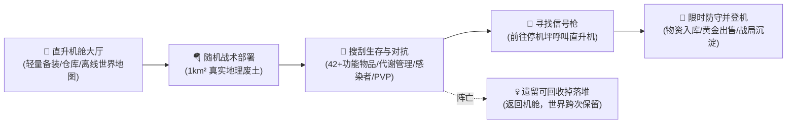

<!-- The transparent SVG switches between black and white to match the active GitHub theme. -->
<p align="center">
  <picture>
    <source media="(prefers-color-scheme: dark)" srcset="./assets/brand/gknext_logo_vertical.svg" />
    <source media="(prefers-color-scheme: light)" srcset="./assets/brand/gknext_logo_vertical.svg" />
    
  </picture>
</p>

<h3 align="center">面向实时路径追踪、游戏原型与 AI Native 工作流的跨平台 C++20 / Vulkan 引擎</h3>

<p align="center">
  <em>个人 R&D 引擎实验场 · 不设商业妥协 · 追求极致画质与性能约束 · 赋能 AI Native 内容生成与自动化验证</em>
</p>

<p align="center">
  <a href="https://github.com/gameknife/gkNextEngine/actions/workflows/desktop.yml"></a>
  <a href="https://deepwiki.com/gameknife/gkNextEngine"></a>
  <a href="LICENSE"></a>
</p>

<p align="center">
  <a href="https://gameknife.github.io/gkNextEngine/">官网</a> &nbsp;·&nbsp;
  <a href="README.en.md">English</a> &nbsp;·&nbsp;
  <a href="README.md">简体中文</a> &nbsp;·&nbsp;
  <a href="https://deepwiki.com/gameknife/gkNextEngine">DeepWiki</a> &nbsp;·&nbsp;
  <a href="AGENTS.md">AGENTS.md</a> &nbsp;·&nbsp;
  <a href="https://github.com/gameknife/gkNextEngine/discussions">社区</a> &nbsp;·&nbsp;
  <a href="https://github.com/gameknife/gkNextEngine/issues">Issues</a>
</p>

<p align="center">
  
  
  
  
</p>

<p align="center">
  
  
  
  
</p>

<p align="center">
  
</p>

gkNextEngine 是一个基于现代 C++20 与 Vulkan 的跨平台 3D 游戏引擎 / 渲染实验场。渲染器是核心，外围是编辑器、C# 脚本、Jolt 物理、结构化内容管线（SCAD / LDraw / glTF / Gaussian Splat）与十余个玩法原型（MagicaLego、Brotato3D、KongLie3D、BrickPlayer 等），共同构成 AI Native 内容生成、场景理解、玩法迭代与自动化验证的基座。

脚本层是 **C#**：一个游戏由一份 JSON manifest 声明，在 launcher 或编辑器里从模板新建、进程内加载运行并热重载，不写 C++、不加 CMake target。五个平台（Windows / Linux / macOS / Android / iOS）共用同一份代码，由 `gnb` 一条命令构建运行。

> [!NOTE]
> **引擎核心目标**
> - **实时视觉表现**：用实时路径追踪、Hybrid Rendering 与 TrueHDR 做出真正有展示力、且能稳定运行的画面。
> - **全栈引擎能力**：渲染、编辑器、脚本、物理与内容管线构成一套可运行、可扩展的引擎，服务玩法原型验证与 AI Native 工作流。

> [!TIP]
> **适用关注方向**
> - **实时渲染效果**：观察实时路径追踪、金属 / 玻璃 / 塑料材质、HDR 环境光和高密度场景的实际表现
> - **运行时性能架构**：研究真正以运行时性能为约束的 Vulkan 渲染管线，而非离线 Demo
> - **完整引擎系统**：理解渲染、编辑器、脚本、物理、内容导入与玩法原型如何紧密协作
> - **工程学习参考**：阅读规模可控（Core < 50k LOC）、强调代码清晰度的现代 Vulkan 引擎源码

**支持平台：** Windows x86_64 · Linux x86_64 · macOS arm64 · Android arm64 · iOS arm64

<sub>桌面三平台功能对齐，移动端带触控输入层，Steam Deck / Arch 有专用的 PathTracingLite 档位；不满足 bindless 预算或缺 `bufferDeviceAddress` 的设备（如 A12X iPad）走兼容渲染器。</sub>

<p align="center">✦</p>

## ✨ 项目特性

- **实时路径追踪与 Hybrid 渲染**：1/2spp 路径追踪、降噪与多管线无缝切换，棋盘格着色再省一半着色开销。
- **高性能 GPU 架构**：全 Bindless、Visibility Buffer 与 GPU-Driven 单 Draw 提交，最小化 CPU 开销。
- **辐射缓存与稀疏显存**：SHARC 缓存复用与按需驻留，在固定 GPU 预算下最大化渲染效率。
- **五平台同一份代码**：桌面、移动与掌机由同一套 `gnb` 命令构建运行，能力不足的设备走兼容渲染器。
- **C# 脚本层**：唯一脚本实现是 .NET，开发用 CoreCLR 热重载、发布与移动端用 NativeAOT，同一份托管代码零改动。
- **数据驱动的 C# 游戏工程**：一份 `*.game.json` manifest 就是一个游戏，从模板新建、进程内加载运行、菜单里重编译，不写一行 C++。
- **全栈引擎与玩法原型**：ECS、entt::meta 反射、ImGui 编辑器、Slang 着色器热重载与 Jolt 物理。
- **AI Native 基础设施**：自动化 Agent 验证加结构化内容管线，让 AI 直接生成、理解并修改 3D 资产与脚本。
- **多格式结构化资产**：glTF 2.0、LDraw（乐高）、OpenSCAD DSL、PlayCanvas 高斯溅射，以及 SRTM + OpenStreetMap 生成的真实地理城市关卡。

<p align="center">✦</p>

## ⚡ 性能与渲染效率

性能是核心约束之一。引擎围绕世界辐射缓存复用、稀疏显存布局、GPU-Driven 海量提交、按需驻留与多档上采，在固定 GPU 预算下尽量多出画面、少占显存。

### 性能参考数据

<details>
<summary><b>典型场景性能参考数据（RTX 5070 Ti / 720p Benchmark）</b> — <i>点击展开 ▾</i></summary>

**基线环境**（复现时请以同样口径标注）：
>
> | 项 | 值 |
> |---|---|
> | GPU | NVIDIA GeForce RTX 5070 Ti |
> | 驱动 | NVIDIA 596.49.0 |
> | 引擎版本 | dev @ 2026-08-08 |
> | 编排配置 | `assets/configs/motion_benchmark.example.json` |
> | 分辨率 | 1280x720 |
> | 采样 | 每场景 3 秒预热 + 3 秒统计 |
> | 关闭项 | DLSS / FSR / GTAO / 动画 tick（由配置中的 cvars 固定） |

| 场景 | 渲染管线 | 帧时间 (ms) | FPS | 显存 | Draw AfterCull / View | 三角形 AfterCull / View |
|------|----------|------------|-----|------|------------------------|-------------------|
| MaterialShowcase | PathTracing | 2.342 | 427 | 978 MiB | 15 / 15 | 13,862 / 13,862 |
| MaterialShowcase | SoftwareModernNoAmbient | 0.619 | 1,614 | 925 MiB | 15 / 15 | 13,542 / 13,542 |
| LightingShowcase | PathTracing | 2.836 | 353 | 978 MiB | 9 / 9 | 4,953 / 4,953 |
| LightingShowcase | SoftwareModernNoAmbient | 0.707 | 1,414 | 925 MiB | 5 / 5 | 2,881 / 2,881 |
| GIBootcamp | PathTracing | 4.950 | 202 | 925 MiB | 30 / 36 | 4,741 / 4,952 |
| GIBootcamp | SoftwareModernNoAmbient | 0.994 | 1,006 | 925 MiB | 33 / 40 | 5,175 / 5,388 |
| KilometerWorld | PathTracing | 1.651 | 606 | 925 MiB | 401 / 1,780 | 4,789 / 21,362 |
| KilometerWorld | SoftwareModernNoAmbient | 0.991 | 1,009 | 925 MiB | 405 / 1,798 | 4,851 / 21,580 |
| MassiveAsteroidBelt | PathTracing | 2.089 | 479 | 1,192 MiB | 34,265 / 67,786 | 2,733,342 / 5,422,850 |
| MassiveAsteroidBelt | SoftwareModernNoAmbient | 0.987 | 1,013 | 1,139 MiB | 32,977 / 65,197 | 2,620,345 / 5,215,602 |

> 复现方式（**不需要**可选资源包，全部为内置 proc demo 场景）：
>
> ```bash
> ./gnb run gkNextMotionBenchmark --benchmark-config assets/configs/motion_benchmark.example.json
> ```
>
> 结果写入 `out/build/<preset>/bin/motion_benchmark_report.csv`。
> 注意：编排 JSON 的 `scenes` 只接受内置 proc demo 场景名（如 `GIBootcamp.proc`），
> 传入 `.glb` 路径会被忽略并静默回落到内置场景列表。

</details>

### 启动与加载

冷启动到首帧同样是一条被单独约束的路径：

- **管线缓存持久化**：`VkPipelineCache` 落盘复用，二次启动跳过图形 / 计算管线编译
- **Streamline 并行初始化**：`slInit` 要加载并 NGX 探测每一个 Streamline 插件，跑在 worker 线程上，与反射注册、pak 挂载、SDL 初始化和窗口创建重叠，并记录它实际阻塞启动的毫秒数
- **资产缓存**：`FileHelper`、场景构建、CPU 加速结构与纹理上传路径共享缓存，同一份数据只读一次、只解析一次
- **启动闪屏**：窗口创建后立刻显示分阶段进度

开发机上冷启动到首帧约 **1.3 秒**（关闭 DLSS 的口径）。

### 性能剖析

命名 scope 直接绑定到 Tracy（CPU/GPU）与 Superluminal（CPU），引擎自身不维护计时聚合器。Tracy 用自己的 Vulkan GPU context 采集 GPU 时间线，Superluminal 接收命名 CPU 事件。

开发构建默认还启用 Tracy client（on-demand，不连接时不持续积累事件）。运行 `gnb tracy fetch` 获取与 vcpkg client 同版本的官方 GUI，再运行 `gnb tracy` 启动；Android 使用 `gnb tracy --android`，通过 adb forward 后连接 `127.0.0.1`。完整步骤见 [Tracy Profiling Guide](docs/guides/tracy-profiling.md)。发布构建使用 `--tracy=off`，不携带 Tracy client。

### Superluminal 集成

Windows 上若安装了 [Superluminal](https://superluminal.eu/) Performance API（默认探测 `C:/Program Files/Superluminal/Performance/API`），构建会自动启用 `WITH_SUPERLUMINAL`，把引擎的命名 CPU 事件和调试 marker 投递到 Superluminal，便于做细粒度采样剖析与跨帧分析。未安装时自动跳过，不影响构建。

### RenderDoc 集成

Windows 上若存在 `C:/Program Files/RenderDoc/renderdoc_app.h`，构建会自动启用 `WITH_RENDERDOC`，并从同一安装目录动态加载 RenderDoc 应用 API。启动任意桌面目标时附加 `--renderdoc`，引擎会在首个场景就绪后自动捕获下一帧并打开 RenderDoc UI；未安装时自动跳过，不影响构建。

<p align="center">✦</p>

## 🛠️ 核心能力

### 1️⃣ 渲染

- **实时路径追踪**：1/2 spp 采样配合时域复用、重投影与降噪，目标是可稳定运行的实时画面，而非离线出图
- **现代 GPU 光栅管线**：Visibility Buffer、全 Bindless、GPU-Driven 单 Draw 提交、Soft Mesh Shader 与 GPU CSM 阴影
- **统一 Surface 管线**：surface build 与调度是默认路径，各渲染器共用同一套稠密 surface RT
- **棋盘格着色**：每帧只着色一半像素、由 resolve pass 重建另一半，Tracing 与 NoAmbient 两条路径均可开关（`r.checkerboardRendering`）
- **多渲染器热切换**：PathTracing、PathTracingLite、SoftwareTracing、SoftwareModern / NoAmbient、VoxelTracing 共享同一套场景与资产，可直接对比画质、性能与平台适配
- **兼容渲染器**：撑不住 bindless descriptor 预算、或缺 `bufferDeviceAddress` 的设备自动切到无 screen-space 链的 `Compatibility` 渲染器，场景、UI 与输入照常可用；这是设备判定，不是画质档位
- **全局光照与上采**：SHARC 世界辐射缓存、ReSTIR DI，以及 DLSS / DLSS-RR / FSR / SGSR2 / Native TAAU
- **高斯溅射共渲染**：PlayCanvas SOG v2 splat 走硬件 billboard 路径，与 mesh 场景在同一帧共存

### 2️⃣ 运行时与编辑器

- **ECS + 反射**：entt 组件系统与 entt::meta 反射层，一次注册即同时服务运行时、编辑器属性面板、撤销 / 重做与 C# 绑定
- **可视化编辑器**：场景编辑、节点式材质图、cvar 调优与数据驱动设置集成在同一套 ImGui 工作流
- **Play in Editor**：F5 在编辑器里跑 C# 游戏，F8 弹出回编辑器检视并编辑运行中的场景，Stop 还原 Play 前的场景
- **着色器热重载**：Slang 增量编译 + pipeline 重建，着色器改动即时生效
- **物理与角色运行时**：Jolt Physics 支撑碰撞、抓取拖拽、载具与角色移动
- **移动端触控**：Android / iOS 走同一套输入层——左半屏虚拟摇杆移动、右半屏拖拽转视角

### 3️⃣ C# 脚本与游戏工程

`Runtime::IScriptRuntime` 的唯一实现是 `Modules/NextDotNet`，引擎里没有第二种脚本语言。

- **双后端、同一份托管代码**：开发用 CoreCLR 换热重载与调试，发布 / 移动端用 NativeAOT 换体积与启动速度，切换只改一个 CMake option，C# 一行不动；`gnb dotnet ci` 强制校验双后端 ABI
- **绑定面只声明一次**：引擎函数在 `EngineApi.def.h` 加一行，组件属性复用 `entt::meta` 反射，`gnb csharpgen` 生成 C# 封装
- **一个游戏 = 一个工程目录**：`projects/<Game>/` 里放 manifest（`<id>.game.json`，声明窗口、程序集、依赖模块、初始场景与热重载策略）、`Content/`（游戏自己的配置 / 音效 / 场景，C# 里用 `GameContent.Path(...)` 引用）和 `Scripts/`（C# 工程），不散落在引擎的 `assets/` 里；per-game 的原生壳只有 15 行，8 个引擎 hook 共用唯一一份转发实现
- **从模板新建**：launcher 的 New Project 卡片或编辑器的 File > New Game Project，五个模板覆盖常见起点（空白 / 2D 街机 / 俯视角生存 / 第一人称漫游 / 第三人称射击）；加模板只要往 `assets/templates/games/` 放一个目录，不改代码
- **进程内装卸**：`gkNextLauncher` 用可回收 `AssemblyLoadContext` 在同一个进程里选择、加载、卸载任意托管游戏，菜单里就能 Rebuild C#；卸载走全量世界重置（场景 / 物理 / 音频 / cvar / showflags / 窗口标题），连续未回收会被判定为泄漏并要求重启
- **parity 作为回归**：`FlappyCpp` 与 `FlappyCSharp` 是逐行对照实现，用确定性 replay 逐帧比对，绑定回归会立刻暴露

入门见 [CSharpGameDevelopment](docs/AGENT_GUIDE/CSharpGameDevelopment.md)，架构见 [.NET 脚本运行时](docs/designs/dotnet-scripting-design.md) 与 [托管游戏 Launcher](docs/designs/managed-game-launcher-design.md)。

### 4️⃣ 内容管线

- **glTF 2.0**：场景、材质、动画与骨骼蒙皮完整导入，并支持将部分运行时内容回写
- **LDraw**：`.ldr` / `.mpd` 直接进入运行时，官方色表与 LGEO 真实材质映射为引擎 PBR，零件连接语义转换为搭建玩法可用的数据
- **OpenSCAD DSL**：内置解析与求值器，几何走 Manifold CSG、文字走 FreeType，把程序化脚本变成可渲染网格
- **ScadRig**：以 SCAD 描述刚体骨骼层级与动画片段，驱动模拟类原型中的角色表现
- **Gaussian Splat**：直接加载 PlayCanvas `.sog`，与 mesh、材质、相机共处同一运行时场景
- **真实地理数据**：`gnb geo` 从 SRTM 高程与 OpenStreetMap 矢量生成可渲染、可行走的 `.scad` 城市关卡，换地点只改经纬度；1km part 可拼成 3–5km 大地块

### 5️⃣ 工具链与自动化验证

- **统一 CLI**：`gnb` 单一入口覆盖依赖准备、构建、运行、测试、打包与官网站点；移动端同样是一条命令（`gnb android build/run`、`gnb ios build/run` 直连真机）
- **性能剖析**：Tracy 0.14.1 CPU/GPU zones（`gnb tracy fetch` 拉取匹配版本 GUI，Android 走 adb forward），可选接入 Superluminal CPU 时间线与 RenderDoc 帧捕获
- **自动化回归**：无窗口截图、输入脚本驱动的断言验证、视觉回归与 benchmark CSV 报告，均可直接接入 CI
- **Remote Play**：任意桌面 target 可作为 WebRTC host，浏览器零安装接入画面并回传键鼠与虚拟手柄输入，视频走 Vulkan Video 硬件编码
- **本地工作台**：图形化 dashboard 汇总待办、构建、运行、测试与 Git，内置 llama.cpp 本地推理服务同时供工具链与运行时使用

### 6️⃣ AI Native 工作流

- **可解析的内容基座**：SCAD、LDraw、glTF 与 Splat 管线让 AI 面对的是可读取、可修改、可校验的结构化 3D 内容，而非不可控的静态素材
- **可编程的运行时**：反射组件把引擎状态同时开放给编辑器与 C# 绑定
- **可自动判定的闭环**：截图、断言脚本、replay parity 与 benchmark 报告构成“生成 → 运行 → 验证 → 迭代”的机器可读回路
- **本地推理**：集成 llama.cpp / Gemma 的本地 OpenAI 兼容服务，供内容生成与游戏内 AI 决策共用

> 第一方 Engine core 刻意维持在 50k LOC 以内，优先明确的数据流与职责边界，而不是过早把实验性功能抽象成重型框架。

<p align="center">✦</p>

## 🖼️ HDR 截图

<p align="center">
  
  
  
  
  
  
</p>

<p align="center">✦</p>

## 📦 桌面发布包

本次 release 准备提供 Windows x64、Linux x86_64、macOS arm64 三个平台的 `.7z` 归档，每包包含五个程序：

| 程序 / 构建 target | 用途 |
|---|---|
| `ScadLibrary` | SCAD 零件库、场景拼装、地形与角色动画编辑，支持实时预览 |
| `NextAstrobot` | 3D 平台跳跃原型，关卡与机关由 SCAD 描述 |
| `Brotato3D` | 俯视角生存射击原型，包含角色、武器、波次与商店 |
| `gkNextRenderer` | 渲染演示、场景浏览与多渲染器对比 |
| `gkNextEditor` | 场景、属性与节点材质编辑器 |

**SCAD 全部明文提供。** 解压后 `assets/scad/` 保留完整目录结构：`lib/` 与 `catalog.json`、`characters/`、`source/`、`proc/`、`evaluated/` 等文件随包分发，包含 NextAstrobot 和 Brotato3D 的 SCAD 关卡。可直接用 ScadLibrary 或文本编辑器打开、修改，无需解开 `runtime.pak`。其他运行资源保留在 `assets/paks/`；`bin/` 与 `assets/` 必须并列保留。

从 [Releases](https://github.com/gameknife/gkNextEngine/releases) 下载对应平台的包，完整解压后启动 `bin/<target>`（Windows 为 `.exe`）。本次五程序包会先生成 **draft**，待 Brotato 商业参考音效 / 图标替换并完成干净机器验收后正式发布。源码中的 benchmark、其他游戏与 C# 开发工具仍可按需自行构建。

发布步骤、预演命令与验收清单见 [发布流程](docs/guides/release-process.md)，本次草稿说明见 [Release Notes](docs/releases/next-release.md)。

<p align="center">✦</p>

## 🚀 快速开始

> **网络前置条件**：构建过程需要稳定访问 GitHub 与 vcpkg 上游（下载依赖库、外部工具链与可选资源包）。
> 若所在网络访问不稳定，请自行准备可靠的网络环境或 vcpkg 镜像后再执行 `gnb setup`。

项目使用 CMake + Ninja，依赖由 vcpkg 管理。除了宿主机必须具备的基础工具（编译器 / IDE、CMake、平台 SDK），项目级依赖、外部工具链和可选资源包都由 `gnb` 准备。依赖下载阶段需要可访问 GitHub 的网络环境。

### 通用说明

- 推荐先执行 `./gnb.sh doctor`（Windows: `gnb.bat doctor`）检查宿主机缺失的基础工具
- `./gnb.sh setup`（Windows: `gnb.bat setup`）会准备 vcpkg、项目外部工具链与可选资源包；如果直接执行 `./gnb.sh build`，首次缺少 toolchain 时也会自动补齐核心依赖
- 桌面平台通过 `gnb` 统一构建和运行，不需要先 `cd` 到 `out/build/<platform>/bin`
- 可用 CMake 预设：`windows`、`linux`、`macos-arm64`、`ios`

### 平台构建

<details>
<summary><b>Windows (Visual Studio 2022)</b> — <i>点击展开步骤 ▾</i></summary>

**前置条件：**

- CMake 3.26+
- Visual Studio 2022（C++ 工作负载）
- Vulkan SDK 1.4.341.1（默认由 `gnb` 自动下载到仓库内；若设置 `VULKAN_SDK` 则优先使用环境里的 SDK）
- 启用“使用 Unicode UTF-8 提供全球语言支持”

```bat
./gnb.bat setup
./gnb.bat build        # 默认构建核心目标 (gkNextRenderer + gkNextUnitTests)
./gnb.bat build --all  # 构建全量 15+ 子项目
./gnb.bat run gkNextRenderer
```

除 Visual Studio 这类宿主工具外，其余项目依赖通常都由 `gnb` 自动准备；默认会拉取项目约定版本的 Vulkan SDK 与 Slang 到仓库内。`gnb` 在 Windows 上默认使用 **Ninja** 极速构建生成器（自动管理 MSVC 与 SDK 环境路径），Windows 默认启用 NVIDIA Streamline（DLSS）。

</details>

<details>
<summary><b>Linux (Ubuntu)</b> — <i>点击展开步骤 ▾</i></summary>

```shell
./gnb.sh setup
./gnb.sh build
./gnb.sh run gkNextRenderer
```

- 在 apt / pacman 环境下，`gnb setup` 与 Linux 首轮 `gnb build` 会在 vcpkg bootstrap 前自动安装桌面构建所需系统包
- 如果自动安装不可用，再手动补齐：`sudo apt install build-essential cmake ninja-build curl zip unzip tar pkg-config libxi-dev libxinerama-dev libxcursor-dev libxrandr-dev wayland-protocols libxkbcommon-dev xorg-dev`
- 非 apt/pacman 发行版会给出缺失桌面依赖提示

</details>

<details>
<summary><b>Steam Deck / Arch Linux</b> — <i>点击展开步骤 ▾</i></summary>

```shell
./gnb.sh setup
./gnb.sh build --reconfigure
./gnb.sh run gkNextRenderer
```

说明：

- 如果机器上没有可用的 `VULKAN_SDK`，`gnb setup` 会自动下载项目约定版本的 LunarG Vulkan SDK 到 `external/VulkanSDK/`
- 如果机器上还没有 `slangc`，`gnb setup` 会自动下载项目约定的 Slang 工具链到 `external/`
- 在 pacman 环境下，`gnb setup` / Linux 首轮 `gnb build` 会在 vcpkg bootstrap 前自动安装系统包；如果自动安装不可用，可手动执行 `sudo pacman -S --needed base-devel cmake ninja curl zip unzip tar pkgconf libx11 libxft libxext libxi libxinerama libxcursor libxrandr wayland-protocols libxkbcommon`
- 如果 vcpkg 阶段遇到 GitHub 归档下载失败，优先直接重试同一条构建命令
- 一次真实 Steam Deck 部署的复盘见 [docs/notes/steamdeck-deployment-notes.md](docs/notes/steamdeck-deployment-notes.md)

</details>

<details>
<summary><b>macOS</b> — <i>点击展开步骤 ▾</i></summary>

**前置条件：**

- Xcode / Command Line Tools
- CMake 3.26+
- Ninja（如果本机的 CMake 发行版未自带）

```shell
./gnb.sh setup
./gnb.sh build
./gnb.sh run gkNextRenderer
```

`gnb setup` 会自动下载项目使用的 Vulkan SDK 与 Slang，无需再单独准备这些项目级依赖。若显式设置 `VULKAN_SDK`，则优先使用该环境变量指向的 SDK。

</details>

### 运行示例

```shell
# 主渲染器
./gnb.sh run gkNextRenderer

# Editor
./gnb.sh run gkNextEditor

# C# 游戏 launcher（进程内加载 / 卸载 / 重编任意托管游戏）
./gnb.sh run gkNextLauncher

# TUI 终端模式（无窗口，画面刷到终端）
./gnb.sh tui --scene assets/models/playground.glb

# Remote Play（浏览器 WebRTC 远程游玩 host）
./gnb.sh remote --target gkNextRenderer --scene assets/models/playground.glb --res 1280x720
```

### 移动平台

```shell
./gnb.sh android build      # 构建 release APK
./gnb.sh android run        # 安装并启动（无在线设备时自动起 AVD）
./gnb.sh ios build
./gnb.sh ios run            # 直连真机安装运行
```

### 用 C# 新建一个游戏

不需要写 C++，也不需要新增 CMake target：

1. 启动 `gnb run gkNextLauncher`，点网格末尾的 **New Project** 卡片（或在编辑器里 **File > New Game Project...**）
2. 填工程名，从五个模板里挑一个（空白 / 2D 街机 / 俯视角生存 / 第一人称漫游 / 第三人称射击），勾上 Publish
3. 生成一个工程目录 `projects/<ProjectName>/`（manifest + `Content/` + `Scripts/`），立刻可玩
4. `gnb dotnet sln` 让新工程进 `assets/csharp/GkNextManaged.sln`；改完 C# 或 `Content/` 在 launcher 或编辑器里点 **Rebuild C#**，开着热重载时正在跑的游戏会直接接手新程序集

详见 [用 C# 开发 gkNextEngine 应用](docs/AGENT_GUIDE/CSharpGameDevelopment.md)。

<p align="center">✦</p>

## 🧩 子项目

<table>
  <tr>
    <td width="33%" align="center" valign="top" style="padding: 0;">
      
      <div style="padding: 10px 8px 12px 8px;">
        <strong>✈️ AirportSim</strong><br>
        <sub>机场生态模拟，验证 SCAD POI、角色队列、A* 寻路与 LLM 智能决策</sub>
      </div>
    </td>
    <td width="33%" align="center" valign="top" style="padding: 0;">
      
      <div style="padding: 10px 8px 12px 8px;">
        <strong>🧱 MagicaLego</strong><br>
        <sub>乐高 / Voxel 风格体素场景搭建与物理玩法实验场</sub>
      </div>
    </td>
    <td width="33%" align="center" valign="top" style="padding: 0;">
      
      <div style="padding: 10px 8px 12px 8px;">
        <strong>🥔 Brotato3D</strong><br>
        <sub>俯视角 3D 生存射击原型，验证技能波次、对象池与 Jolt 物理</sub>
      </div>
    </td>
  </tr>
  <tr>
    <td width="33%" align="center" valign="top" style="padding: 0;">
      
      <div style="padding: 10px 8px 12px 8px;">
        <strong>🧩 BrickPlayer</strong><br>
        <sub>基于 LDraw 标准的数字乐高积木交互与搭建原型</sub>
      </div>
    </td>
    <td width="33%" align="center" valign="top" style="padding: 0;">
      
      <div style="padding: 10px 8px 12px 8px;">
        <strong>🐤 FlappyCpp / FlappyCSharp</strong><br>
        <sub>逐行对照的 C++ / C# 双实现，确定性 replay 逐帧比对绑定 parity</sub>
      </div>
    </td>
    <td width="33%" align="center" valign="top" style="padding: 0;">
      
      <div style="padding: 10px 8px 12px 8px;">
        <strong>📐 ScadStudio</strong><br>
        <sub>OpenSCAD DSL 建模求值、场景生成与 ScadRig 刚体绑定</sub>
      </div>
    </td>
  </tr>
  <tr>
    <td width="33%" align="center" valign="top" style="padding: 0;">
      
      <div style="padding: 10px 8px 12px 8px;">
        <strong>🏢 StudioSim / CitySolSim</strong><br>
        <sub>工作室经营与城市模拟，验证本地 LLM 事件与 ScadRig 职业表现</sub>
      </div>
    </td>
    <td width="33%" align="center" valign="top" style="padding: 0;">
      
      <div style="padding: 10px 8px 12px 8px;">
        <strong>🧟 NextDayz</strong><br>
        <sub>硬核末日撤离沙盒、真实地理关卡、程序化 3C 与 Master-DS 多人联机体系</sub>
      </div>
    </td>
    <td width="33%" align="center" valign="top" style="padding: 0;">
      
      <div style="padding: 10px 8px 12px 8px;">
        <strong>⚔️ NextTotalWar / NextRA</strong><br>
        <sub>大规模军团战术模拟与 Lockstep 确定性 RTS 验证</sub>
      </div>
    </td>
  </tr>
</table>

<details>
<summary><b>全量 15+ 子项目与工程分类详解清单</b> — <i>点击展开清单 ▾</i></summary>

#### 渲染与编辑器 (Render & Editor)
- **`gkNextRenderer`**：主渲染器，支持实时路径追踪 / Hybrid Rendering / 降噪与多管线对比。
- **`gkNextEditor`**：ImGui 综合编辑器，面向场景、材质节点工作流（material node editor）与运行时 cvar 调优。
- **`ScadStudio`**：OpenSCAD（`.scad`）程序化 DSL 建模求值、场景生成与 ScadRig 角色绑定实验场。
- **`ScadLibrary`**：SCAD 资产的统一作者工具——kit 浏览、对象化场景编排、地形规则与角色动作编辑，支持与 Agent 实时协作迭代。
- **`gkNextLauncher`**：C# 游戏启动器，在同一个进程内选择 / 加载 / 卸载任意托管游戏，可从模板新建工程并在菜单里 Rebuild C#（CoreCLR 专属）。
- **`RmlUiDemo`**：RmlUi 运行时 HTML/CSS UI 引擎集成与交互验证 demo。

#### 玩法与生态模拟 (Game & Simulation)
- **`AirportSim`**：机场生态模拟，验证 SCAD POI、角色队列、A* 寻路、LLM 决策与 ScadRig 角色。
- **`StudioSim`**：工作室经营模拟，验证本地 LLM 事件、员工目标、SCAD 办公室与 ScadRig 职业配色。
- **`MagicaLego`**：体素 / 乐高风格玩法原型与场景物理搭建。
- **`BrickPlayer`**：基于 LDraw 标准的数字乐高交互与搭建原型。
- **`NextAstrobot`**：SCAD 关卡驱动的 3D 平台跳跃，包含移动平台、机关与 ScadRig 角色。
- **`Brotato3D`**：俯视角 3D 生存射击原型，验证技能波次、怪物 AI、对象池与 Jolt 物理。
- **`KongLie3D`**：自走棋 / 羁绊 / 战斗回合模拟原型。
- **`NextRA`**：确定性 RTS 模拟原型，验证 Lockstep 帧同步与 Replay 回放。
- **`CharacterDemo`**：角色 Actor 挂载、NavGrid A* 导航、AI 行为树与战斗交互实验。
- **`FlappyCpp` / `FlappyCSharp`**：Flappy Bird 的 C++ 与 C# 逐行对照实现，作为绑定面确定性重播 parity 的回归基线。
- **`Brotato3DCSharp`**：Brotato3D 的 C# 实现，验证完整玩法规模下的托管绑定面。
- **`NextWorldTravel`**：真实地点浏览器，用 Walk / Aerial / Focus 三视图浏览 `gnb geo` 生成的城市 tile。
- **`NextDayz`**：DayZ 风格硬核末日撤离沙盒，集成 1km² 真实地理关卡、程序化 3C 拟真枪战、动态感染者生态与 Master-DS 分布式专用服务器集群。
- **`TruckerDemo` / `CitySolSim` / `NextTotalWar`**：车辆驾驶、城市交通与军团战术模拟原型。

#### 基准测试与自动化工具 (Benchmark & Tools)
- **`gkNextStillBenchmark`**：静态场景帧率与画质基准测试。
- **`gkNextMotionBenchmark`**：动态镜头 / 多场景渲染性能基准，自动输出 CSV profile 报告。
- **`gkNextVisualTest`**：自动化视觉回归测试，渲染场景并生成对比截图报告。
- **`gkNextUnitTests`**：Catch2 单元测试套件。
- **`Packager`**：资产打包工具，将场景与纹理打包为 `.pkg` 归档文件。

> 所有桌面 Target 均可配合 `./gnb remote --target <Target>` 进入 Remote Play host 模式（WebRTC 浏览器零安装游玩）。`src/Application/Game/Voyage3D` 是航海 / 港口 / 海战源码原型。

</details>

### 🧟 重点子项目：NextDayz（硬核末日撤离沙盒与分布式联机系统）

`NextDayz` 是基于 gkNextEngine 打造的 DayZ 风格末日战术撤离与多人联机生存沙盒原型。它作为引擎综合系统能力的“试验尖兵”，验证了引擎在**大规模真实地理场景生成、拟真程序化士兵 3C 与枪战、动态感染者生态、服务端权威（Server-Authoritative）架构与 Master-DS 分布式联机调度**等全栈维度的实战表现。

#### 1. 核心玩法与长线撤离循环 (The Extraction Loop)

游戏采用长线战术撤离机制：从安全屋机舱整备出征，深入危险重重的废土搜刮生存，呼叫直升机撤离并将战利品带回安全屋。



- **直升机大厅与备装**：启动直接进入轻量直升机舱大厅，展示坐姿穿戴的角色与仓库，无需预载整张地图；内置基于 Natural Earth 离线矢量的全球部署地图。
- **生存代谢与三栏背包**：玩家具备生命、饥饿、口渴、创伤流血与保暖等多维真实代谢状态；42+ 种具象功能物品（开罐器、止血带、夹板、防弹衣、提灯、指南针、电台补给等）；背包重构为“附近地面 / 随身穿戴 / 容器储物”三栏容量管理。
- **信号枪与直升机撤离**：搜刮稀有信号枪，前往指定停机坪发射呼叫直升机；直升机进场并限时停留，玩家需抵御威胁并在舱门踏板处登机撤离。
- **持久化资产与世界状态**：成功撤离后物资安全入库、换取黄金；死亡随身物品就地形成跨重启保留的掉落堆，可重返拾回；单人、训练场与联机存档互不干扰。

#### 2. 拟真战术枪控与程序化 3C (Tactical Gunplay & Procedural IK)

- **士兵 3C 战术机动**：FPS / TPS 视角平滑切换，支持站立、蹲伏、跑动、冲刺、滑铲、跳跃、矮墙翻越与物理攀爬。
- **机械瞄具与视线对齐 ADS**：支持机械瞄具与光学瞄准镜（红点/倍镜）自由切换；摄像机平滑飞越（Camera flight）对齐第一人称瞄具视线，消除单帧延迟（0-frame viewmodel lag）。
- **程序化骨骼 IK 与武器配件**：基于 ScadRig 骨架的纯算法程序化 IK 驱动，实时计算武器后坐力、摆动、受击摇晃与切枪动作；支持武器配件装配（瞄具、消音器等）与战术枪套副武器快速切换。
- **分部位命中与视听反馈**：跟随骨架的动态胶囊体命中盒，提供分部位伤害（爆头击杀、打腿断肢硬直）、命中准星提示（Hitmarker）、枪口火焰、曳光弹流与真实枪械环境音效。

#### 3. 动态感染者生态 (Dynamic Infected AI)

- **视听感知与行为树**：感染者具备基于视线锥的视觉感知，以及对开火、跑步脚步声的听觉空间噪声传播感知；支持使用鞭炮诱饵声东击西。
- **部位破坏与战术硬直**：击中腿部致残减速或倒地爬行、受击硬直与踉跄；支持警觉、搜寻、群体狂暴与近距离扑击。
- **生态刷新机制**：按 POI 区域风险预算生成，严格执行视线遮挡判定防止在眼前凭空刷怪；支持昼夜光照影响活跃度。

#### 4. 1km² 真实地理关卡与波希米亚风格 (Geographic Worlds)

- **真实地理程序化转化**：复用 `gnb geo` 工具链，直接基于 SRTM 高程与 OpenStreetMap 矢量生成 1km × 1km 真实比例关卡：
  - **捷克洛克特·河湾（Loket — Riverbend）**：依托奥赫热河环抱岩岬的真实地形，包含老城广场、历史城堡、温泉别墅、集体农场、瓷器厂等 15 个据点、108 栋可自由探索建筑、反射水体与 22 块多样土地覆盖。
  - **综合军用训练场（800m × 800m）**：内置靶场指挥部、全物品陈列棚（供快速试装练枪）、300m 步枪射击靶位（自动距离报环）、CQB 训练屋与感染者测试围栏。
- **地域专属 PBR 资产套件（`kit_bohemia.scad`）**：民间巴洛克市民房立面、陶瓦、石板、洋葱顶教堂、水渍与室内油漆墙裙，全部以明文 OpenSCAD DSL 描述，由实时路径追踪渲染。
- **大气与环境表现**：动态昼夜交替、高度雾与平滑天候过渡、自适应曝光与 Biome 运行时植被（Grass）。

#### 5. 分布式 Master-DS 联机网络架构 (Multiplayer Architecture)

NextDayz 实现了工业级标准的“专用服务器（DS）+ 调度中心（Master）”分布式网络架构：

```
 客户端 NextDayz.exe
   │ ① HTTP：登录 / 档案 / 请求出击        ┌─────────────────────────┐
   ├───────────────────────────────────────►│  Master（调度 + 仓库中心） │
   │ ② 签发票据 + DS 目标地址                │  账号·全局档案·地图舰队   │
   │◄───────────────────────────────────────│  DS 自动拉起·票据鉴权·存档 │
   │ ③ UDP (ENet) + 票据接入                 └──────────▲──────────────┘
   ▼                                                    │ 注册/心跳/角色迁入/原子存档
 关卡 DS：NextDayz.exe --dedicated --map <id> ──────────┘
```

- **无头专用服务器（Dedicated Server）**：启动传 `--dedicated` 进入无头模式，引擎完全跳过光栅化、UI 与音频渲染，单机与联机复用同一套权威模拟核心，极大降低 CPU/GPU 负载并保持 60Hz 稳定判定。
- **轻量传输与权威裁决（NextNet）**：基于 ENet 打造的轻量级跨平台传输模块；采用“客户端预测移动 + 服务端防作弊物理校验”；射击伤害、战利品 Ledger 账本、掉落事务由服务端全权仲裁；支持服务端历史位姿回退的延迟补偿（Lag Compensation）。
- **Master 调度集群**：采用 Go + SQLite 构建常驻主控服务，负责跨地图全局账号档案、地图 DS 舰队的健康心跳与动态编排拉起、票据派遣机制与原子事务检查点。
- **压测与网络仿真**：配套 `NextDayzBots` 机器人集群自动化压测工具，支持链路丢包、延迟抖动模拟注入，并在客户端提供实时网络状态诊断面板。

#### 6. 常用运行与调试命令

```bash
# 启动游戏（进入机舱大厅，支持单人训练场/单机战役/联机模式选择）
./gnb.sh run NextDayz

# 本地一键启动 Master 调度中心 + 关卡 DS + 自动登录的客户端
./gnb.sh ds --master

# 启动独立关卡专用服务器 (DS) 并直连
./gnb.sh ds

# Master 服务端舰队独立管理
./gnb.sh master serve       # 启动 HTTP Master (默认端口 7780)
./gnb.sh master status      # 查看当前 DS 舰队状态与在线玩家
./gnb.sh master pvp on|off  # 全局切换 PVP 伤害模式

# 自动化压测（拉起 16 个 NextDayzBots 机器人持续压测 30 分钟）
./gnb.sh ds --bots 16 --minutes 30

# 自动化 Agent 无窗口冒烟验证
./gnb.sh validate --script assets/agentscripts/nextdayz-smoke.agentscript.json
```

> 深入了解 NextDayz 设计细节与技术实现：
> - [NextDayz 多人联机与 Master-DS 架构](docs/projects/nextdayz/nextdayz-multiplayer-design.md)
> - [NextDayz 持久世界与直升机撤离设计](docs/projects/nextdayz/nextdayz-extraction-design.md)
> - [NextDayz 真实地理关卡与世界派遣](docs/projects/nextdayz/nextdayz-world-map-design.md)
> - [NextDayz 战术 3C 与 ScadRig 分层动画](docs/projects/nextdayz/nextdayz-3c-scadrig-design.md)
> - [NextDayz 服务端部署与运维指南](docs/guides/nextdayz-server-deployment.md)

<p align="center">✦</p>

## 📚 参考与感谢

- [RayTracingInVulkan](https://github.com/GPSnoopy/RayTracingInVulkan)
- [Vulkan Tutorial](https://vulkan-tutorial.com/)
- [Vulkan-Samples](https://github.com/KhronosGroup/Vulkan-Samples)

<p align="center">✦</p>

## 🤝 参与贡献

欢迎 Issue / PR。

- 开发协作说明见 `AGENTS.md`
- 官网与文档站：<https://gameknife.github.io/gkNextEngine/>（源码在 `website/`，`gnb website` 本地热重载）
- 社区讨论：[GitHub Discussions](https://github.com/gameknife/gkNextEngine/discussions)
- 如果你对实时路径追踪、现代渲染架构、渲染性能优化、C# 脚本层、LDraw、编辑器工具链、AI Native 工作流或玩法原型验证感兴趣，欢迎交流

<p align="center">✦</p>

## 📦 第三方依赖

tracy · cpptrace · cxxopts · sdl3 · vulkan-headers · vulkan-loader · vulkan-memory-allocator · glm · imgui · rmlui · stb · curl · nlohmann-json · tinygltf · draco · fmt · meshoptimizer · ktx · joltphysics · manifold · earcut-hpp · freetype · xxhash · spdlog · cpp-base64 · catch2 · entt · libwebp · libdatachannel · cpp-httplib · libavif（可选）

<p align="center">✦</p>

## 📜 许可协议

gkNextEngine 以 [MIT 协议](LICENSE) 开源。第三方库的源代码详见 [LICENSE](LICENSE) 中的第三方声明。
