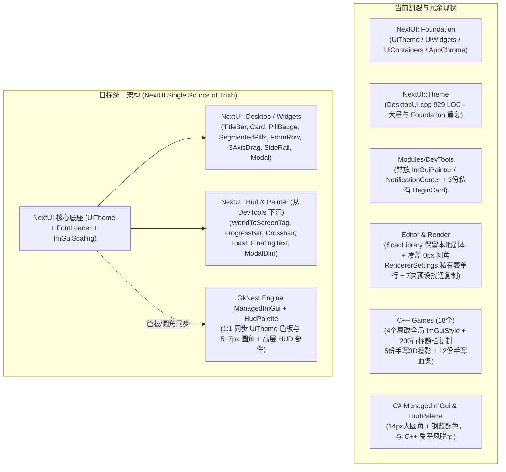

# 全局 UI 收敛与现代扁平化重构计划

> 本计划关联现行契约 [Desktop UI Foundation](../designs/desktop-ui-foundation.md)，覆盖 `Modules/NextUI`、`Modules/DevTools`、`Modules/NextDotNet`、编辑器系列（`gkNextEditor` / `ScadStudio` / `ScadLibrary`）、渲染器（`gkNextRenderer` / `gkNextBenchmark`）以及全部 C++ / C# 游戏示例。
> 核心目标：以 `src/Modules/NextUI/UI/UiTheme.cpp` 定义的**现代简约扁平风格**（无色相中性暗色层级、零控件内描边、`5~7px` 圆角、克制的语义点缀色）为全引擎唯一视觉基准（Single Source of Truth），消除跨模块的 Cheap Copy 与局部样式篡改，收敛约 **3,500+ 行**重复 UI 代码。

---

## 1. 现状诊断与四大核心病灶

1. **底座双轨分裂 (`NextUI::Foundation` vs `NextUI::Theme`)**：
   `src/Modules/NextUI/UI/DesktopUI.cpp` 与 `UiContainers.cpp` / `UiWidgets.cpp` / `AppChrome.cpp` 存在平行的两套实现，不仅代码逐行重复，还产生了行为分叉与 Bug（例如 `UiContainers.cpp:25-37` 的 `FScopedInsetPanel` 漏设 `ImGuiStyleVar_ChildBorderSize` 导致 `border = true` 完全无边框，而 `DesktopUI.cpp:427` 的 `BeginInsetPanel` 修复了该问题；`AppChrome.cpp:15-26` 与 `DesktopUI.cpp:153-173` 定义了两个同名但画法完全不同的 `DrawBrandMark`）。
2. **模块归属错位**：
   `src/Modules/DevTools/ImGuiPainter.h`（`NextUI::Painter`）和 `src/Modules/DevTools/NotificationCenter.h`（`NextUI::FNotificationCenter`）虽然命名空间属于 `NextUI`，物理文件却放在 `DevTools` 模块下，导致不链接 `DevTools` 的游戏无法使用，只能各自手写进度条、遮罩和 Toast 横幅。
3. **业务层大量 Cheap Copy（编辑器 / 渲染器 / 调试面板）**：
   组件提取到公共层后未清理原文件的本地副本（如 `ScadLibraryInterface.cpp:82-240`），或将通用组件写在文件匿名命名空间内再跨文件复制粘贴（如 `BeginCard` 5 份、`CompactStat` 3 份、`DrawPillBadge` 5 份、`Draw3AxisFloatDrag` 2 份）。
4. **视觉风格被局部硬编码破坏**：
   - `ScadLibraryInterface::Init`（`L1835-1850`）在启动时将 `WindowRounding` 改回 `0.0f`、`ChildRounding` 改回 `3.0f` 并覆盖了蓝灰底色；
   - 4 个 C++ 游戏（`BrickPlayer`、`MagicaLego`、`KongLie3D`、`AirportSim`）直接覆写全局 `ImGui::GetStyle()`；
   - C# 侧 `ManagedImGui.cs` 和 `HudPalette.cs` 使用 `14px` 大圆角、粗边框与冷蓝/薄荷绿配色，与编辑器极简无色相暗色风格脱节。

---

## 2. 不合理冗余与 Cheap Copy 清单

### 2.1 `NextUI` 与 `DevTools` 模块内部冗余

| 冗余项 | 具体文件与位置 | 问题描述 |
| :--- | :--- | :--- |
| **`BeginCard` / `EndCard` 重复 5 处** | 1. `src/Modules/NextUI/UI/DesktopUI.cpp:442-463` 2. `src/Application/Editor/ScadLibrary/ScadLibraryInterface.cpp:82-107` 3. `src/Application/Render/gkNextRenderer/RendererSettingsPanel.cpp:146-171` 4. `src/Modules/DevTools/UiDevPanels.cpp:655-682` 5. `src/Modules/DevTools/GraphicsDebugPanel.cpp:275-300` & `PhysicsDebugOverlay.cpp:125-150` | 第 4、5 处将同一个局部 lambda `BeginCard`/`EndCard` 原封不动复制粘贴了 3 遍；第 2、3 处为文件内私有函数，alpha 与边距微调导致卡片质感不一致。 |
| **`Foundation` 与 `Theme` 容器重复** | • `src/Modules/NextUI/UI/UiContainers.cpp:7-71` vs `DesktopUI.cpp:417-440, 580-639` • `src/Modules/NextUI/UI/AppChrome.cpp:15-54` vs `DesktopUI.cpp:19-76, 153-173` | `OverlayPanel`、`InsetPanel`、`Section` 代码重复两遍；`DrawBrandMark` 在两处画出不同 Logo；`DesktopUI.cpp` 中残留未调用的 `DrawWindowControlButton` 死代码。 |
| **`CompactStat` 键值行复制 3 处** | 1. `src/Modules/DevTools/UiDevPanels.cpp:720-727` 2. `src/Modules/DevTools/GraphicsDebugPanel.cpp:307-312` 3. `src/Modules/DevTools/PhysicsDebugOverlay.cpp:156-161` | 三处一字不差定义了相同的 `CompactStat` lambda；另有 `AboutDialog.cpp:15-22`、`GizmoController.cpp:207-212` 等同类实现。 |
| **字体加载与 FA 图标合并重复** | • `src/Modules/NextUI/UserInterface.cpp:254-356` • `src/Modules/NextUI/FontLoader.cpp:100-108` • `src/Modules/NextRemote/RemoteImGuiSession.cpp:157` | `UserInterface.cpp` 将合并 3 个 FontAwesome 字体的 25 行代码复制了两遍；而 `FontLoader::LoadDefaultUiFont` 未合并图标字体，导致 `RemoteImGuiSession` 缺少图标字形。 |
| **GPU 驱动信息与显存查询复制 3 处** | • `src/Modules/DevTools/UiDevPanels.cpp:72-100, 148-154` • `src/Application/Render/gkNextBenchmark/Common/BenchMark.cpp:44-80` • `src/Modules/DevTools/UI/DeveloperStatusBar.cpp:63-65` | `GetPhysicalDeviceDriverName` / `DriverVersionToString` / `GetPhysicalDeviceDriverInfo` 在 `UiDevPanels.cpp` 和 `BenchMark.cpp` 中逐行完全一致。 |

### 2.2 编辑器（`gkNextEditor` / `ScadStudio` / `ScadLibrary`）、启动器与渲染器冗余

| 冗余项 | 具体文件与位置 | 问题描述 |
| :--- | :--- | :--- |
| **`ScadLibrary` 保留 `DesktopUI` 本地副本** | `src/Application/Editor/ScadLibrary/ScadLibraryInterface.cpp:82-240, 2577-2588` | `BeginCard`、`EndCard`、`DrawCardHeader`、`DrawSegmentedPills`、`DrawTagChip` 与 `DesktopUI.cpp:442-541` 完全同构，但文件内 40+ 处仍调用本地副本。 |
| **三轴 `Draw3AxisFloatDrag` 两套实现** | 1. `src/Application/Editor/gkNextEditor/Panels/PropertiesPanel.cpp:42-199` (158 LOC) 2. `src/Application/Editor/ScadLibrary/ScadLibraryInterface.cpp:171-223` (53 LOC) | 均为左红/绿/蓝 X/Y/Z 胶囊 + 右数值拖拽框控件；`gkNextEditor` 版功能更完整（支持标签拖拽 scrubbing 与双击单轴重置），应下沉共用。 |
| **胶囊徽章 `DrawPillBadge` 5 处重复** | 1. `src/Application/Game/gkNextLauncher/LauncherGameInstance.cpp:87-101` 2. `src/Modules/NextDotNet/NewGameProjectDialog.cpp:90-111` 3. `src/Modules/DevTools/UI/DeveloperStatusBar.cpp:80-116` 4. `src/Application/Editor/gkNextEditor/Panels/ContentBrowserPanel.cpp:825-837` 5. `src/Modules/DevTools/UI/DiagnosticWidgets.cpp:14-27` | `LauncherGameInstance` 的 `DrawPillBadge` 与 `NewGameProjectDialog` 的 `DrawBadge` 逐字符相同。 |
| **`Init()` 重复加载字体与覆盖样式** | 1. `src/Application/Editor/ScadStudio/ScadStudioInterface.cpp:488-505` 2. `src/Application/Editor/ScadLibrary/ScadLibraryInterface.cpp:1829-1864` 3. `src/Application/Editor/gkNextEditor/EditorInterface.cpp:97-145` | 父类 `UserInterface` 已应用主题并加载带 DPI 密度的中英文字体+FA 图标；子类不仅重复调 `ApplyProfessionalTheme`，还裸调 `AddFontFromFileTTF("DroidSansFallback.ttf")` 塞入无用字体，且 `ScadLibrary` 强行把圆角改回 `0px/3px`。 |
| **可折叠停靠侧边栏框架复制 (210 LOC)** | 1. `src/Application/Editor/ScadStudio/ScadStudioInterface.cpp:880-939, 1112-1157` 2. `src/Application/Editor/ScadLibrary/ScadLibraryInterface.cpp:2927-2971, 3495-3553` | 相同的 `kCollapsedRailWidth = 46.0f`、折叠态 `ModeRailButton` 纵向图标轨 + Chevron 展开钮、展开态 Header + 折叠钮。 |
| **SwapChain 视口同步与异步文件框复制** | • 视口同步：`ScadStudioInterface.cpp:561-572` vs `ScadLibraryInterface.cpp:2079-2088` • 文件对话框：`ScadStudioInterface.cpp:341-407` vs `ScadLibraryInterface.cpp:8281-8366` | 视口坐标转物理像素并调 `UpdateOutputViewport` 逐行一致；`SDL_ShowOpenFileDialog` + 寻找 `AGENTS.md` 归一化相对路径逻辑完全复制。 |
| **`gkNextRenderer` 场景分组与预设按钮重复** | • `src/Application/Render/gkNextRenderer/RendererSettingsPanel.cpp:54-94` vs `RendererViewportToolbar.cpp:61-101` • `RendererSettingsPanel.cpp:180-229, 380-412, 524-1126` | `ESceneListGroup` 跨文件一字不差复制；`RendererSettingsPanel.cpp` 内重写了 `DrawSegmentedPills`，且等宽预设胶囊按钮循环在单文件内手抄了 **7 次**。 |

### 2.3 C++ 与 C# 游戏示例冗余

| 冗余项 | 具体文件与位置 | 问题描述 |
| :--- | :--- | :--- |
| **自定义窗口顶栏 200 行整段复制** | 1. `src/Application/Game/MagicaLego/MagicaLegoUserInterface.cpp:253-441` 2. `src/Application/Game/BrickPlayer/BrickPlayerUserInterface.cpp:64-271` 3. `src/Application/Game/gkNextLauncher/LauncherGameInstance.cpp:376-466` | `BrickPlayer` 逐行复制了 `MagicaLego` 的 200 行顶栏代码；`gkNextLauncher` 也手写了 90 行顶栏。三者均应直接复用 `NextUI::Theme::DrawAppTitleBar`。 |
| **3D 世界坐标投影 `ProjectWorld` 复制 5 处** | 1. `src/Application/Game/AirportSim/AirportSimUI.cpp:134-150` 2. `src/Application/Game/StudioSim/StudioSimUI.cpp:108-124` 3. `src/Application/Game/CitySolSim/CitySolSimUI.cpp:23-41` 4. `src/Application/Game/CharacterDemo/CharacterDemoAIDebugUI.cpp:239-258` 5. `src/Gameplay/Sim/AnchorDebugOverlay.cpp:16-34` | 引擎已在 `NextEngineHelper.hpp` 提供 `Runtime::EngineHelper::TryProjectWorldToScreenForGame`，这 5 处却各自手写 `ReverseZPerspective` 矩阵乘法与透视除法。 |
| **时间倍速胶囊 (`Pause/1x/2x/4x`) 重复 4 处** | 1. `src/Application/Game/KongLie3D/KongLie3DUI.cpp:1281-1314, 1358-1370` 2. `src/Application/Game/AirportSim/AirportSimUI.cpp:267-279` 3. `src/Application/Game/CitySolSim/CitySolSimUI.cpp:109-129` | 全部手写 `PushStyleColor` 按钮循环，应统一替换为 `NextUI::Theme::SegmentedPills`。 |
| **血条/进度条、飘字、准星、框选框重复 12+ 处** | • 血条/颜色阶梯：`Brotato3DUI.cpp:159-192`、`KongLie3DUI.cpp:62-83, 544-578`、`Voyage3DUI.cpp:25-36, 74-84`、`NextDayzHUD.cpp:166-197` • 阴影/描边字与头顶气泡：`AstroHud.cpp:22-36`、`StudioSimUI.cpp:527-574`、`AirportSimUI.cpp:1052-1073` | 缺少位于 `NextUI` 模块的通用 HUD 辅助原语，导致每个游戏各自用 `ImDrawList` 手写矩形填充、阴影文字和头顶标签。 |
| **C# 游戏与模板 HUD 重复及绕过封装** | • `projects/Flappy/Scripts/FlappyCSharpGameInstance.cs:297-360` • `projects/Brotato3D/Scripts/BrotatoUiSystem.cs:1-331` • `projects/TestFPS/Scripts/TestFPSGame.cs:273-342` & `projects/TestTPS/Scripts/TestTPSGame.cs:395-463` | `FlappyCSharp` 绕过 `ManagedImGui` 手写 `DrawPanel`；`BrotatoUiSystem` 绕过 `HudPalette` 硬编码 30+ 处颜色；`TestFPS`/`TestTPS` 与 `firstperson`/`tps` 模板的 HUD 及 `DrawCrosshair` 代码 95%~100% 重复。 |

---

## 3. 五阶段重构计划

### Phase 1：收敛 `NextUI` 底座，统一命名空间、字体与缩放度量
1. **合并 `NextUI::Foundation` 与 `NextUI::Theme` 双轨实现**：
   - 以 `src/Modules/NextUI/UI/` 下的模块化文件（`UiTheme`、`UiWidgets`、`UiContainers`、`AppChrome`）为唯一物理实现，`DesktopUI.hpp` 仅保留高层工作台复合组件与向后兼容的 `using` 别名，删除 `DesktopUI.cpp` 中重复的 `BeginOverlayPanel`、`BeginInsetPanel`、`BeginSection`、`CalcFontTextWidth`、`DrawWindowControlButton` 及重复的 `DrawBrandMark`。
   - 修复 `UiContainers.cpp:35` 中 `FScopedInsetPanel` 漏设 `ImGuiStyleVar_ChildBorderSize` 的 Bug。
2. **下沉 6 个高复用桌面级扁平组件到 `NextUI`**：
   - **`DrawPillBadge`**：合并 `LauncherGameInstance`、`NewGameProjectDialog`、`DeveloperStatusBar`、`ContentBrowserPanel` 的胶囊徽章绘制。
   - **`Draw3AxisFloatDrag`**：将 `PropertiesPanel.cpp:42-199` 的无缝圆角三轴拖拽控件（支持 `glm::vec3&` 与 `float[3]`）下沉到 `NextUI`。
   - **通用表单行与预设胶囊组 (`FormRow` / `PresetPills`)**：将 `RendererSettingsPanel.cpp:231-324` 的 `DrawSettingSliderRow` / `CheckboxRow` / `ComboRow` / `PresetPills` 下沉到 `NextUI`。
   - **可折叠停靠侧边栏 (`BeginCollapsibleSidePanel`)**：封装 `ScadStudio` 与 `ScadLibrary` 共用的 46px 折叠图标轨 + 展开面板框架。
   - **现代无边框 Modal (`BeginModernModal` / `DrawModalHeader` / `DrawModalFooter`)**：融合 `BeginAnchoredPopupModal` 的视口夹紧与 `NewGameProjectDialog.cpp:318-374` 的 56px 扁平 Header + `ManagedProjectBuilder.cpp:27-79` 的 `DrawSmoothSpinner` / `DrawAnimatedProgressBar`。
   - **可交互表面卡片 (`DrawInteractiveCard`)**：统一 `gkNextLauncher` 与 `NewGameProjectDialog` 的悬停/选中圆角卡片原语。
3. **统一字体加载与 UI Scale**：
   - 在 `FontLoader::LoadDefaultUiFont` 中内置合并 FontAwesome 图标字体（修复 `RemoteImGuiSession` 缺图标问题），消除 `UserInterface.cpp:272-355` 中的重复 FA 合并代码与硬编码 `.extraGlyphsUtf8`。
   - 在 `ImGuiScaling.hpp` 中提供统一的 `GetUiScale()`（替代各文件手写的 `ImGui::GetFontSize() / 16.0f`）与 `SyncImGuiViewportToSwapChain()`。

### Phase 2：下沉 `ImGuiPainter` / `NotificationCenter` 并建立 `NextUI::Hud`
1. **模块迁移**：将 `ImGuiPainter.h/.cpp` 和 `NotificationCenter.h/.cpp` 从 `src/Modules/DevTools/` 移至 `src/Modules/NextUI/UI/`，并将内部硬编码颜色替换为 `NextUI::Foundation::EColor` Token（中性暗色底 `SurfaceElevated` + `Border` + `Success/Warning/Danger`）。
2. **扩充轻量级游戏 HUD 原语 (`NextUI::Painter` / `NextUI::Hud`)**：
   - **文字原语**：`DrawTextCentered`、`DrawTextShadowed`、`DrawTextOutlined`（替代 10+ 处手写阴影/描边字）。
   - **状态条与颜色阶梯**：`GetHealthColor(float fraction)`（基于 `EColor::Success` / `Warning` / `Danger`）与统一的扁平圆角 `DrawStatusBar`。
   - **3D 世界空间锚点标签**：基于 `Runtime::EngineHelper::TryProjectWorldToScreenForGame` 封装 `DrawWorldHealthBar`、`DrawWorldBillboardTag`（替代员工气泡/航班标签/建筑标签）、`DrawWorldFloatingText`（伤害飘字）。
   - **战术/射击 HUD 原语**：`DrawCrosshair`（十字准星）、`DrawSelectionBox`（RTS 框选框）、`DrawKeyHintPill`（底部按键提示胶囊）。

### Phase 3：清理编辑器、启动器、渲染器与 `DevTools` 冗余
1. **`ScadLibrary` & `ScadStudio` & `gkNextEditor`**：
   - 删除 `ScadLibraryInterface.cpp:82-240` 的本地 `BeginCard`、`DrawSegmentedPills`、`DrawTagChip`、`Draw3AxisFloatDrag` 副本，全部切回 `NextUI::Theme`。
   - 删除 `ScadLibraryInterface::Init`（`L1829-1864`）中将圆角重置为 `0.0f/3.0f` 及覆盖 `ImGuiCol_*` 的旧样式代码，以及 `ScadStudio` / `ScadLibrary` 中重复加载 `DroidSansFallback.ttf` 的代码。
   - 用 `BeginCollapsibleSidePanel` 和 `SyncImGuiViewportToSwapChain` 替换 `ScadStudio` 与 `ScadLibrary` 的重复侧栏和视口同步代码。
2. **`gkNextLauncher`**：
   - 删除 `LauncherGameInstance.cpp:376-466` 自绘顶栏与 `_`/`X` 文本按钮，直接复用 `NextUI::Theme::DrawAppTitleBar`（配置 `Height = 56.0f`）。
3. **`gkNextRenderer` & `DevTools`**：
   - 合并 `RendererSettingsPanel.cpp` 与 `RendererViewportToolbar.cpp` 的场景分组函数及全局 `extern float` 尺寸变量；用 `PresetPills` 消除 7 处重复预设按钮循环。
   - 删除 `UiDevPanels.cpp`、`GraphicsDebugPanel.cpp`、`PhysicsDebugOverlay.cpp` 中复制 3 遍的 `BeginCard` 与 `CompactStat` lambda，以及 `BenchMark.cpp` 中重复的驱动版本查询代码。

### Phase 4：C++ 游戏示例视觉对齐与去重
1. **清除全局样式篡改**：
   - 移除 `BrickPlayerUserInterface::ApplyStyle`（恢复 `5~7px` 现代圆角与中性暗色底座）、`MagicaLego::Style::ApplyStyle`、`KongLie3D::ApplyKongLieImGuiStyle`、`AirportSimUI::PushProductTheme` 对全局 `ImGuiStyle` 的覆写，保留品牌色仅作为局部 `Accent` / `TagChip` 点缀。
2. **替换重复顶栏、倍速胶囊与 3D 投影**：
   - 将 `MagicaLego` 与 `BrickPlayer` 各 200 行的手写 `TitleBar` 替换为 `DrawAppTitleBar`。
   - 将 `KongLie3D`、`AirportSim`、`CitySolSim` 的时间倍速按钮替换为 `SegmentedPills`。
   - 将 `AirportSim`、`StudioSim`、`CitySolSim`、`CharacterDemo`、`AnchorDebugOverlay` 的 5 处手写投影替换为 `TryProjectWorldToScreenForGame` + `NextUI::Hud` 世界标签。

### Phase 5：C# 托管 UI (`ManagedImGui` & `HudPalette`) 现代扁平化同步
1. **同步色板与圆角（1:1 对齐 `UiTheme.cpp`）**：
   - 更新 `assets/csharp/GkNext.Engine/Gameplay/HudPalette.cs` 与 `ManagedImGui.cs` 默认 `Style`：
     - 面板底色：`Surface (25, 25, 25, 245)` / `SurfaceElevated (38, 38, 38, 245)`（替代原冷蓝灰 `(18, 25, 34)`）；
     - 边框：`Border (66, 66, 66, 90)`，`1.0f` 细线或无边框；
     - 强调色：`Accent (46, 110, 199)` / `Brand (242, 148, 36)` / `Success (56, 199, 97)` / `Warning (242, 179, 61)` / `Danger (235, 64, 71)`；
     - 圆角半径：Panel `7.0f`、Card `6.0f`、Button/Bar `5.0f`（替代原 `14px` / `10px` 过度圆角）。
2. **补充高层 C# HUD 部件并清理游戏脚本**：
   - 在 `ManagedImGui` 中增加 `FullScreenDim()`、`ModalCardCentered()`、`DrawCrosshair()`、`DrawKeyHintPill()`、`DrawResultOverlay()`。
   - 重构 `FlappyCSharpGameInstance.cs`、`BrotatoUiSystem.cs`、`TestFPSGame.cs`、`TestTPSGame.cs` 及 `assets/templates/games/` 模板，消除手写颜色与重复准星/结算框代码。

---

## 4. 验收与验证标准

1. **构建与单测**：
   - C++ 构建：`./gnb.bat build --all` 零编译错误。
   - C# 绑定与模板：`./gnb.bat dotnet ci` 与 `./gnb.bat dotnet templates` 全部通过。
2. **自动化脚本与视觉回归验证**：
   - 运行 UI 基础设施验证脚本：`./gnb.bat validate --script assets/agentscripts/ui-foundation-renderer-normal.agentscript.json` 与 `ui-foundation-editor-normal.agentscript.json` 确保 Window/Style 栈平衡。
   - 截图抽检：`./gnb.bat shot --target gkNextEditor --ui`、`./gnb.bat shot --target ScadLibrary --ui`、`./gnb.bat shot --target gkNextLauncher --ui`、`./gnb.bat shot --target AirportSim --ui`。
