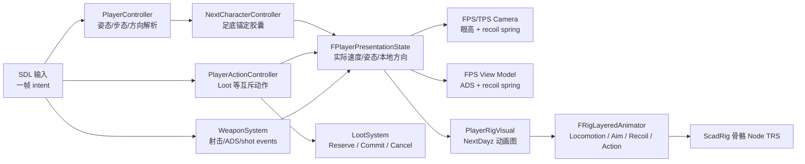
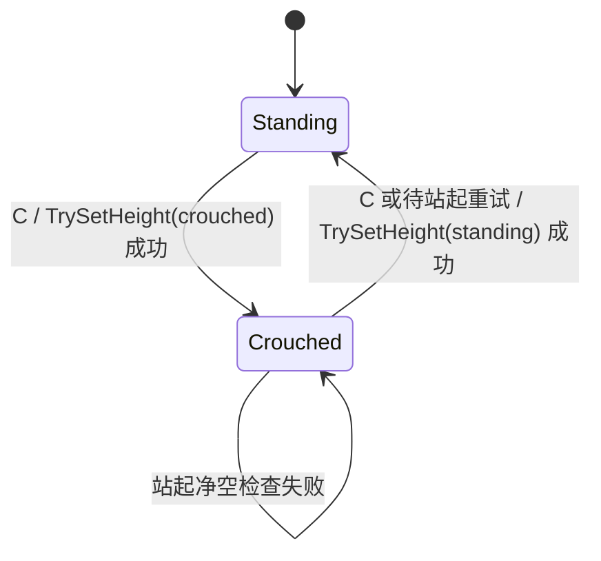

# NextDayz 复杂 3C 与 ScadRig 分层动画设计

> 本文记录 NextDayz 的蹲姿、四方向移动、步行/跑步/冲刺、举枪瞄准、开火后坐力和 loot 动作。
> 生存、背包、昼夜与 HUD 的现行边界见 [PVE 生存循环产品化设计](nextdayz-productization-design.md)。
>
> **实现状态（2026-11-03）**：P0～P7 已落地；随后做了"战术手感"重构（§15），其中的移动积分、
> CoD 式冲刺规则、20 骨骼资产、程序化生成的 clip、混合空间 + 武器驱动 IK 的动画图、第一人称视图模型
> 运动**取代**了 §3、§6.3、§8、§9 里与之冲突的描述。状态模型、动态胶囊、shot event 和 loot 两阶段
> 提交保持不变。资产为 `assets/scad/characters/nextdayz_survivor.scad`（由
> `assets/scad/lib/rig_humanoid.scad` 生成 clip）；动画图职责仍由 `PlayerRigVisual` 承担。

## 1. 目标与边界

### 1.1 本期必须交付

1. 站姿和蹲姿都支持前、后、左、右及相邻方向的连续混合。
2. 站姿具有 Walk / Run / Sprint 三种独立步态；不是把同一个 walk clip 简单加速三倍。
3. 蹲姿具有静止和四方向 crouch-walk；蹲姿不能冲刺。
4. 角色胶囊随实际姿态改变高度；低矮空间下站起失败时，视觉、相机和碰撞仍保持蹲姿。
5. 站姿/蹲姿、静止/移动时都可举枪瞄准；瞄准姿态只覆盖上身，不打断腿部 locomotion。
6. 每一发子弹都产生：
   - FPS 相机和 view model 的后坐力；
   - TPS ScadRig 上身的 recoil 叠加动画；
   - 不丢失连发事件的一次性 shot presentation event。
7. loot 时播放全身 loot 动作，在动作中段提交拾取；动作期间移动、瞄准、开火被显式锁定。
8. 所有状态可通过 `game.*` agent query 观察，并有输入驱动回归脚本和截图。

### 1.2 本期不做

- 趴下、侧身探头、攀爬、翻越、游泳。
- 脚部 IK、手部 IK、motion matching、root motion 驱动位移。
- 换弹、受伤、近战等额外全身动作；架构应能以后按同一 Action Layer 接入。
- 第一人称完整手臂 rig；FPS 继续使用独立 view model，TPS 使用完整 ScadRig。
- 网络复制和预测。状态结构不得主动阻碍未来复制，但本期不实现。
- 修改 `kit_char.scad` 的七骨骼通用角色标准。复杂人形骨架先作为 NextDayz 专用资产验证，出现第二个消费端后再抽成通用 humanoid kit。

## 2. 当前实现与缺口

当前实现已经具备完整 MVP 链路，但不足以直接叠加这些动作：

| 当前代码 | 已有能力 | 不能满足的部分 |
| --- | --- | --- |
| `Player/PlayerController.*` | Jolt 控制器、WASD、两档速度、FPS/TPS 相机、ADS FOV | 无 crouch；胶囊高度创建后不可变；只有 `Idle/Walk/Run`，没有本地四方向和第三档步态 |
| `Gameplay/Character/NextCharacterController.*` | 对物理后端的轻量封装 | 后端没有 `TrySetHeight`，无法在站起前检查头顶净空 |
| `Gameplay/Rig/RigInstance.*` | 单 clip 播放、速度、phase offset、两 clip crossfade | 没有骨骼遮罩、方向 clip 混合、override/additive layer、可重触发 one-shot |
| `Player/PlayerRigVisual.*` | `idle/walk/fire` 离散切换；run 复用 walk 加速 | fire 会替换 locomotion；不能同时“跑 + 瞄准 + recoil” |
| `next_ra_soldier.scad` | 7 骨骼和 `idle/walk/fire` | 手臂和腿各是一根刚体；步枪烘在 torso；没有肘、膝和武器 socket |
| `Weapons/WeaponSystem.*` | hitscan、ADS、换弹、FPS view model | 只有 `ConsumeFiredThisFrame()` 布尔脉冲；无 camera/view-model recoil；低帧率下一帧无法表达多发 |
| `Inventory/LootSystem.*` | E 键立即入包并隐藏节点 | 没有 reservation、动作锁和延迟 commit，无法可靠同步 loot 姿势 |

因此本期不是继续扩充 `EAnimState` 的 `switch`，而是补齐两个可复用基础能力：

- 角色控制器的**足底锚定动态高度**；
- ScadRig 的**分层 pose 混合**。

## 3. 产品默认值

下列是未另行确认时的开发默认值，都必须放在 NextDayz 配置中，不写死在状态机：

| 行为 | 默认输入/规则 |
| --- | --- |
| 蹲下/站起 | `C` 切换；站起被阻挡时保持蹲姿并继续重试 |
| Walk | 按住 `Ctrl` |
| Run | 无速度修饰键时的默认步态 |
| Sprint | 按住 `Shift`；仅站姿且未 ADS、未 loot 时允许 |
| 四方向 Sprint | 支持 F/B/L/R clip；后退和侧向通过方向速度系数降低实际速度 |
| 瞄准 | 右键点按切换 FPS ADS，按住使用当前视角举枪；两种瞄准均将 Walk/Run/Sprint 解析结果限制为 Walk |
| 蹲姿移动 | 只有 crouch-walk 一档；方向速度系数仍生效 |
| 蹲姿跳跃 | 拒绝；跳跃输入先请求站起，净空不足则本次跳跃失败 |
| loot | E 开始，约 `0.9s`；`55%` 进度提交物品；提交前可由移动/跳跃取消 |

建议初始数值：

```text
StandWalkSpeed     2.0 m/s
StandRunSpeed      4.2 m/s
StandSprintSpeed   7.6 m/s
CrouchWalkSpeed    1.55 m/s
BackwardScale      0.72
StrafeScale        0.82
AimMoveScale       0.65
StandingHeight     1.80 m
CrouchedHeight     1.18 m
StandingEyeHeight  1.65 m
CrouchedEyeHeight  1.02 m
```

这些是调参起点，不是资产契约。

## 4. 总体架构



### 4.1 所有权

- `PlayerController`：原始移动 intent、实际 stance/gait、Jolt 控制器、基础 look yaw/pitch、相机眼高。
- `PlayerActionController`：loot 等互斥全身动作的权威 timer、锁、commit/cancel 事件。
- `WeaponSystem`：武器和弹药权威状态、射击判定、每发 `FShotEvent`。
- `PlayerRigVisual`：ScadRig 资产生命周期、动画图、TPS 武器 attachment；只消费 presentation state，不决定玩法。
- `FRigLayeredAnimator`：通用 pose 采样/混合/应用，不知道 NextDayz 的 crouch、枪械或 loot。
- `NextDayzGameInstance`：按固定顺序转发输入、更新系统和处理事件，不重新收容业务状态。

### 4.2 帧顺序

1. SDL 回调只更新 held input 或排队 one-frame command，不在回调内直接拾取、切姿态或开火。
2. `PlayerActionController` 先解析动作锁；loot 会禁止本帧 movement/aim/fire。
3. `PlayerController` 解析目标姿态和 gait，尝试改变胶囊，随后更新物理控制器。
4. `LootSystem` 更新准星候选；`WeaponSystem` 更新射击并产生零到多个 `FShotEvent`。
5. shot event 逐个施加到 camera/view-model recoil spring，并逐个重触发 TPS recoil layer。
6. action timer 到 commit 点时，GameInstance 调 `LootSystem::Commit`；视觉资产缺失也不能阻止玩法提交。
7. 组装只读 `FPlayerPresentationState`，驱动相机、view model 和 `PlayerRigVisual`。
8. `FRigLayeredAnimator` 一次求值并只做一次根节点 `RecalcTransform(true)`；Scene 每帧最多一次 `MarkTransformDirty()`。

## 5. 共享状态模型

建议在 `src/Application/Game/NextDayz/Player/PlayerState.hpp` 定义：

```cpp
enum class EPlayerStance
{
    Standing,
    Crouched,
};

enum class EPlayerGait
{
    Idle,
    Walk,
    Run,
    Sprint,
};

enum class EPlayerAction
{
    None,
    LootGround,
};

struct FPlayerLocomotionState
{
    EPlayerStance desiredStance = EPlayerStance::Standing;
    EPlayerStance actualStance = EPlayerStance::Standing;
    EPlayerGait gait = EPlayerGait::Idle;
    glm::vec2 localMove{0.0f};       // x=right, y=forward, [-1,1]
    glm::vec3 worldVelocity{0.0f};
    float horizontalSpeed = 0.0f;
    bool onGround = false;
    bool standBlocked = false;
};

struct FPlayerPresentationState
{
    FPlayerLocomotionState locomotion;
    EPlayerAction action = EPlayerAction::None;
    float actionTime01 = 0.0f;
    float aimWeight = 0.0f;
    float aimPitchRadians = 0.0f; // 不含 recoil；后坐力由独立 additive layer 表达
    bool hasWeapon = false;
};
```

`desiredStance` 和 `actualStance` 必须分开。动画、相机和 HUD 只能读 `actualStance`；否则在矮屋檐下按 C 会出现视觉站起但胶囊仍蹲着的穿模。

## 6. 物理姿态与移动解析

### 6.1 通用角色控制器 API

在 [`NextPhysics.hpp`](../../../src/Engine/Runtime/Subsystems/NextPhysics.hpp) 的
`INextCharacterControllerBackend` 增加：

```cpp
virtual bool TrySetHeight(float height) = 0;
virtual float GetHeight() const = 0;
```

[`NextCharacterController`](../../../src/Gameplay/Character/NextCharacterController.h) 提供同名 façade，并只在后端成功后更新缓存高度。

Jolt 5.4 的 `CharacterVirtual::SetShape` 已直接支持 stance 切换和扩张碰撞检查。实现约束：

1. 抽出 `CreateFootAnchoredCapsule(height, radius)`：
   - capsule cylinder half-height 为 `(height - 2 * radius) / 2`；
   - 外层 `RotatedTranslatedShape` 的 Y offset 为 `height / 2`；
   - CharacterVirtual position 继续表示脚底，因此换高时世界脚点不跳。
2. `height >= 2 * radius + epsilon`，非法值返回 false 并记录错误。
3. 变矮只减少占用体积，可用无扩张检查路径。
4. 变高必须调用带 broad/object/body/shape filter 和有限 penetration tolerance 的 `SetShape`；失败时保留原 shape 和实际高度。
5. 若以后启用 CharacterVirtual inner body，成功后同步 `SetInnerBodyShape`；本期不为了 crouch 主动启用 inner body。
6. 不能 destroy/recreate controller 来切 crouch；那会丢失接触、速度并在楼梯或移动地面上跳点。

### 6.2 姿态状态机



- 蹲下通常立即成功；成功后才改变 `actualStance`。
- 请求站起但失败时设置 `standBlocked=true`，每 tick 低频重试或在角色移动后重试。
- 相机眼高用阻尼平滑到实际姿态眼高；先成功换 shape，再抬高相机。
- crouch 视觉切换用 `0.12～0.18s` crossfade；碰撞体不做连续缩放，避免多次昂贵 shape query 和中间态钻缝。

### 6.3 步态和方向

输入先解析为相机水平空间的 `localMove`，物理移动仍由 camera forward/right 合成。

步态优先级：

```text
Loot/其它锁定动作 -> Idle
Crouched           -> Walk（使用 crouch 速度）
ADS                -> Walk
Shift              -> Sprint
Ctrl               -> Walk
其它               -> Run
```

方向速度系数按 `abs(localMove.x/y)` 连续混合，避免斜向跨阈值突变；对角输入在合成世界方向前仍需归一化，不能获得 √2 速度。

动画方向使用**实际水平速度投影**，起步首帧可用 intent 做 fallback。这个策略可复用
[`CharacterAnimationComponent`](../../../src/Gameplay/Components/CharacterAnimationComponent.cpp) 已有的“实际速度优先、commanded direction 兜底”思路，避免撞墙时原地高速踏步。

## 7. ScadRig 分层动画框架

### 7.1 不扩展资产 DSL 的内容

现有 clip 已经表达相对 bind pose 的 `pos/rot/scale`，足以做 override 和 additive。本期不把以下运行时概念写进 `.scad`：

- layer 名；
- bone mask；
- additive 标记；
- gameplay event。

原因是同一 clip 可被不同游戏以不同层语义使用，loot 的权威 commit 也不能依赖视觉资产。`.scad` 格式继续只保留现有 `["loop", bool]` 元数据，避免破坏 loader 和作者工具。

### 7.2 新的通用类型

在 `src/Gameplay/Rig/` 增加格式无关的 pose/mixer 实现，建议接口形状如下：

```cpp
enum class ERigLayerBlendMode
{
    Override,
    Additive,
};

struct FRigBonePose
{
    glm::vec3 t{0.0f};
    glm::quat r{1.0f, 0.0f, 0.0f, 0.0f};
    glm::vec3 s{1.0f};
    uint8_t authoredComponents = 0; // Position / Rotation / Scale bits
};

struct FRigBoneMask
{
    std::vector<float> weights; // 与 asset.bones 对齐，0..1

    static FRigBoneMask FullBody(const Assets::FRigAsset& asset);
    static FRigBoneMask FromSubtree(
        const Assets::FRigAsset& asset, std::string_view rootBone, float weight = 1.0f);
};

struct FRigClipBlendSample
{
    const Assets::FRigClip* clip = nullptr;
    float weight = 0.0f;
};
```

新增 `FRigLayeredAnimator`，至少提供四类操作：

```cpp
Bind(asset, boneNodes, root)
CreateLayer(name, blendMode, boneMask)
SetLoopBlend(layer, samples, syncGroup, playRate, fadeSeconds)
SetStaticBlend(layer, samples, fadeSeconds)
SetManualBlend(layer, samples, normalizedTime, fadeSeconds)
PlayOneShot(layer, clip, playRate, fadeIn, fadeOut, restartIfSame)
SetLayerWeight(layer, weight, fadeSeconds)
IsOneShotComplete(layer)
Update(deltaSeconds)
```

接口命名可在实现时微调，但这些语义必须保留：

- locomotion 的多个方向 clip 共享一个 normalized phase；
- 同一 one-shot 可被每发子弹强制重触发；
- layer 和 clip 名在 Bind/切换时解析，不在每骨骼每帧做字符串查找；
- Update 热路径不做无界分配；
- 缺失 mask root 或必需 clip 时 warning 只打印一次，并提供可测试的错误状态。

### 7.3 Pose 求值语义

1. 求值从 offset identity 开始：`t=0`、`r=identity`、`s=1`。
2. 每个骨骼、每个 TRS component 都保留 authored bit。一个 clip 没写 rotation 时，不能把下层 rotation 混回 identity。
3. 同一层多个 clip 混合时，只在真正写了该 component 的样本之间归一化权重。
4. Override：
   - `w = layerWeight * boneMaskWeight`；
   - position/scale 线性混合；
   - rotation 使用 hemisphere-corrected weighted nlerp 或等价、顺序无关的归一化混合。
5. Additive：
   - `out.t += delta.t * w`；
   - `out.r *= slerp(identity, delta.r, w)`；
   - `out.s *= mix(1, delta.s, w)`。
6. 所有层混完后才应用一次 bind：
   `L_final = L_bind · T(offset.pos) · R(offset.rot) · S(offset.scale)`。
7. 最后只从 rig root 做一次 transform 递归刷新。

### 7.4 旧 API 兼容

现有 `FRigAnimator::Bind/Play/SetPlaySpeed/SetPhaseOffset/CurrentClip/Update` 必须继续编译且行为不变。

推荐把采样和 apply 抽成共享内部实现，再让旧 `FRigAnimator` 表现为“一个 full-body override base layer”；不要求 AirportSim、StudioSim、CitySolSim、ScadLibrary 或 Brotato3D 迁移。现有 `[Rig]` 单测中的采样、loop、non-loop、crossfade、phase 和 same-clip no-op 都是兼容门禁。

## 8. NextDayz 动画图

### 8.1 固定层

```text
Layer 0  Locomotion  FullBody   Override   永远存在
Layer 1  Aim         UpperBody  Override   aimWeight 0..1
Layer 2  Recoil      UpperBody  Additive   每发重触发 one-shot
Layer 3  Action      FullBody   Override   loot 时最高优先级
```

执行顺序即上表顺序。Action 权重为 1 时完全覆盖其它层；进入 loot 时 Aim/Recoil 权重主动淡出，不能依赖“最后一层刚好遮住”来维持 gameplay 规则。

UpperBody mask 从 `bone_torso` 子树构建，再做权重微调：

- torso 约 `0.65`；
- head 约 `0.25`，避免准星转动时头部完全僵住；
- upper arm / forearm / hand / weapon socket 为 `1.0`；
- pelvis、腿和脚为 `0.0`。

Recoil mask 可将 head 设为 0，避免整颗头随枪弹跳。

### 8.2 四方向 blend

把 rig 面向定义为本地 +forward，`localMove = (right, forward)`：

```text
wF = max( localMove.y, 0)
wB = max(-localMove.y, 0)
wR = max( localMove.x, 0)
wL = max(-localMove.x, 0)
```

非零权重按和归一化。对角方向自然得到相邻两个 clip 的混合，不需要首期制作 8 个方向。速度接近 0 时再与当前 stance 的 idle clip 混合。

同一个 gait 的四个 clip 必须：

- duration 相同或误差不超过 2%；
- 左右脚触地相位一致；
- 使用共享 normalized phase。

从 walk 切到 run/sprint 或从 stand 切到 crouch 时保留 locomotion sync group 的 phase，再做短 crossfade，避免每次换方向都从左脚第一帧重新开始。

播放速度只做小范围步幅补偿：

```text
playRate = clamp(actualSpeed / authoredSpeed, 0.75, 1.35)
```

超出范围应切换 gait，而不是继续把 walk clip 拉伸到 sprint。

### 8.3 瞄准

Aim layer 使用三张静态 pose：

- `aim_rifle_down`
- `aim_rifle_center`
- `aim_rifle_up`

由相机 pitch 在配置的上下限间做一维 blend。角色 world yaw 继续跟随基础 camera yaw，因此首期不需要额外 aim-yaw blend；camera recoil yaw 不旋转整个人。

Aim layer 的权重用阻尼在 `0 ↔ 1` 间过渡。站立、蹲下、四方向移动时均可叠加；Sprint 和 loot 会把 ADS 请求解析为 false。

### 8.4 开火后坐力

TPS 使用 `recoil_rifle` non-loop additive clip，内容必须以 identity offset 开始和结束。每个 `FShotEvent` 都调用
`PlayOneShot(..., restartIfSame=true)`。

FPS 不依赖 TPS clip：

- `PlayerController` 持有 camera recoil pitch/yaw spring；
- view model 持有 position/rotation recoil spring；
- shot 先按当时准星方向做 hitscan，再施加 recoil impulse；
- 后续 shot 的方向读取已经包含尚未回正的 camera recoil，形成可控连发抬枪。

`FWeaponDef` 增加数据化参数，例如：

```cpp
float recoilPitchDegrees;
float recoilYawDegrees;
float recoilReturnRate;
float viewModelKick;
float rigRecoilScale;
```

`WeaponSystem` 用 `std::vector<FShotEvent>`、小型固定队列或 callback 输出每发事件，不再用单个
`ConsumeFiredThisFrame()` bool。随机横向 recoil 使用现有确定性 RNG，并把 shot sequence 放进事件，保证 agent 回放稳定。

### 8.5 Loot 动作

新增 `PlayerActionController`，loot 流程为：

1. E 键请求 `LootSystem::ReserveHovered()`，返回稳定 handle；entry 进入 Reserved，不能再次拾取。
2. 成功后进入 `LootGround`，清 sprint/ADS/trigger，速度解析为 0，FPS view model 下压或隐藏。
3. Action Layer 以权威 `actionTime01` 手动采样 `loot_ground` non-loop full-body clip，不另起一个可能漂移的视觉 timer。
4. 权威 action timer 到 `commitNormalizedTime` 后产生一次 `CommitLoot(handle)` 事件；GameInstance 调 `LootSystem::Commit` 入包并隐藏节点。
5. timer 结束后淡回 locomotion。
6. commit 前若移动、跳跃或目标失效，调用 `Cancel(handle)` 并淡回；commit 后不回滚物品。

关键不变量：**loot 成功与否由 gameplay timer 决定，不由 `PlayerRigVisual` 或 clip 是否存在决定**。这样无 rig fallback、服务器逻辑和测试都不会因为视觉资产缺失而卡死。

## 9. NextDayz ScadRig v2 资产契约

新建专用资产 `assets/scad/characters/nextdayz_survivor.scad`，不直接改共享的
`next_ra_soldier.scad`。

### 9.1 骨架

```text
bone_root                         # 足底世界锚点，不做水平 root motion
└─ bone_pelvis
   ├─ bone_torso
   │  ├─ bone_head
   │  ├─ bone_upperarm_l
   │  │  └─ bone_forearm_l
   │  │     └─ bone_hand_l
   │  └─ bone_upperarm_r
   │     └─ bone_forearm_r
   │        └─ bone_hand_r
   │           └─ bone_weapon_socket  # 可为空骨骼
   ├─ bone_thigh_l
   │  └─ bone_calf_l
   │     └─ bone_foot_l
   └─ bone_thigh_r
      └─ bone_calf_r
         └─ bone_foot_r
```

约束：

- `bone_weapon_socket` 不烘焙枪模型；当前装备的 TPS 武器 node 在运行时挂上去，并设为不可 raycast。
- 衣物按实际装备实例切换：头盔挂 `bone_head`，外衣、护甲和背包挂 `bone_torso`；袖子、裤腿与靴子分别挂四肢骨骼。详见 §18。
- 角色仍遵守 1 unit = 1 m、Z-up、面朝 SCAD −Y、root 落地。
- locomotion clip 只做 in-place 动画；`bone_root` 的水平 position 偏移必须接近 0。

### 9.2 必需 clip

| 类别 | clip |
| --- | --- |
| Stand idle | `stand_idle` |
| Stand walk | `stand_walk_f/b/l/r` |
| Stand run | `stand_run_f/b/l/r` |
| Stand sprint | `stand_sprint_f/b/l/r` |
| Crouch | `crouch_idle`、`crouch_walk_f/b/l/r` |
| Aim poses | `aim_rifle_down/center/up` |
| Fire | `recoil_rifle`，`["loop", false]` |
| Interaction | `loot_ground`，`["loop", false]` |

循环 clip 的周期和 authored speed 由 NextDayz animation profile 配置，不写入通用 `FRigClip`。首次资产可以在同一个 SCAD 文件内用 helper function 生成镜像和相位变体；在第二个复杂人形消费端出现前，不新增全局 kit。

## 10. 生命周期与武器 attachment

继续严格遵守现有顺序：

```text
OnInit              LoadRig
BeforeSceneRebuild  注入 rig parts、服装、TPS/FPS 武器 models/materials
OnSceneLoaded       Instantiate、建立 masks/layers、挂 attachment
OnSceneUnloaded     只清 animator、Node 和 scene 指针
```

`OnSceneUnloaded` 不能清注入产物。新 layered animator 和 attachment node 不改变这条 ScadRig/AirportSim 已验证的生命周期规则。

第一人称：

- 完整 rig 隐藏；
- WeaponSystem 的 view model 展示 ADS/recoil；
- loot 时 view model 淡出/下压。

第三人称：

- 完整 rig 展示分层动画；
- 当前武器 model 挂 `bone_weapon_socket`；
- Fire ray 仍从 camera/weapon gameplay 逻辑发出，不从动画后的枪口骨骼反推权威弹道。

## 11. 可观察性与验收契约

至少新增：

```text
game.stance              "standing" | "crouched"
game.desiredStance       "standing" | "crouched"
game.standBlocked        bool
game.controllerHeight    number
game.gait                "idle" | "walk" | "run" | "sprint"
game.localMoveX          number
game.localMoveY          number
game.baseAnim            string
game.aimWeight           number
game.action              "none" | "loot_ground"
game.actionTime          number (0..1)
game.shotSequence        integer
game.recoilActive        bool
```

视觉验收必须在 TPS 截图中覆盖：

- 站立 idle；
- Walk / Run / Sprint 的 F/B/L/R；
- crouch idle 和 crouch F/B/L/R；
- stand/crouch 的 ADS 静止与移动；
- locomotion + aim + recoil 同时存在；
- loot 动作 commit 前后。

FPS 验收覆盖 ADS FOV、view-model 对齐、每发 kick 和平滑回正。

## 12. 兼容性与失败策略

1. **旧 ScadRig 消费端零迁移**：简单角色继续使用 `FRigAnimator`。
2. **旧资产零修改**：新骨架放在 `nextdayz_survivor.scad`；NextRA battlefield 和现有 `[ScadRig][NextRA]` 测试不受影响。
3. **缺 clip 不静默**：开发构建记录一次 warning；NextDayz 资产单测把所有必需 clip/骨骼当硬失败。运行时可回退到 bind/idle，不能崩溃。
4. **物理是真实姿态来源**：站起失败永远不能只做视觉站起。
5. **玩法不依赖视觉**：无 rig 时仍能移动、射击、loot；动画只消费事件。
6. **无 root motion**：控制器位置唯一权威来源，避免动画和 Jolt 双重位移。

## 13. 主要风险

| 风险 | 缓解 |
| --- | --- |
| 多方向 clip 混合时脚滑/脚相位跳变 | 同 gait 等周期、共享 normalized phase、限定 play-rate、小范围 crossfade |
| 刚体骨架的瞄准/蹲姿过于僵硬 | NextDayz v2 增加肘、膝、脚和 weapon socket，不强行复用七骨骼 kit |
| 站起穿顶或重建 controller 跳点 | Jolt `SetShape` 净空检查，足底锚定，失败保留实际 crouch |
| fire 覆盖走路 | recoil 作为 upper-body additive layer，不再切换 base clip |
| full-auto 某些帧丢 recoil | 每发 `FShotEvent`，不使用一帧 bool |
| loot 动画丢失导致物品不能拾取 | 权威 action timer 独立于 visual/clip |
| 共享动画器改动破坏模拟项目 | 旧 API 兼容门禁 + `[Rig]` 回归 + 目标化编译现有消费端 |

## 14. 开发前可调整但不阻断架构的问题

以下仅影响配置/资产数量，不要求重做框架：

1. `C` 是 toggle 还是 hold。
2. 默认无修饰键是 Run 还是 Walk。
3. Sprint 是否允许完整后退/侧向，还是输入存在但自动降级为 Run。
4. loot 动作时长、commit 点及提交前的取消规则。
5. 首期是否只做 rifle aim profile，还是同时制作 pistol/shotgun profile。

若没有额外产品决定，按 §3 的默认值和 rifle-first profile 开发。

## 15. 战术手感重构（2026-11-03）

### 15.1 为什么

旧实现"假、机械"的根因不在单个 clip，而在链路：速度每帧直接设成目标值（无加减速），动画读指令速度
（撞墙原地跑）；四方向权重直接取 WASD 数字输入（换向一帧跳变）；walk/run/sprint 的骨盆高度是常量
（没有起伏和重心转移）；上身被静态 `weapon_ready` 以权重 1 覆盖（跑动时上身僵死），手臂角度离线算好
后在 clip 间混合，手会脱离武器；且 `_r` 骨骼实际在角色左侧，士兵是左手持枪而相机在右肩。

### 15.2 移动（`PlayerController`）

- 速度按加速度积分（`GroundAcceleration` / `SprintAcceleration` / `GroundDeceleration` /
  `AirAcceleration`），自行积分重力后走 `UpdateWithVelocity`；空中松键保留动量。
- 动画与相机读**实测**速度（位移 / dt，0.05 s 平滑）；正面撞墙时把指令速度收敛到实测速度。
- 冲刺（取代 §3 的四方向冲刺默认值）：需要 `localMove.y >= SprintMinForwardInput`；瞄准或按住扳机
  打断冲刺；`SprintAlpha` 是武器从冲刺姿势回到可射击的过渡，`WeaponReady()` 之前 `WeaponSystem` 不开火
  （按住扳机会在就绪瞬间开第一枪）。
- 第一人称相机：按距离推进的步幅相位驱动头部起伏和侧倾，平移时视角向移动方向轻微侧倾，落地下沉弹簧，
  冲刺 FOV 增加。玩法用的 `EyePosition()` 不含这些偏移，射线不受影响。

### 15.3 资产（取代 §9）

- 20 根骨骼：§9.1 的 17 根 + `bone_ik_weapon`（躯干子骨骼）→ `bone_ik_hand_r` / `bone_ik_hand_l`。
  `_r` 骨骼在 SCAD −X（角色右侧）；`bone_weapon_socket` 的 bind 是右手握把帧的逆。
- 比例：腿 0.44 + 0.42、手臂 0.31 + 0.29，躯干相应缩短，总高不变。
- 所有 clip 由 `rig_humanoid.scad` 生成（见 `docs/AGENT_GUIDE/ScadRig.md`）。新增 `weapon_sprint`
  （步枪斜挎胸前、枪口朝支撑侧上方）与 `weapon_low`（枪口朝下）。持枪 clip 的躯干/头通道是侧身与转头，
  运行时以 Additive 叠加。

### 15.4 动画图（取代 §8）

```text
locomotion      FullBody  Override  18 clip：stand idle、walk/run/sprint × F/B/L/R、crouch idle、crouch walk × 4
hold            手臂+IK    Override  weapon_ready / aim_rifle_center / weapon_sprint 静态混合
hold_body       躯干+头    Additive  同一组样本（侧身、转头）
weapon_action   手臂+IK    Override  reload / switch（权威时间手动采样）
weapon_action_body 躯干+头 Additive  同上
recoil          上身       Additive  每发重触发
action          FullBody  Override  loot
→ 程序化阶段 → Apply
```

- 混合空间：速度按 idle/walk/run/sprint 锚点（clip 作者速度）分段线性加权，方向取**躯干坐标系**下的
  实测速度方向并平滑；蹲姿权重平滑过渡。所有样本固定在一个集合里只改权重，因此永不交叉淡入、相位连续。
  播放速率由混合后的步频换算到主导 clip，超过最后一个锚点才加速。
- 下半身朝向：移动时快速跟随相机 yaw；静止时扭转超过 `TurnInPlaceThresholdDegrees` 才原地转身。
- 程序化阶段：整体倾斜（加速度驱动的阻尼弹簧，转弯侧倾、急停后仰）；相机俯仰/扭转按比例分给躯干和头，
  剩余部分绕射击侧肩部旋转 `bone_ik_weapon`，枪口始终对准准星；步伐相位驱动武器起伏，冲刺时摆臂；
  最后两骨 IK 把右手解到 `bone_ik_hand_r`、左手解到 `bone_ik_hand_l`（拾取与翻越时左手放开交给 clip）。
- 手枪等非步枪握持通过 `HoldFor()` 调整模型偏移和左手目标；第三人称武器缩放 `TpsWeaponScale`。

### 15.5 第一人称视图模型（`WeaponSystem::UpdateViewModelMotion`）

8 字步伐晃动（冲刺放大、瞄准压到 10%）、视角角速度驱动的惯性摆动弹簧、平移倾斜与反向漂移、冲刺持枪
姿势（压低、枪口左转、倾斜）、静止呼吸、落地冲击，以及以厘米计的后坐力抬枪。参数在
`FWeaponFeelConfig`。

### 15.6 观察与验证

- 新增查询：`game.sceneReady`、`horizontalSpeed`、`sprintAlpha`、`weaponReady`、`bodyYawLag`、
  `turningInPlace`、`leanRoll`、`gripError`（右手到握把目标的距离）、`recoilCamera` /
  `recoilViewModel` / `recoilRig`。
- 验证 cvar：`nextdayz.validation.lookYaw`（度）、`nextdayz.validation.thirdPerson`；调试环绕相机
  `nextdayz.debug.orbit` / `orbitYaw` / `orbitDistance` / `orbitHeight`（从侧面、正面检查动作，开启时
  隐藏第一人称视图模型）。
- 验证模式帧率很高，按帧等待不再代表时间：NextDayz 脚本开头等待 `game.sceneReady`，locomotion 脚本
  用 `wait-until game.baseAnim` 等待混合空间到位。

### 15.7 第三人称相机防穿墙

`PlayerController` 在移动、翻越与视角更新之后，用场景 CPU raycast 检查从角色焦点到相机的整条臂，
包含肩部偏移。中心与周围八个采样覆盖镜头边缘；探测范围超过目标镜头位置，预留
`TpsCollisionRadius`（0.20 m）与 `TpsCollisionPadding`（0.05 m）的安全距离。

遇障碍当帧收缩，离开障碍以 `TpsArmReturnSpeed`（5 m/s）伸回。滚轮设置的距离独立保留，
碰撞允许缩到 `TpsMinDistance` 以下；肩部偏移随臂长一起缩短。角色部件与挂载物按各自世界位置到相机的
距离渐隐：`TpsFadeFarDistance`（1.5 m）之外完全不透明，进入后 smoothstep 降低覆盖率，到
`TpsFadeNearDistance`（0.35 m）完全淡出。较远的腿部仍保留；拉远后自然恢复，调试环绕关闭渐隐。

覆盖率通过 `RenderComponent::SetMainOpacity` 传到 `NodeProxy.reserved2` 的高 16 位（反向 UNORM16，
零值为不透明），不改变 GPU 布局；低位仍供 outline 使用。visibility fragment 使用固定屏幕空间 8×8
Bayer 图案 discard，角色各部件与正反面共用像素阈值。被丢弃的片元不写深度或 visibility ID，后方表面
直接成为后续 SurfaceBuild/光追的 primary hit。只改变 visibility 覆盖率，阴影与光追加速结构保留完整几何。

查询 `game.cameraArmLength` / `cameraArmFraction`、`cameraPosX/Y/Z`、`playerRigVisible`、
`playerRigOpacity`（可见部件最低覆盖率）可观察结果。
`assets/agentscripts/nextdayz-camera-arm.agentscript.json` 使用独立几何 fixture 验证墙面、侧墙、细柱、
目标位置外的安全间距、地面、缩放记忆、平滑恢复和视角切换。

## 16. 近战动作（2026-11-04）

- 右键为近战戒备：抬刀、举撬棍或双手举斧，保留正常 FOV，移动使用瞄准时的步行规则。
- 左键每次点击执行一次完整攻击，按住不自动连挥。收招末尾 0.20 秒内的点击可以缓存下一击；冲刺中的点击先退出冲刺，武器就绪后起手。
- 刀为刺击（0.42 秒），撬棍为横扫（0.78 秒），斧头为双手劈砍（1.05 秒）。伤害分别在动作的 38%、42%、43% 时结算一次，使用当前玩家位置和朝向，仍检查世界遮挡。刀的判定较窄，撬棍较宽。
- `WeaponSystem` 是权威计时来源；`weaponAction = melee` 和归一化时间驱动第三人称 `melee_<id>_attack` clip，第一人称也按相同接触帧采样起手、攻击与收招。两种视角都不触发枪械后坐力。
- 每种武器各有 `melee_<id>_low` / `ready` 姿势；刀和撬棍的空闲手护胸，斧头双手握柄。打开背包、开始其他动作、翻越、死亡、换武器或丢弃武器会取消未完成的近战和缓存输入。
- 验证：`gnb validate --script assets/agentscripts/nextdayz-melee.agentscript.json` 使用调试冻结与固定步进验证延迟命中、单击单次攻击、收招缓存、中断与枪械回归，同时保存 FPS/TPS 戒备和攻击截图。资产握持测试标签为 `[ScadRig][NextDayz][Melee]`。

## 17. 战术翻越与攀爬（2026-11-04）

跳跃键是情境动作：`QueueContextualJump` 先跑 `TryBeginTraversal`，没有可用动作才普通起跳；按下的同时开启
空中抓沿窗口。四个动作（`EPlayerTraversalAction`，clip 名一一对应）：

| 动作 | 适用 | 表现 |
|---|---|---|
| `vault` | 薄顶（≤ `MaxWallThickness` 1.0 m）且 ≤ `VaultMaxHeight` 1.15 m | 支撑手按顶，腿从射击侧横扫过去，落地继续跑（保留速度） |
| `mantle` | 可站立顶面 ≤ `MantleMaxHeight` 1.60 m | 掌+握枪拳上顶（步枪横放在顶面），撑直手臂，右膝上顶，站起 |
| `climb` | 可站立顶面 ≤ `ClimbMaxHeight` 2.70 m | 蓄力、脚蹬墙、双手抓沿、悬挂收脚、引体到胸、撑起、跪上、站起 |
| `climb_over` | 薄墙 > 1.15 m | 抓沿或直接起撑，臀部坐上墙顶双腿从射击侧翻过，扶顶滑下落地 |

### 17.1 探测（`TryBeginTraversal`）

所有数字相对当前脚底，参数在 `FTraversalConfig`：

1. **正面**：膝盖到头顶每 0.28 m 一条水平射线，距离 `ProbeDistance` 1.35 m + 速度 × `ProbeSpeedLookahead`
   0.16 s（冲刺时约 2.4 m）。取最近的非地面/非底面命中；与朝向夹角超过 `MaxApproachDegrees` 55° 拒绝，
   动作方向对齐墙面法线（身体正对墙）。
2. **沿口**：从墙面前 `EaveMaxOverhang` 0.8 m（屋檐可能伸出墙外）到墙后 0.45 m 逐列向下探测，第一个
   `SurfaceNormalMinY` 0.60 以上的面就是顶，在最后一个低列与它之间二分出沿口。CPU 射线会命中背面，因此
   扫描原点必须在自由空间：头顶有遮挡就压到遮挡下方，同高度水平射线进入实体之后的列视为"更高的墙"。
   **站在屋檐下**时列原点在檐下看不到屋面，改为沿 -dir 向后逐列向上探测，天空重新出现的位置就是檐口。
3. **沿口净空**：沿口内 0.10 m 处先找到真实表面（坡屋顶会继续升高）再向上留 0.95 m。
4. **墙后**：从 `topY + 0.9` 往下探测（不受檐下扫描原点限制）。`MaxWallThickness` 内顶面结束且后方有
   落脚点（≤ `MaxDropBehind` 3.2 m、`LandingHeadroom` 1.25 m）为"薄"；沿口后 `radius + 0.14` 处三点
   等高（`StandFlatness`）且坡度可站（`StandNormalMinY`）为"可站"，净空够站立就站立结束，只够蹲姿就
   **以蹲姿结束**。净空射线每条都从自己的表面起算，坡屋顶不会从屋面内部起射。
5. 手的落点：左掌在沿口内 `HandInset`、侧移 `HandSpread`，右拳（握枪）略高略深，各自向下探测真实顶面。

**空中抓沿**（解决"离墙稍远就变成普通跳"和"小跳能上的高墙"）：起跳后在 `AirCatchWindowSeconds`
0.4 s 内或一直按住跳跃且有前进输入时，每帧以空中参数重新探测：墙面进入 `AirCatchReach` 0.95 m 才抓
（身体自己飞到墙边，不会隔空扑过去），沿口在脚上 `AirCatchMinHeight`..`AirCatchMaxHeight`（0.25..2.05 m）。
低于 `AirMantleMaxHeight` 直接撑上（mantle/vault），否则进入悬挂（climb/climb_over）。跳跃顶点脚离地
1.2 m，所以空中可抓到约 3.2 m 的沿口；更高的墙保持普通跳。原有的踢墙动作已移除。

### 17.2 路径扭曲（`BuildTraversalPath`）

控制器沿一组关键帧移动：每个关键帧是 (时间, 脚底位置, clip 相位, 眼高)。接触类关键帧放在**沿口坐标系**
的固定位置（u 沿动作方向、v 相对顶面，如 mantle 撑起 (-0.30, -0.92)、climb 抓沿 (-0.32, -1.75)、
跪上 (0.12, 0)），所以 clip 里手脚的位置对任何高度都落在真实几何上；只有接近与起跳段随高度伸缩。
位置用逐轴单调三次插值（Fritsch–Butland，不会过冲进墙），端点切线取进入/退出速度，跑着进入、跑着出去；
clip 相位在关键帧间线性推进。眼高同样插值：一人称镜头跟随身体折过沿口，而不是脚底 + 1.65 m 硬抬。
坡屋顶上双手高于沿口时悬挂段整体抬高。`MoveTimeScale` 统一缩放所有分段时长。
结束时：vault 把速度交还控制器继续跑，mantle/climb 静止站好（或蹲下），落差大的 vault/climb_over
在半空结束交给重力，走正常的滞空 → 落地。

### 17.3 表现

- clip（`nextdayz_survivor.scad` 的 Traversal 段）由 `nd_tk` 关键帧经 Catmull-Rom 重采样（每 clip 24 个
  求解键）再 IK 求解，四肢连续穿过接触点；文件头注释列出各动作的接触相位，与 `PlantWindow`
  （`PlayerController.cpp`）一致。步枪始终在射击手：低位携行，或双手上顶时横放在顶面、拳头压在握把上。
- `PlayerRigVisual`：动作期间身体朝向锁定 `traversalYaw`，躯干不再跟随相机扭转（平滑过渡）；
  `traversalHand[]` 是世界坐标的手部落点，左手直接两骨 IK，右手通过平移武器框让握把落在落点上，
  武器随手。`game.plantError` 报告完全按住时手到落点的最大误差。
- 一人称：镜头按相位低头看沿口、抓沿时抬头、vault 向支撑手侧倾；武器不再隐藏，压低收向射击侧。
- 调试：`game.traversalProbe` 给出 `accepted:*` / `rejected:*`，空中探测带 `air:` 前缀。

### 17.4 验证

`gnb validate --script assets/agentscripts/nextdayz-3c-traversal.agentscript.json`，fixture
`assets/agentscripts/fixtures/nextdayz-traversal.scad`：1.0 m 薄墙 vault（落地仍在跑）、1.25 m 平台
mantle、2.2 m 平台 climb、2.0 m 围墙与 1.4 m 院墙 climb_over、带 0.5 m 出檐的 2.5 m 农舍（檐外起跳与
贴墙站在檐下两种）、3.6 m 墙保持普通跳、离 1.9 m 台子 3 m 起跳空中抓沿、头顶 1.5 m 的夹层 mantle 后
蹲姿，以及一人称 mantle 截图；关键相位冻结后用调试环绕相机拍侧面图，并断言 `plantError < 0.05`。
fixture 目录不在资产自动复制规则里，改完要手动拷到 `out/build/<preset>/assets/agentscripts/fixtures/`。
teleport cvar 的 `"x,y"` 中 y 是 SCAD 北向，引擎 `z = -y`，lookYaw 0 朝 SCAD -y 走；同一个值连续设置
不会触发回调。

## 18. 装备驱动的刚体换装

`nextdayz_survivor.scad` 只包含身体、白色短裤和现有 20 骨骼/动作；空装备时没有固定制服、护甲、帽子或鞋。
`nextdayz_clothing.scad` 集中存放 30 件衣物，每个穿戴部位各 6 款。长裤同时提供对应的鞋靴，整体保持低饱和都市生存风格。

| 部位 | 款式 |
| --- | --- |
| 头部 | 钢盔、针织帽、棒球帽、渔夫帽、战术头盔、护耳帽 |
| 外衣 | 野战夹克、卫衣、羽绒夹克、雨衣、牛仔夹克、救援夹克 |
| 护甲/背心 | 军用护甲、警用防弹衣、胸挂、狩猎背心、工具背心、反光安全背心 |
| 裤装 | 工作裤、工装裤、牛仔裤、战术裤、防雨裤、雪地裤 |
| 背包 | 小型背包、徒步背包、突击背包、邮差包、医疗背包、卷口背包 |

款式区别包含帽檐/护耳、羽绒分仓/封闭拉链/反光带、开放胸挂/弹药环/工具袋、护膝/裤脚护套，以及不同背包轮廓。
保暖、减伤和容量各有取舍，普通帽子和工具背心没有防弹属性。所有款式都在 `LootTables.cpp` 按地点配置正权重掉落，
`nextdayz_loot_items.scad` 提供与穿戴款式对应的落地模型（服装折叠、背包立放），不使用未知物品纸箱兜底。

衣物作者契约是 `bone_<物品 id>__<目标骨骼后缀>`，例如 `bone_jacket__forearm_l`；所有 bind TRS 为单位变换，
几何直接处于目标骨骼的局部坐标。特殊后缀 `harness` 表示挂躯干的独立背带。加载时核对物品和骨骼是否存在，
场景构建前一次性注入全部 96 个衣物部件，创建动态、不可射线命中的 render node 并登记到 scene。
这些衣物没有自己的动画骨架；render node 直接跟随玩家骨骼，原有 clip、混合层、IK 和镜头淡出继续生效。

`SyncClothingVisuals()` 使用 `Inventory::EquippedClothing()` 的真实物品 id，同步穿戴、替换、脱下、丢弃、拾取、
重开及场景加载后的外观。外衣隐藏躯干和双臂对应的身体 render part；长裤隐藏短裤、双腿和裸脚，脱下时恢复。
只隐藏 render part，不隐藏骨骼或其子树。单穿护甲仍保留裸露皮肤。

防穿插分三层：身体覆盖区域剔除；外衣、护甲、背包使用逐层扩大的几何包络；背包本体、独立背带和背枪再依据
当前外衣/护甲厚度调整深度，背枪放在所穿背包真实网格的左右两侧，深度取包体前后沿中点。袖子和裤腿在肘膝处约 1 cm 重叠，保持分段刚体活动时的连接；衣服下摆和口袋避开护甲下沿。
这套规则提供固定款式之间的层次配合，不包含布料模拟。

验证：`gnb validate --script assets/agentscripts/nextdayz-clothing.agentscript.json` 检查实际 render part 数量、换装后旧款消失、
身体遮挡/恢复、重开归零，并生成正背面、蹲姿和跑动截图。`game.clothingVisuals` 返回实际可见的衣物及部件数，
`game.bareTorsoVisible` / `game.shortsVisible` 查询身体显示状态。单测 `[ScadRig][NextDayz]` 另检查全部衣物均有模型、
绑定坐标、材质槽、靴底高度和包络尺寸，以及原有步态与持枪契约。

扩充款式回归：`gnb validate --script assets/agentscripts/nextdayz-clothing-variety.agentscript.json`，逐套穿过全部 30 件，
检查旧款清除、身体覆盖、正背面与动作截图。`[NextDayz][Clothing][Loot]` 保障每部位至少 6 件且均可掉落；
世界模型测试检查每件衣物恰好一个落地模型、材质槽不溢出、底面贴地。

## 19. 双槽收枪与拔枪

`1` / `2` 选择背后武器槽，`3` 选择右腰手枪槽；`Q` 优先切回上一把仍存在的武器，失效时跳过空槽寻找其他武器，只有一把时保持不动。
切换默认耗时 0.85 秒，由 `FWeaponFeelConfig::SwitchSeconds` 控制；中点才切换活动槽，期间禁止开火和换弹并退出瞄准。
归一化时间 0～0.53 收枪，0.47～1 拔出新武器，中段重叠 0.06（默认约 0.05 秒），没有双枪均停在背上的等待阶段。
FPS 在 0.46～0.54 短暂隐藏单个视模以替换模型，再抬回持枪位；切换位移不经过滞后平滑。

1 号槽位于角色背后左侧（躯干局部 +X），2 号槽位于右侧（-X）；枪口朝上，握把朝后。
背包的网格横向包络决定枪位间距，换包和脱包时同步更新。TPS 的 `switch_weapon` 提供身体动作，
`PlayerRigVisual::UpdateSwitchPose` 分别驱动两把枪：收枪沿肩上弧线，拔枪从腰侧下方握住背枪，再沿体侧低位弧线抬到胸前；左手携左槽、右手携右槽。
拔左槽时左手先握低处握把，右手接上持枪后左手滑向护木。空闲手从下方提前伸向新枪，原枪归位后该手也沿低位路线回到新枪的支撑握点。切枪期间复用两个背枪节点独立移动，隐藏常规手持节点，
从而在中点切换活动槽时保留两把枪连续的运动；动作结束后恢复右手 socket 的常规持枪节点。常规瞄准、近战继续使用原有 IK。
收枪使用上抬、外展肘部 pole，低位拔枪保持肘部朝下、朝外；按弯曲平面重建上臂朝向，前臂只沿局部 -X 轴屈伸，
求解范围为 5～150 度，与 `rh_arm_ik` 的单轴肘契约一致。越肩点保留手腕与肩膀间距，避免过度折叠或翻肘。

验证：`gnb validate --script assets/agentscripts/nextdayz-weapon-switch.agentscript.json`，覆盖重复装备后 Q 互切、
数字键切换、切换中重复输入、空槽、退出瞄准、0.85 秒完成、双枪同时离开背部插槽、实际可见性、握持误差、无背包/小背包/突击背包位置，
另逐帧检查站姿和蹲姿双向切换的实际肘部单轴约束、屈伸范围和握持误差，检查左右拔枪手低于背部插槽的高度，并保存 TPS/FPS 及双侧关键帧截图。

## 20. 蹲姿瞄准的前倾补偿

蹲姿移动层的骨盆和躯干合计前倾约 30 度。举枪层覆盖手臂但保留躯干的加法姿态，直接继承该前倾会使 ADS 权重已满时枪口仍朝下。
`PlayerRigVisual::UpdateProcedural` 在蹲姿枪械 ADS 时，以真实相机瞄准方向（包含后坐力）补偿枪械方向，
围绕持枪肩部转动枪位，再求解双手 IK，保持握持距离。补偿随蹲姿/ADS 权重淡入淡出，动作锁定期间让位给换弹、切枪和攀爬；近战戒备继续使用原有姿态。

验证：`gnb validate --script assets/agentscripts/nextdayz-crouch-aim.agentscript.json`，检查站蹲切换、蹲姿直接举枪、
俯仰与转向、蹲走 ADS、后坐力及第一人称视模/FOV；通过实际枪口和相机方向夹角检查举枪，避免只检查 `aimWeight` 而漏掉姿态错误。

## 21. 右键点按 ADS / 按住举枪

右键按下立即按当前视角举枪；在 `FCameraConfig::AimTapSeconds`（默认 0.2 秒）内松开则切换保持式 FPS ADS，
再次点按退出。在 TPS 下按住右键保持第三人称举枪，松开结束；从已保持的 ADS 长按右键时，超过阈值转为 TPS 举枪，松开结束。
`V` 手动选择的 FPS 仍支持原有按住瞄准；ADS 只临时覆盖视角，退出时恢复原有视角。

`Player/AimInput.hpp` 独立处理点按/长按，使用单调墙钟时间，与帧率、游戏时间缩放和调试单步解耦。
`PlayerController::IsAiming()` 统一供移动、镜头 FOV、视模和骨骼使用；`IsAds()` 只表示点按保持的 ADS。
切枪、换弹、搜刮、攀爬、死亡或释放鼠标给界面时调用 `CancelAiming()`，同时清除保持状态与未完成点按；
随后收到的松键不会重新进入 ADS。近战右键仍是按住戒备，空槽和近战不允许点按进入枪械 ADS。

验证：单测 `[NextDayz][AimInput]` 覆盖快速互切、长按、阈值边界、取消及重复输入；
`gnb validate --script assets/agentscripts/nextdayz-ads-input.agentscript.json` 检查实际视角、视模、FOV、
站蹲 ADS、长按、`V`、界面/切枪/换弹中断、近战及空槽，并保留 TPS/FPS 截图。

## 22. ADS 瞄具贴眼与光学视野

第一人称举枪不再使用统一的前伸握把偏移。`WeaponModelPoints` 保存照门 / 目镜的模型坐标和贴眼距离，
由 `eyeRelief - rearSightForward * ViewModelScale` 推算握把前后位置，并把瞄准线高度移到眼睛高度。
AK、莫辛、霰弹枪和手枪分别使用 0.32 / 0.34 / 0.35 / 0.36 米贴眼距离，铁瞄直接使用模型上的照门与准星；
举枪期间隐藏 HUD 十字与中心点，命中反馈保留。

相机和视模共享包含横滚的正交坐标系，举枪时收敛腰射惯性 / 呼吸偏移，避免蹲走、转向时瞄具脱离屏幕中心。
后坐力仍作用于相机和枪械，视模绕照门转动，恢复后回到同一条瞄准线。基础相机仍由角色控制，以保持碰撞和命中方向一致。
第一人称近裁切距离为 0.02 米，避免近处机匣和目镜被切开；第三人称仍为 0.1 米。

SVD 以 PSO-1 目镜为锚点，在贴眼过渡结束后隐藏空心镜筒视模，显示圆形镜内画面和中心尖角分划线。
第一人称光学视野为 22 度（约 4 倍），第三人称按住举枪继续使用原有 40 度视野；退出 ADS、切枪、换弹和界面中断会退出镜内画面。

验证：`gnb validate --script assets/agentscripts/nextdayz-ads-sight.agentscript.json`，逐枪检查真实视模照门到相机的距离、
照门及瞄准轴相对相机的角误差，覆盖俯仰 / 转向 / 蹲走 / 后坐恢复及镜内画面退出，并保存靶场截图。

## 24. 腰部手枪槽与上一把武器

`WeaponSystem` 有三个槽：1 / 2 沿用背后左右插槽，3 只接受手枪。物品双击 / 使用手枪默认装备到 3，
背包新增腰部卡片与右键装备入口，安全屋也支持装备到 3；保留旧 1 / 2 手枪绑定的兼容性。
原四个物品快捷键顺延为 4–7，物品绑定内容不变。

`previousSlot_` 在实际装备或切换提交时更新。`Q` 首先尝试有效的上一槽，失败后从当前槽循环查找其他已装备武器；
所有其他槽为空时不会启动切换，也不会打断 ADS。数字键仍可选择空槽收枪。

腰部手枪节点挂在骨盆右侧，枪口向下，随站蹲移动，穿外套时向外留出衣物间隙。
切枪展示显式传递来源 / 目标槽，未参与切换的第三把保持在自己的插槽。
手枪收拔使用右腰路径，手臂保持肘部单轴约束；同一只右手涉及背枪与手枪时，先收枪、移向另一个插槽、再拔枪，
左手回胸前等待并重新辅助握持。两个背槽继续保留约 0.05 秒重叠，换枪总时长仍为 0.85 秒。
FPS 也区分背部与右腰的下压 / 抬枪位置。

存档格式升级到 v3，保存三槽、各枪弹匣、当前槽和上一槽；读取 v1 / v2 时追加空手枪槽，保留原装备与快捷物品。
恢复时直接恢复当前 / 上一槽，不由加载顺序推导历史。

验证：`gnb validate --script assets/agentscripts/nextdayz-sidearm.agentscript.json`，覆盖三槽分类、腰部朝向 / 外套间隙、
站蹲四向收拔枪、握持与动作期间肘部约束、FPS 显隐、弹匣保留、Q 历史 / 缺失回退 / 单武器及空槽。
存档单测覆盖三槽往返、弹匣和历史保存，以及 v1 / v2 兼容读取。
