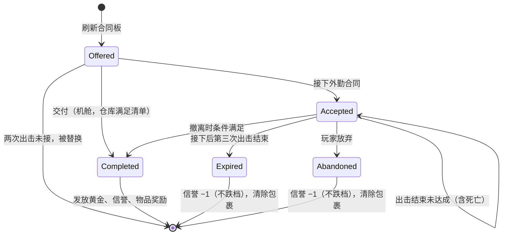

# NextDayz 局外经济与合同任务

本文给 [持久世界与直升机撤离](nextdayz-extraction-design.md) 的长线循环补上目标和资金去向：黄金要有
花处，出击要有理由。设计的前提是复用现有的生存、搜刮、撤离、地图锚点与 Master 档案，
**不新增战斗或 AI 系统**。现有的生存循环见 [PVE 生存循环](nextdayz-productization-design.md)，
联机现状见 [启动模式与多人联机](nextdayz-multiplayer-design.md)。

## 0. 一页结论

```text
机舱：看合同板 → 接 1～2 个外勤合同 / 交付仓库里的物资 → 向商人补给 → (付费)选择落点 → 出击
野外：照常搜刮生存，顺路完成侦察 / 取件 → 撤离
回舱：结算合同 → 黄金 + 信誉 → 出售多余物资 → 信誉解锁更好的货架与合同 → 再出击
```

| 组成 | 是什么 | 解决什么 |
| --- | --- | --- |
| **统一价目表** `nextdayz_economy.json` | 101 种物品的显式售价、商人货架、手续费、信誉阈值、合同模板，单机 C++ 与 Master Go 读同一份 | 规则只写一份数据；价格不再散在 `SellPrice` 的 switch 和撤离配置里 |
| **商人与服务** | 按信誉解锁的固定货架、按出击周期补货；付费精准落点 | 黄金第一次有去处，“这局带什么出门”成为决策 |
| **合同板** | 交付类（机舱里从仓库交）+ 外勤类（侦察某据点 / 到某据点取回包裹，再撤离） | 出击有方向；玩家被带着走遍整张图，而不是在最近的村子刷物资 |
| **信誉** | 一条递增的数值，四档，档位只升不降 | 长线进度：解锁货架、合同档位和合同板容量 |
| **出击记录** | 每局一条结构化记录（收入、支出、带出价值、合同、死因） | 经济调参用实测数据，不靠截图 |

一句话：**黄金从出售和合同流入，从商人、落点和信誉档位的门槛流出；合同只是在现有地图锚点上
加一层“去哪、带什么回来”的目标，不改动野外玩法本身。**

## 1. 现状中决定方案的事实

| 事实 | 位置 | 含义 |
| --- | --- | --- |
| 单机能出售：按物品覆盖价或种类默认价（枪 100、弹 1、衣 20、近战 15、配件 25、其余 5）给黄金；黄金只累计和展示 | [Campaign.cpp](../../../src/Application/Game/NextDayz/World/Campaign.cpp)、`assets/configs/nextdayz_extraction.json` 的 `sellPrices` | 已经有收入，只差支出 |
| Master 账号里有 `Gold`，但 HTTP 接口只有登录、档案、出击和 DS 侧接口，**没有出售** | `tools/gnb/internal/dzmaster/{store,master}.go` | 联机玩家的黄金永远是 0；联机经济要从 Master 开始补 |
| 仓库是无限容量的堆列表，撤离时 `StoreAll` 把随身物品摊平入库 | `FCampaign::StoreAll` | 交付合同可以直接从仓库扣物品；目前没有任何促使玩家卖掉物资的压力 |
| 地图锚点有 `Poi(name, kind)`、`Extraction`、带 profile 的 `Loot` 刷新点 | [WorldAnchorRegistry.hpp](../../../src/Application/Game/NextDayz/World/WorldAnchorRegistry.hpp) | 合同目标可以直接引用据点和刷新点 |
| `nd_poi` 由 `nd_pcg_encounter` 按 `PCG_SITES` 生成，只带名字和归类后的种类；据点的 `risk(1..3)` 与 `padSize` 只在 `layout.scad` 里 | `assets/scad/lib/nextdayz_pcg.scad`、`assets/scad/proc/nextdayz/<map>/layout.scad` | 风险等级与据点范围需要在发布时导出，机舱不加载地图也能生成合同 |
| 电台补给已经能在运行时把一个军用刷新点改写成固定内容并标在地图和指南针上（`LootSystem::PlantCache`） | `LootSystem.cpp`、`UseRadio` | 取件合同的“包裹”沿用这条路径，不新建世界物体 |
| 物资键由来源、物资类型、毫米精度位置和重叠序号组成，跨同一版本地图加载稳定 | 撤离设计“存档契约” | 合同可以按物资键记住包裹放在哪个刷新点 |
| 存档是版本化 JSON（当前 v5），读档带逐版本迁移；正式存档与验证存档隔离 | `CampaignPersistence.cpp` | 新字段走 v6 迁移，默认值即可 |
| 机舱有两个页签：世界／任务、仓库／携装；已有 `nextdayz.validation.campaignCommand`（`store-all`、`sell-first`、`deploy`…） | `NextDayzExpedition.cpp` | 新页签和验证命令沿用同一结构 |
| 物品实例只有 `defId/count/containerId/loadedAmmo/attachments/placement`；联机协议按内存布局整块写结构体 | `Inventory.hpp`、`Net/WireLayouts.hpp` | **不给物品实例加字段**：加字段要升协议版本并重编 Web 内核。合同物品用独立的物品定义区分 |
| 54 件服装里有一批带 `lore` 的历史装备（阿富汗卡、6B3、M56…） | `Data/ItemDefs.cpp` | “收藏家”交付合同的天然素材 |

## 2. 目标与边界

### 2.1 必须交付

1. 单机战役里黄金有三种花法：商人购买（含限购的信号枪）、精准落点、仓库扩容。
2. 合同板常驻机舱：交付合同在机舱内即时完成；外勤合同（侦察、取件）在野外达成，撤离后结算。
3. 信誉四档，解锁商人货架、合同档位和合同板容量。
4. 所有价格、货架、模板、阈值都在一份 JSON 里；改数值不需要重编。
5. Master 联机有出售、购买、交付合同和侦察合同；规则由 Master 裁决，桌面与 Web 大厅只负责显示。
6. 每局留一条出击记录，能通过 agent 查询和调试快照读出，用来验证 §8 的调参目标。
7. 全部有确定性测试：同一种子产生同一合同板，单机 C++ 与 Master Go 对同一组输入给出同一结果。

### 2.2 不做

- 玩家之间交易、拍卖、动态市场价。
- 装备保险。死亡掉落留在世界里供回收，这是持久世界的核心；保险把物品“退回”仓库，会让同一件物品
  同时存在于世界和仓库，破坏联机的“物品单一归属”契约。
- 多条派系信誉、剧情任务链、对话。合同的发布者只是文案上的身份，共用一条信誉。
- 击杀类合同（清剿某据点）。它需要把击杀归属到据点，留到 §10 的 E5 之后。
- 联机取件合同。包裹需要成为 DS 共享世界里只属于某个玩家的物资，第一期不做（§7.4）。
- 训练场参与经济。训练场仍是独立会话，不读写战役存档。

## 3. 决策

### 3.1 已定

| 议题 | 决定 | 理由 |
| --- | --- | --- |
| 数据位置 | 新增 `assets/configs/nextdayz_economy.json`；`nextdayz_extraction.json` 只保留航班时长与距离，`sellPrices` 迁走 | 一份数据，两个读者（C++ 单机、Go Master） |
| 售价 | JSON 里列出每种物品的显式售价，不再有种类默认值 | Go 侧没有物品种类表；显式表也让调参一目了然。单测检查与 `ItemDefs.cpp` 一一对应 |
| 买价 | `buy = round(sell × buyMarkup)`，可逐项覆盖；**所有货架条目都满足 `buy ≥ 2 × sell`** | 买了再卖必亏，没有套利 |
| 周期 | 商人补货、合同板刷新、合同过期都按“出击结束次数”计，不按真实时间 | 机舱和离线期间世界是暂停的；按时间计会鼓励挂机 |
| 交付合同 | 在机舱从**仓库**交付，不要求“本局所得” | 物品实例没有来源字段，也不该加（§1）；从仓库扣物品本身就是一个物资出口 |
| 外勤合同 | 只在撤离时结算；死亡不算失败，合同保持有效直到过期 | 持久世界里死了还能回去捡；失败只来自过期或放弃 |
| 合同物品 | 每种包裹是独立的物品定义（`contract_*`，售价 0，不可入库）；同一种包裹同时只有一个有效合同 | 不给物品实例加字段，也能知道包裹属于哪个合同 |
| 信誉 | 只升不降：放弃或过期扣分，但不会跌出当前档位 | 不让一次失手抹掉几小时的进度 |
| 联机权威 | Master 生成合同板、结算交付与侦察、扣加黄金；DS 只上报“本局到过哪些据点” | DS 不需要知道谁接了什么合同；Web 不加任何规则 |
| 两端一致 | 合同板生成用 `Data/DeterministicRng.hpp` 的 SplitMix64，Go 端逐位移植；共享一份 golden 用例 | 沿用 Web 客户端用 `client-replay-golden` 对齐两端的做法 |

### 3.2 支出项（2026-11-25 确认）

| 议题 | 决定 | 理由 |
| --- | --- | --- |
| 仓库限容 | 基础 40 堆，花钱扩到 60 / 90 / 130 堆；放在 E3。规则见 §4.3 | 没有容量压力，出售就不是决策 |
| 购买信号枪 | 信誉 2 档起可买，每周期限购 1 把，买价 300 | 撤离是这款游戏最大的卡点，花钱确保能回来是一笔有分量的支出；限购保证捡到的信号枪仍然珍贵 |
| 精准落点 | 40 金指定一次落点；不付费时仍随机 | 实现最便宜，也给接了外勤合同的玩家一个“花钱省路”的选择 |

未采纳的选项：仓库保持无限、信号枪不能购买、落点按据点风险收费。

## 4. 经济模型

### 4.1 收入与支出

| 收入 | 估算（按现有价目，E5 用实测修正） |
| --- | --- |
| 出售 | 一次正常撤离约 150～350 金：一把枪 50～200、几件衣服各 20、弹药每发 1、杂物各 5 |
| 交付合同 | 所需物品售价之和 × 1.6 + 档位奖金（20 / 40 / 80） |
| 侦察合同 | T1 100～140；两个据点的 T2 220～280 |
| 取件合同 | T2 240～320；T3 450～600，外加一件物品奖励（配件或稀有服装） |

| 支出 | 价格 |
| --- | --- |
| 商人：消耗品 | 绷带、水、罐头、电池、燃料 各 15；急救包 75；止痛药 30 |
| 商人：弹药 | 售价 × 4（每发 4 金，商人按 10 / 20 发一包卖） |
| 商人：装备 | 普通背包 60、军用背包 150、手枪 150、AKS-74U 300、AK 360、4 倍镜 75、消音器 120 |
| 商人：信号枪 | 300（信誉 2 档起，每周期限购 1 把） |
| 精准落点 | 40 / 次 |
| 仓库扩容 | 40 → 60 → 90 → 130 堆，分别 300 / 800 / 2000 |

**调参目标：** 算上死亡，每局净收入的中位数在 +60～+150 金之间；第 10 局前后能买得起第一把步枪；
信誉 3 档大约需要 15～25 局。这些都是 E5 用出击记录校验的目标，不是现在就确定的数字。

### 4.2 商人

- 货架是 JSON 里的固定列表：`{ item, tier, stock, pack, buy? }`。`tier` 是所需信誉档，`stock` 是每周期的库存，
  `pack` 是一次买几个（弹药 20、绷带 2）。
- 每结束一次出击（撤离或死亡）算一个周期，库存回满。没卖完不累积。
- 购买的物品直接进仓库。仓库放不下就拒绝购买，并提示先出售或扩容。
- 买来的枪是空仓、不带配件，弹药和配件要另外买，避免“买枪送满弹匣”变成弹药的便宜来源。
- 出售沿用现有接口和单件 / 整栈按钮，价格改从价目表读取。合同物品不能出售，也不能入库。

### 4.3 服务

- **精准落点**：出击前在世界页选中已发布地区的某个安全落点（列表 + 世界地图上的点），付费后这次出击
  不再随机落点。没付费时行为不变。
- **仓库容量**：按“堆”计，基础 40 堆，扩容档见 §4.1。仓库页顶部显示 `已用 / 容量` 和下一档价格。
  - **入库时合并普通堆**：同一种物品、没有装弹和配件的堆自动合并到 `maxStack` 为止，和 Master 的
    `AddToStorage` 规则一致。现在单机的 `StoreAll` 逐个实例追加，不合并就让堆数上限失去意义。
  - **撤离入库、合同的物品奖励永远入库**，即使超出容量。任何情况下都不销毁玩家的物品。
  - **超容时不能出击**，也不能购买或手动入库。出售、交付或把物品带上身让仓库回到容量以内，才能再出击。
    这就是“回舱先整理仓库”的压力来源。
  - **老存档**：迁移（实际落在存档 v8）时把 `warehouseLevel` 设为能容纳现有堆数的最低档；超过最高档 130 堆的，额外记下
    `warehouseFloor = 现有堆数`，作为这份存档的容量下限。老玩家升级后不会一进机舱就被挡住出击。
  - 联机账号同样适用这条规则，由 Master 在 `/api/deploy` 时检查；Master `State` v2 迁移的规则相同。

## 5. 合同

### 5.1 类型

| 类型 | 达成条件 | 结算时机 | 例子 |
| --- | --- | --- | --- |
| **交付** | 仓库里有清单所列物品与数量 | 机舱里点“交付”，立即结算 | 医疗站：3 个急救包；军需官：1 把步枪 + 30 发同口径弹药；收藏家：阿富汗卡上衣 + 裤子 |
| **侦察** | 本次出击进入过目标据点的范围（1～2 个） | 撤离成功时 | 电台站：“确认城堡还有没有人”——到过 Castle Loket 并撤离 |
| **取件** | 本次出击带着该合同的包裹撤离 | 撤离成功时 | 医疗站：“到老城的诊所取回病历”；军需官：“到高风险据点取回飞行记录仪” |

外勤合同可以带一个**限定撤离点**修饰：必须从指定的 `[H]` 撤离，奖励 +30%。单机里航班的
`pointId` 已经记录了撤离点。

发布者（医疗站、军需官、收藏家、电台站）只决定文案和模板池，共用一条信誉。

### 5.2 合同板

- 每个合同板有 3 个空位，信誉 2 档起有 4 个。至少一个外勤合同；同一物品类别最多出现在一个交付合同里
  （避免三个合同都要急救包）。
- 刷新：未接的合同在两次出击结束后被替换；接下的外勤合同在**接下之后的第三次出击结束时**过期。
  交付合同不会进入“已接”状态，交了就完成。
- 同时最多接 2 个外勤合同。
- 生成：`RollBoard(rng, templates, poiIndex, reputationTier, activeContracts)`。从当前档位及以下的模板里按
  权重抽取；需要地点的模板，从已发布、非训练场地图的据点索引（§6.2）里按 `risk` 与模板要求的
  `kind` 挑目标。地点风险决定合同档位：risk 1 → T1，2 → T2，3 → T3。
- 随机数：战役存档新增 `boardRng`，种子从战役种子派生；每次刷新取下一段，所以同一份存档的合同板可以复现。

### 5.3 生命周期



出击结束时的顺序固定为：**先结算达成，再推进过期**。这样带着包裹撤离的那一局一定算完成，
不会出现包裹因合同刚好过期而变成废物的情况。

### 5.4 取件包裹

1. 接合同时选定目标据点范围内的一个刷新点，按物资键记在合同里（不限 profile，优先室内、离据点中心近的）。
2. 下一次部署到该地图、物资系统完成加载后，把这个刷新点改写成只含包裹的内容，同时标记为
   “合同占用”：不参与补货、不被电台补给选中、不受品类上限约束。写法与 `PlantCache` 相同，只是按
   物资键定位、换一种内容。
3. 地图和指南针显示这个目标（与电台补给共用标记绘制，标记数量从 1 扩展到最多 3 个），HUD 目标行显示
   距离与方向。
4. 捡起后包裹就是普通背包物品：死亡后落在尸体掉落堆里，下次可以回去捡；丢在地上也一样。
5. 过期或放弃时，战役在本存档的所有位置清除这个包裹：刷新点的内容、掉落堆、随身背包。单机的物资归属
   全在一份存档里，所以这一步是完整的。
6. 新增物品定义 `contract_parcel`（2×2）、`contract_documents`（1×2）、`contract_blackbox`（2×2），售价 0、
   最大堆叠 1。训练场陈列单测和物品图标脚本把 `contract_*` 列为不陈列的例外。

### 5.5 侦察判定

- 野外每 0.5 秒检查一次玩家是否在某个据点的范围内（据点中心 + 半径来自 §6.2 的索引），进入就把据点
  名字记进本局的 `visitedPois`。
- `visitedPois` 存进存档的本局进度里，中途退出再继续不会丢。
- 范围按据点地块尺寸的半对角线 + 10 m 计算，侦察不要求进到某栋楼里。

## 6. 数据与代码结构

### 6.1 `assets/configs/nextdayz_economy.json`

```jsonc
{
  "version": 1,
  "sell":   { "ak": 120, "svd": 200, "bandage": 5, "...": 0 },   // 每种物品都要有；contract_* 为 0
  "buyMarkup": 3.0,
  "trader": [
    { "item": "bandage",      "tier": 0, "stock": 6, "pack": 2 },
    { "item": "ammo_9mm",     "tier": 0, "stock": 4, "pack": 20, "buy": 4 },
    { "item": "signal_flare", "tier": 2, "stock": 1, "pack": 1,  "buy": 300 }
  ],
  "services": { "insertionFee": 40, "warehouse": { "base": 40, "steps": [[60, 300], [90, 800], [130, 2000]] } },
  "reputation": { "tiers": [0, 3, 8, 15], "gain": [1, 2, 3], "penalty": 1 },
  "board": { "slots": [3, 3, 4, 4], "replaceAfter": 2, "expireAfter": 3, "maxActive": 2 },
  "contracts": [
    { "id": "med_supplies", "issuer": "medical", "type": "deliver", "tier": 1, "weight": 3,
      "items": [["medkit", 2, 3]], "bonus": 20 },
    { "id": "recon_fortress", "issuer": "radio", "type": "recon", "tier": 1, "weight": 2,
      "poi": { "kind": ["fortress", "military"], "count": 1 }, "reward": [100, 140] },
    { "id": "lost_records", "issuer": "medical", "type": "fetch", "tier": 2, "weight": 2,
      "poi": { "kind": ["hospital", "town"], "risk": [2, 3] }, "parcel": "contract_documents", "reward": [240, 320] }
  ]
}
```

物品数量和奖励区间写成 `[min, max]`，用合同板的随机数取值。

### 6.2 据点索引 `pois.json`

> **E2 实施时的调整：** 没有新增 `pois.json`。已发布目录里的 `generation.json` 已经带着每个据点的 id、名字、
> 类型、中心、地块尺寸和风险，`World/PoiIndex` 直接读它（类型按 `nd_poi_kind` 映射，中心转成游戏坐标，半径 =
> 半对角线 + 10 m）。洛克特 v8 因此不需要补写，冻结的发布目录保持不变；Master 在 E4 读同一个文件。下面是原计划。

`gnb geo expedition --publish` 在 `published/v<N>/` 旁边写出 `pois.json`：

```json
{ "map": "cz_loket_riverbend", "mapVersion": 8,
  "pois": [ { "id": "castle", "name": "Castle Loket", "kind": "fortress", "risk": 3,
              "center": [20, 140], "radius": 49 } ] }
```

- 数据来自 `PCG_SITES`（id、名字、类型、中心、地块尺寸、风险），`kind` 用与 `nd_poi_kind` 相同的映射。
  中心与半径使用游戏坐标，转换方式与锚点扫描一致。
- 已发布的洛克特 v8 用一次 `gnb geo expedition --recipe … --pois-only` 补写；只新增这个文件，冻结的场景不变。
- 运行时按 `name` 与扫描到的 `Poi` 锚点匹配。`[NextDayz][Landscape]` 新增检查：索引里的每个据点都能在
  实际求值的场景里找到同名锚点，并且距离在 2 m 以内。
- Master 读同一个文件，所以联机的合同板也知道每张图有哪些据点。

### 6.3 C++ 模块

| 文件 | 内容 |
| --- | --- |
| `Data/EconomyDefs.{hpp,cpp}` | 读取并校验 `nextdayz_economy.json`：售价覆盖全部物品、`buy ≥ 2 × sell`、模板引用的物品和据点种类存在 |
| `World/Economy.{hpp,cpp}` | `SellPrice`（从 `Campaign.cpp` 迁来）、`BuyPrice`、`Buy`、`RefreshTrader`、落点费用、仓库容量 |
| `World/Contracts.{hpp,cpp}` | 模板与合同结构、`RollBoard`、`Accept`、`Abandon`、`HandIn`、`SettleSortie`（结算并返回报告） |
| `World/PoiIndex.{hpp,cpp}` | 读取 `pois.json`，做范围查询 |
| `NextDayzExpedition.cpp` | 机舱第三个页签、出击结束时调用 `SettleSortie`、部署时放置包裹、HUD 目标与标记 |

`Economy`、`Contracts`、`PoiIndex` 都不依赖引擎（只用 `FCampaign`、`Inventory`、物品表），和 `ItemLedger` 一样
能直接进 `gkNextUnitTests`，以后也可以并入 `NextDayzCore`。

### 6.4 存档 v6 / v7

> v7 已随 E2 落地：`FCampaign` 新增 `boardRng`、`boardCycle`、`contractSerial`、`board`、`contracts`、
> `contractsCompleted`，`sortie` 新增 `visitedPois`、`contractGold`、`contractsCompleted`。`FContract` 没有
> `parcelKey`（见 §10.2）。仓库档位仍待 E3。

E1 落地的 v6 只含 E1 用到的字段：`reputation`、`traderStock`、`traderCycle`、`sortie { spent, insertionMap,
insertionPoint, insertionPaid }`、`history`。合同板、已接合同、包裹与仓库档位随 E2 / E3 进入 v7，迁移同样全部取
默认值（仓库档位按 §4.3 给足）。完整字段：

```text
reputation          uint32
traderStock         map<item, int>      本周期剩余库存
traderCycle         uint64              上次补货时的出击结束次数
warehouseLevel      uint8               迁移时按现有堆数给足（§4.3）
warehouseFloor      uint32              老存档超出最高档时的容量下限，默认 0
boardRng            uint64
contractSerial      uint64
board               FContract[]         未接
contracts           FContract[]         已接
sortie              { visitedPois[], parcelPlanted, insertionPoint? }
history             FSortieRecord[]     最近 50 条（§8）
```

`FContract`：`id`、`templateId`、`tier`、`mapId`、`targets[]`（据点名）、`items[]`、`parcel?`、`parcelKey?`、
`extractionPoint?`、`reward`、`itemReward?`、`offeredAt`、`acceptedAt`、`state`。

## 7. 联机（Master）

### 7.1 职责

| 进程 | 新增职责 |
| --- | --- |
| Master | 价目表、商人库存、合同板生成、交付、侦察结算、信誉；出售与购买 |
| DS | 在检查点里上报每名幸存者本局到过的据点 |
| 桌面 / Web 大厅 | 显示合同板、商人和信誉，发请求；不做判断 |

### 7.2 接口

沿用现有 `/api/*` 的 token 鉴权与 JSON 风格：

| 接口 | 请求 | 说明 |
| --- | --- | --- |
| `GET /api/profile` | — | 返回值新增 `reputation`、`board`、`contracts`、`trader`（含本周期库存） |
| `POST /api/sell` | `index, item, count` | 仓库堆没有实例编号，用下标 + 物品 id 双重校验，避免并发请求卖错 |
| `POST /api/buy` | `item, count` | 检查档位、库存、黄金、仓库容量，一次提交 |
| `POST /api/contracts/accept` | `contractId` | 只允许侦察合同（§7.4） |
| `POST /api/contracts/abandon` | `contractId` | |
| `POST /api/contracts/handin` | `contractId` | 从仓库扣物品并结算 |

有幸存者在野外时，`sell` / `buy` / `handin` 照常可用（仓库属于账号，不属于野外角色），`accept` 也可用，
但只对下一次出击生效。

### 7.3 检查点变化

- `checkpointCharacter` 新增 `visited []string`。DS 用该地图的 `pois.json` 判断每名幸存者到过哪些据点，
  每次检查点都带上本局的完整列表；`Character` 也保存这份列表，下线后回到野外可以继续。
- `outcomeExtracted`：先按 `visited` 结算该账号的侦察合同，再把随身物品入库，与单机相同的“先结算、再推进
  过期”的顺序。
- `outcomeDead` / `outcomeExtracted` 都推进一次周期：商人补货，合同板刷新与过期。
- Master 的 `State.Version` 1 → 2，新字段取默认值。

### 7.4 为什么第一期没有联机取件

包裹要放进 DS 的共享世界：其他玩家能看见、能拿走吗？拿走后算谁的？物品账本要不要认这件东西？
这些都要改 DS 的物资同步和 `ItemLedger`。第一期先用侦察和交付把联机经济跑通；取件留到“包裹只对接取者
可见”的方案定下之后再做。

### 7.5 两端一致

- `tools/nextdayz/economy_golden.json`：用真实的 `nextdayz_economy.json` 和洛克特的 `pois.json`，给出若干组输入
  （种子、信誉、已接合同、仓库、本局到过的据点、出击结果），以及期望的合同板、结算报告、黄金与信誉。
- C++ `[NextDayz][Economy]` 与 Go `dzmaster` 测试读同一份文件逐项比对。改规则要同时更新两端和 golden。

## 8. 出击记录与度量

每局结束追加一条 `FSortieRecord`（联机由 Master 写进账号）：

```text
sortieId, mapId, outcome(extracted|died|debug), seconds, deathCause,
extractedValue   带出物品按售价计的总值
spentBefore      出击前在机舱花掉的黄金（商人 + 落点）
contractGold, contractsCompleted, reputationAfter, visitedPois
```

- 机舱世界页显示最近十局的战报，也就是这份记录的列表视图。
- agent 查询：`game.reputation`、`game.reputationTier`、`game.contractBoard`（逗号分隔的模板 id）、
  `game.contractsActive`、`game.contractsCompleted`、`game.traderStock`、`game.lastSortieValue`、`game.lastSortieNet`。
  `nextdayz.debug.dump` 加入经济与合同的完整状态。
- **E5 用这份记录验收 §4.1 的目标**：在固定种子下用 agentscript 驱动若干局，再加真人试玩若干局，算出净收入中位数、
  合同完成率（目标 40%～70%）、首次购买出现在第几局（目标 ≤ 3）、黄金曲线有没有无限增长。不达标就改 JSON，
  不改代码。

## 9. 界面

- **机舱第三个页签 “合同 / 商人”**：左边是合同板卡片（发布者、标题、地图、目标、奖励、信誉、剩余出击次数，
  按钮“接下 / 交付 / 放弃”，不可用时写明原因），右边是商人货架（档位锁、本周期库存、价格、购买）。顶部是黄金、
  信誉和下一档的进度条。
- **世界页**：已接外勤合同的目标据点在世界地图和区域列表上高亮；付费精准落点的选择也在这里。
- **野外 HUD**：`CurrentObjective` 的优先级改为 流血 > 航班 > 持信号枪找撤离点 > 外勤合同 > 新手软目标。合同目标
  写成“侦察 城堡 · 340 m 东北”或“取回 病历 · 已在背包”。M 地图和指南针显示合同标记。
- **回舱结算**：撤离或死亡回到机舱时，在现有的消息之外显示本局战报：带出价值、完成的合同、黄金与信誉变化。
- 文案全部走 `L10n`，中英两份翻译同步补齐。

## 10. 分期实施

| 期 | 内容 | 完成标准 |
| --- | --- | --- |
| **E1 价目表与商人** | `nextdayz_economy.json`、`EconomyDefs`、`Economy`；出售改读价目表；商人页签与周期补货；精准落点；存档 v6 迁移 | 单测：售价覆盖、`buy ≥ 2×sell`、买卖守恒、补货周期、v5 迁移；`nextdayz-economy.agentscript.json`：出售 → 购买 → 付费落点出击 → 回舱库存回满 |
| **E2 合同（单机）** | `PoiIndex` 与 `pois.json`（含洛克特 v8 补写）、`Contracts`；交付、侦察、取件；HUD 目标与标记；回舱结算 | 单测：合同板可复现、先结算再过期、过期清除包裹、死亡不失败；`nextdayz-contracts.agentscript.json`：交付即时结算；接侦察 → 部署 → 传送到目标据点 → 撤离 → 结算；接取件 → 拿到包裹 → 死亡 → 回去捡回 → 撤离 → 结算；`[Landscape]` 检查据点索引与锚点一致 |
| **E3 信誉与仓库** | 信誉档位解锁货架（含信号枪）、合同档位、合同板容量；仓库限容、入库合并与扩容 | 单测：不跌档、解锁边界、信号枪每周期限购、入库合并、撤离超容不丢物品、超容禁止出击与购买、v6 迁移给足容量；agentscript 覆盖一次升档和一次“超容 → 出售 → 出击” |
| **E4 Master 接入** | Master `State` v2、§7.2 接口、检查点 `visited`、DS 上报、桌面大厅与 Web 大厅的页签；golden 两端比对 | Go 测试与 golden 通过；`nextdayz-master-economy` 脚本：登录 → 出售 → 购买 → 接侦察 → 出击 → 到达 → 撤离 → 结算；Web e2e 加一个大厅交易场景；`gnb ds --bots 8 --minutes 3` 不退化 |
| **E5 度量与调参** | 出击记录、战报、查询；固定种子批量跑局 + 真人试玩；按数据调 JSON | §8 的指标写回本文 §4.1，替换掉估算值 |

### 10.1 E1 落地记录（2026-11-25）

| 内容 | 实现 |
| --- | --- |
| 价目表 | `assets/configs/nextdayz_economy.json`：101 种物品的显式售价（E2 起加上 3 种售价为 0 的合同包裹；原 `sellPrices` 覆盖价与按种类默认价原样保留，部分历史装备、配件和杂物按单项调整），`buyMarkup` 3，21 个货架条目，服务与信誉阈值。`nextdayz_extraction.json` 不再有 `sellPrices`。合同模板与 `board` 段随 E2 加入，解析器对未知键报错 |
| C++ | `Data/EconomyDefs`（解析与校验）、`World/Economy`（售价、买价、补货周期、购买、合并入库、付费落点、出击记录）。两者不依赖引擎，已加入 `gkNextUnitTests` |
| 周期 | 周期号 = 已结束出击数 + 1，由 `sorties` 与 `inField` 推出；`traderCycle` 记录库存所属周期，0 表示从未补货，所以新档和迁移档进机舱就是满货 |
| 商人 | 机舱第三页签 “商人 / 服务”（`T` 键或机舱菜单按钮）：货架、档位锁、本周期剩余、购买；右侧是付费落点状态、仓库堆数和最近十条战报。购买直接进仓库，与同种无装弹无配件的堆合并 |
| 精准落点 | 落点列表来自已发布场景旁的 `generation.json` 的 `spawns`（SCAD `(x, y)` → 游戏 `(x, -y)`），按最近据点命名，不需要加载地图。在世界页地图说明下方的下拉框里选，付费 40；同一地区改选免费，取消或改选其他目的地退款。部署时在 `PlayerSafe` 锚点里取离所选点最近的一个，随机数照常抽取以保持序列 |
| 出击记录 | 每次撤离、死亡或调试返回追加一条 `FSortieRecord`（最多 50 条）：带出价值、出击前花费、结局、时长、死因 |
| 联机 | 大厅的第三页签只显示“联机交易待 Master 经济上线”，Master 侧不变（E4） |
| 打包 | NextDayz 包带上 `nextdayz_economy.json` 和每张地图的 `generation.json` |

验证：

- 单测 `[NextDayz][Economy]`：价目表覆盖全部物品、`buy ≥ 2 × sell`、拒绝不完整或可套利的表、买入再卖出必亏、
  合并入库、补货只在出击结束时发生、档位锁与信号枪每周期 1 把、付费落点的扣款 / 改选 / 退款 / 消耗、
  战报上限、v6 往返与 v5 迁移、洛克特 `generation.json` 的落点坐标。
- `assets/agentscripts/nextdayz-economy.agentscript.json`：出售 SVD 与 AK（+320）→ 买急救包与 9x18（−155），
  信号枪因档位被拒 → 预订洛克特第三个落点（−40）、取消退款、再预订 → 出击，落点与所购落点距离 0 m →
  调试返回，战报记下花费 195、带回 5、净 −190，货架回满。

已知限制：信誉在 E2 之前没有来源，所以 E1 里只有 0 档货架可买；落点名称用的是 `generation.json` 里的英文据点名。

### 10.2 E2 落地记录（2026-11-25）

| 内容 | 实现 |
| --- | --- |
| 数据 | `nextdayz_economy.json` 新增 `board`（每档空位 3/3/4/4、`replaceAfter` 2、`expireAfter` 3、`maxActive` 2、交付系数 1.6）和 15 个合同模板：T1 三个交付 + 两个侦察，T2 三个交付 + 一个双据点侦察 + 两个取件，T3 两个交付 + 一个侦察 + 一个带物品奖励的取件。每个模板有 `title`（翻译键）。解析器校验发布者、类型、据点种类、风险区间、包裹与奖励物品 |
| 据点 | `World/PoiIndex` 读已发布的 `generation.json`（§6.2 的调整）。`[NextDayz][Landscape][Contracts]` 求值已发布场景，检查每个据点都有同名 `nd_poi` 锚点、距离 < 2 m、种类一致 |
| 合同 | `World/Contracts`：`RefreshBoard`（每周期一次，先下架过期报价再按权重补满；没有外勤合同时下一份必定是外勤；模板不重复，交付物品不重叠，同种包裹只有一份）、`AcceptContract`、`AbandonContract`、`HandInContract`、`SettleContracts`、`ExpireContracts`、`PurgeItemFromWorld`。合同档位 = max(1, 信誉档)；地点按模板的种类与风险区间筛选 |
| 包裹 | 三种 `contract_*` 物品（售价 0，不能入库或出售，训练场陈列测试把它们列为例外，`nextdayz_loot_items.scad` 有各自模型）。**没有存物资键**：部署到合同地图时，如果包裹既不在背包也不在这张图的任何物资里，就放进目标据点范围内离中心最近的刷新点（`LootSystem::PlantItem`）。所以首次部署、地图升级后都会自动放置，尸体堆里的包裹不会被重复放置。电台补给不会选中放着包裹的刷新点 |
| 清除 | 合同过期或放弃时，从背包、当前加载的世界、`mapStates_` 和机舱里保存的世界中删除该包裹；接下取件合同时也先清一次旧副本。部署时顺带清掉没有对应合同的包裹 |
| 侦察 | 野外每 0.5 秒检查玩家所在的据点并记入 `sortie.visitedPois`；进入侦察目标时提示 |
| 结算顺序 | 撤离（以及调试返回）时先 `SettleContracts`（侦察：同地图且目标全到过；取件：背包里有包裹，结算时取走），再离开野外、`ExpireContracts`、`FinishSortie`、`RefreshBoard`、清除包裹。死亡不结算，合同保持有效 |
| 界面 | 商人页签分成“合同”和“商人与服务”两页。合同页左边是合同板（发布者、档位、标题、交付清单与仓库现有数、目标与地区、报酬、剩余次数、交付 / 接下按钮），右边是进行中的合同和放弃按钮。世界页地区列表显示该地区的合同数。HUD 目标行在“持信号枪找撤离点”之后显示合同目标（距离 + 方向，或“包裹已在背包”），指南针和地图用琥珀色标记最多 3 个目标。回舱消息附带结算摘要，战报加上合同收入 |
| 查询与验证命令 | `game.contractBoard`、`contractBoardSize`、`contractBoardTypes`、`contractsActive`、`contractsCompleted`、`lastContractGold`、`lastContractsExpired`、`visitedSites`、`contractObjective`、`contractMarkers`、`parcelCarried`、`parcelInWorld`；`contract-offer:<模板>`、`contract-accept:<类型>`、`contract-abandon:<类型>`、`contract-fill`、`contract-handin`、`contract-reroll`、`reputation:<n>`、`goto-target`、`take-item:<物品>`、`page:<0/1>` |

验证：

- 单测 `[NextDayz][Contracts]`：模板与据点加载、每个外勤模板都能放到已发布地图上、合同板可复现且守规则
  （60 个种子）、同周期刷新不变、交付即时结算、侦察“先结算再过期”与死亡不失败、三次后过期且扣信誉不跌档、
  外勤上限与未接报价轮换、取件结算取走包裹并发放物品奖励、放弃后从世界里清掉包裹、包裹不能入库或出售、
  v7 往返与 v6 迁移。
- `assets/agentscripts/nextdayz-contracts.agentscript.json`：交付即时结算 → 接侦察、部署洛克特、传送到目标、
  乘直升机撤离、结算 → 接取件、包裹已放置、拿到后死亡、回去从尸体堆捡回、撤离、结算 → 接另一个取件后放弃，
  信誉从 4 降到 3 但不跌档。`nextdayz-economy`、`nextdayz-helicopter-lobby`、`nextdayz-extraction`、
  `nextdayz-inventory-icons`（期望物品数改为 104）同时通过。

与计划的差异和遗留：

- 限定撤离点修饰（§5.1，+30%）没有做，留到 E3 或 E5 依据试玩决定。
- 调试返回也按撤离结算合同，避免包裹被 `StoreAll` 丢弃。
- 包裹刷新点只按“离据点中心最近”选，没有区分室内 / 地面；§11 的“不可达”降级仍待试玩数据。
- 侦察目标与包裹的据点名、HUD 标签都是 `generation.json` 里的英文名。

### 10.3 E3 落地记录（2026-11-25）

| 内容 | 实现 |
| --- | --- |
| 信誉 | 档位效果在 E1/E2 已经接上：货架档位锁（信号枪 2 档、每周期 1 把）、合同档位 = max(1, 信誉档)、合同板空位 3/3/4/4、扣分不跌档。E3 补上升档提示：撤离回舱或交付合同后信誉档位上升时，消息里写明“信誉达到第 N 档：解锁了新的货架和合同” |
| 合并入库 | `FCampaign::Put`：没有装弹、没有配件的同种物品先补满已有的堆（到 `maxStack`），剩下的才开新堆，与 Master 的 `AddToStorage` 一致。手动入库、撤离入库、购买、合同物品奖励都走它 |
| 容量 | 基础 40 堆，扩建 60 / 90 / 130（300 / 800 / 2000 金，计入本局出击前花费）。`WarehouseCapacity = max(档位容量, warehouseFloor)` |
| 超容规则 | 撤离入库与合同奖励永远入库，不销毁任何物品。超容时 `Deploy` 拒绝出击并说明原因，`CanBuy` 返回 `StorageFull`，手动入库（单件或全部）若会新增堆数并超容就拒绝；出售、交付、取出不受限。会多开一堆而超容的购买同样拒绝 |
| 存档 v8 | `warehouseLevel`、`warehouseFloor`。v7 及更早的存档迁移时 `warehouseFloor = 现有堆数`；进机舱时 `ResolveWarehouse` 把它换成能容纳的最低档，超过 130 堆的保留下限。老玩家升级后不会被挡住出击 |
| 界面 | 仓库页顶部 `仓库 已用 / 容量 堆`（超容时变红并写明限制）和扩建按钮；商人页“服务”栏同样显示容量和下一档；回舱时若超容，消息里提示先整理 |
| 查询与验证命令 | `game.warehouseCapacity`、`warehouseLevel`、`warehouseOver`；`gold:<n>`、`fill-storage:<n>`、`warehouse-upgrade`。`store-all` 改为按手动入库规则执行 |

验证：

- 单测：合并入库与装弹武器分开、40 堆满后购买 / 手动入库被拒而撤离入库照收、出售后恢复出击、三档扩建与金币不足、
  v7 → v8 迁移（12 / 70 / 150 堆分别得到 0 / 2 / 3 档，150 堆保留下限）、信誉阈值边界与合同档位 / 合同板空位。
- `assets/agentscripts/nextdayz-warehouse.agentscript.json`：42/40 堆时购买和出击都被拒 → 卖掉两堆后出击 →
  带着三件物品调试返回，仓库超容但物品一件不少 → 扩建到 60 堆 → 交付合同把信誉从 2 提到 3（升到 1 档），
  1 档货架可买、信号枪仍锁 → 信誉 8 后买到信号枪，同周期第二把被拒。
- `nextdayz-extraction` 的一处断言从 2 堆改为 1 堆：两罐豆子现在合并成一堆。
- 修复了一个 E3 引入、被 `nextdayz-contracts` 抓到的问题：`AddToStorage` 一度整体替换战役对象，使调用方持有的
  合同引用失效；现在它只改仓库，失败时恢复仓库。

依赖关系：E1 → E2 → E3。E4 在 E2 完成后即可开始，与 E3 并行。E5 的记录结构随 E1 一起落地，调参放在最后。
每期合入前都要通过现有的 NextDayz 桌面闸门（[Web 客户端开发计划 §3](nextdayz-web-client-plan.md#3-闸门)）。

## 11. 风险与降级

| 风险 | 预警信号 | 降级 |
| --- | --- | --- |
| 黄金通胀，商人很快就没意义 | 出击记录里黄金单调增长，10 局后余额远超最贵的货架条目 | 提高高档条目价格和扩容价格、交付奖励系数从 1.6 降到 1.3；只改 JSON |
| 仓库限容让人烦躁 | 试玩中回舱整理仓库的时间明显长于整备时间；出售主要是一件一件地卖 | 提高基础容量；加“出售所有某类物品”的批量按钮；不取消限容 |
| 交付合同变成“更好的出售”，囤货即可秒完成 | 交付完成率 > 90% 且大多发生在接取的同一周期 | 交付模板改要稀有物品（历史服装、配件），或每周期限交 1 个 |
| 侦察太轻松 | 侦察合同完成率接近 100%，平均用时短 | 目标据点改偏向高风险，或加限定撤离点修饰 |
| 包裹刷新点不可达 | 取件合同长期不完成；`[Landscape]` 或导航测试报告该刷新点在室内死角 | 只从地面、入口 15 m 内的刷新点里选；选不到就不生成这条合同 |
| 单机与 Master 规则分叉 | golden 两端结果不一致 | golden 进 CI；规则改动必须同一个提交改两端 |
| 地图升级后据点名字改变 | 旧合同的目标在新版本里找不到 | 地图升级迁移时把该地图的已接合同按“放弃且不扣信誉”处理，返还到合同板刷新 |
