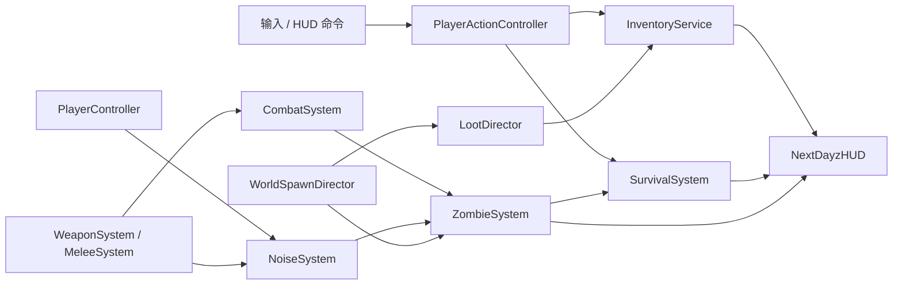

# NextDayz PVE 生存循环产品化设计

本文记录 `NextDayz` 单人 PVE 生存纵切的现行产品边界、运行时架构和验收契约。2026-08-02 已完成配套开发计划：容量化库存、生存代谢与水源、语义刷新点、感染者 AI/战斗/噪声、物资刷新、产品 HUD、死亡与同进程重开均已接入。复杂移动、ScadRig 分层动画的现行约束仍以 [复杂 3C 与 ScadRig 分层动画设计](nextdayz-3c-scadrig-design.md) 为准。2026-11-03 以士兵战术动作为质量基线重做了感染者与枪战：程序化生成的感染者骨架与动作、带转向/加速/警觉/硬直/打腿/扑击的 AI、跟随骨架的胶囊命中盒与分部位伤害、准星命中标记与受伤反馈、枪口焰/曳光/血雾等特效和程序化音效（§8、§9.4）。2026-11-04 做了一轮"末日生存感"深化：地图扩到 22 个据点、相邻 60～120 m，每栋可进入建筑带家具和 loot 刷新点；loot 改为按 profile 抽表的刷新点 + 地图手摆物资 + 掉落堆三类来源，按 POI 区域聚类补货；42 种物品都有具体功能（开罐、止血、护甲、保暖、近战、指南针、地图、电台补给、提灯、鞭炮诱饵、休息）；背包重做为附近/装备/容器三栏；感染者上限 40（夜间 48）并成组刷新；加入天气循环、高度雾和环境音（§15）。

## 1. 决策摘要

首个产品化版本是一局可重复游玩的单人 PVE 生存沙盒：玩家低配出生，必须在 1 km² Riverland 地图中寻找食物、饮水、衣物、背包、近战武器、枪械和弹药，管理饥饿、口渴、生命与容器容量，躲避或击杀由世界规则刷新的感染者，死亡后可重新开始一局。

2026-11-05 已在生存纵切上接入[持久世界与直升机撤离](nextdayz-extraction-design.md)：安全屋备装、随机 POI 部署、死亡掉落、信号枪呼叫、登机撤离、物资入库与出售换金。世界跨次保留，黄金没有购买用途；长线循环与存档契约以该文档为准。

本期仍不做 PVP、联机同步、基地建造、可驾驶载具、疾病、体温、复杂创伤和物品耐久。

## 2. 实施基线（2026-07-31 历史快照）

本节保留产品化前的差距快照，用于解释后续架构取舍；不代表 2026-08-02 之后的当前能力。现行实现以本设计后续契约、代码和新增 `[NextDayz]` 测试为准。

### 2.1 已经可直接复用

| 能力 | 当前实现 | 结论 |
| --- | --- | --- |
| 地图与 POI | `riverland_1km.scad`，含村庄、加油站、碉堡、军事基地、小镇、工厂、通信站、坠机点和湖畔营地 | 世界空间和基础物资分布已足够支撑纵切 |
| 玩家 3C | FPS/TPS、站立/蹲伏、走/跑/冲刺、跳跃、翻越/攀爬、相机碰撞和输入锁 | 不重写，只在受伤、死亡、使用物品时增加状态门控 |
| 玩家表现 | `nextdayz_survivor.scad`、分层移动、瞄准、后坐力、换弹、切枪和搜刮动作 | 可扩展使用物品、近战和死亡动作 |
| 枪械 | 5 把枪、双武器槽、ADS、射速/散布、弹匣/备弹、换弹、后坐力和视图模型 | 目前射线只命中场景并做表现，不会对目标造成伤害 |
| 搜刮 | 场景节点扫描、59 个现有拾取点、瞄准与距离判定、两阶段 `Reserve → Commit`、拾取后隐藏节点 | 可保留交互事务语义，但没有容量拒绝和重新刷新 |
| 物品/装备 | 武器、弹药、服装、杂物字符串栈；头盔和背包有 TPS 附件 | `kMaxSlots=256` 只是防失控，不是玩法容量；食物、药品不能使用 |
| 世界时间 | 昼夜循环、阴天天候和 HUD 时钟 | 生存代谢必须与视觉昼夜时标解耦 |
| 验证 | smoke、locomotion、aim/recoil、loot、weapon UI agentscript；大量 `game.*` 查询 | 可在原有脚本上增加确定性的生存闭环验证 |

### 2.2 现有循环的终点

当前玩家出生即获得满弹 AK 和 60 发备弹；地图物品被拾取后永久隐藏；罐头、医疗包、绷带、背包和头盔只会进入列表或切换附件。世界里没有可受伤对象，玩家也没有生命、饥饿、口渴、受伤、死亡或重开状态。因此目前是“移动/搜刮/枪械手感陈列”，还不是生存游戏循环。

### 2.3 必须补齐的产品缺口

1. 可受伤、死亡、重开的玩家生存状态。
2. 有容量贡献的衣物/背包与受容量约束的物品事务。
3. 食物、饮水、治疗物品及使用动作。
4. 可寻路、感知、追击、攻击、受伤、死亡和回收的感染者。
5. 枪械/近战命中感染者、噪声吸引感染者的战斗闭环。
6. 按 POI 类型、玩家距离、视线和全局预算刷新的感染者与物资。
7. 面向玩家而非开发者的 HUD、库存、死亡和重开界面。

### 2.4 现状证据入口

- [NextDayzGameInstance.cpp](../../../src/Application/Game/NextDayz/NextDayzGameInstance.cpp)：系统编排、开局 AK/60 发备弹、输入、HUD snapshot 和 agent queries；
- [Inventory.hpp](../../../src/Application/Game/NextDayz/Inventory/Inventory.hpp)：当前字符串栈、服装 ID 列表和仅防失控的 256 项上限；
- [LootSystem.cpp](../../../src/Application/Game/NextDayz/Inventory/LootSystem.cpp)：场景节点映射、reservation/commit 和拾取后隐藏；
- [WeaponSystem.cpp](../../../src/Application/Game/NextDayz/Weapons/WeaponSystem.cpp)：CPU hitscan、弹药和后坐力；命中结果没有进入伤害系统；
- [NextDayzConfig.hpp](../../../src/Application/Game/NextDayz/NextDayzConfig.hpp)：只有 3C、枪械表现、loot 距离和昼夜参数，没有生存/感染者配置；
- [nextdayz-smoke.agentscript.json](../../../assets/agentscripts/nextdayz-smoke.agentscript.json)：当前 59 个 loot、枪械、拾取、TPS 和天候基线。

## 3. 产品目标与一局体验

### 3.1 目标体验

- 首次进入后 60 秒内找到第一件可用补给或近战武器。
- 3～5 分钟内出现第一次可规避的感染者遭遇。
- 8～12 分钟内形成一次“容量取舍”：丢弃低价值物品、换穿衣物或寻找背包。
- 15～20 分钟内至少完成一次枪械战斗、补充食物/饮水并迁移到另一个 POI。
- 空手玩家始终可以逃跑；感染者不能在玩家眼前凭空出现，也不能无限追踪全地图。
- 玩家死亡有明确原因，重开不需要重启进程。

### 3.2 开局与软目标

默认开局不赠送 AK。现行持久模式从安全屋开始，可携装或仅带基础衣物容器空手出击，从地图预设 POI 外围安全点随机部署，不赠送消耗品。HUD 依次给出不强制的软目标：

1. 找到饮水或水井；
2. 找到食物；
3. 找到背包或大容量衣物；
4. 找到近战武器或枪械与匹配弹药；
5. 前往高风险 POI 获取高级物资。

完成软目标不会结束游戏；它只负责把新玩家带入可持续沙盒循环。

### 3.3 明确不做

- PVP、联机服务器、反作弊和网络预测；
- 温度、疾病、血型、骨折、复杂出血和药理；
- 武器耐久、卡壳、附件改装和弹匣逐颗装填；
- 基地建造、可驾驶车辆、耕作和狩猎；
- 大规模感染者群。首版全图活跃上限以 24～32 只为目标。

## 4. 总体架构

`NextDayzGameInstance` 继续只负责编排。新增系统之间通过小型事件传递，不允许 `WeaponSystem` 直接持有感染者容器，也不允许 HUD 修改业务成员。



建议目录：

```text
src/Application/Game/NextDayz/
├── Data/
│   ├── ItemDefs.{hpp,cpp}
│   ├── ZombieDefs.{hpp,cpp}
│   └── WorldProfiles.{hpp,cpp}
├── Combat/
│   ├── CombatEvents.hpp
│   ├── CombatSystem.{hpp,cpp}
│   └── NoiseSystem.{hpp,cpp}
├── Inventory/
│   ├── Inventory.{hpp,cpp}
│   ├── InventoryTransactions.{hpp,cpp}
│   └── LootSystem.{hpp,cpp}
├── Player/
│   ├── SurvivalSystem.{hpp,cpp}
│   └── PlayerActionController.{hpp,cpp}
├── World/
│   ├── WorldAnchorRegistry.{hpp,cpp}
│   ├── LootDirector.{hpp,cpp}
│   └── ZombieSpawnDirector.{hpp,cpp}
├── Zombies/
│   ├── ZombieSystem.{hpp,cpp}
│   ├── ZombieAI.{hpp,cpp}
│   └── ZombieVisualPool.{hpp,cpp}
└── UI/
    ├── NextDayzHUD.{hpp,cpp}
    └── InventoryScreen.{hpp,cpp}
```

纯数据和纯规则文件应加入 `gkNextUnitTests`；场景、物理、渲染和输入留在应用集成测试中。

## 5. 物品、衣物与网格背包

### 5.1 实例与物品占位

每个物品定义使用稳定字符串 ID，实例使用单调递增的 `instanceId`。`FItemDef::size` 定义每栈占位，
`containerSize` 定义穿戴后提供的网格；`FItemInstance::placement` 保存格子坐标和旋转方向。
手枪 2×1、步枪 4×1、弹匣 1×2；衣物、医疗和工具等全部物品也有明确尺寸。
完整表及交互规则见 [网格背包设计](inventory-grid-design.md)。

### 5.2 容器模型

开局有上衣口袋 6×1、裤袋 2×2，另有两条 4×2 武器背带。衣物提供额外网格：例如夹克 6×2、
普通背包 6×6、突击背包 6×8。武器背带仅接受枪械和近战武器。

拾取会寻找空的矩形；手动拖放则检查指定位置。不能因为总空格足够而越界或覆盖其他物品。
拖动时 R 旋转，绿色轮廓允许放置、红色轮廓表示冲突。拖到容器标题可自动找位。

### 5.3 事务不变量

- 添加、移动、精确放置、拆分、合并和穿脱要么完整成功，要么保持原状。
- 栈拆分和合并后数量守恒，拆分需要额外矩形。
- 每个在容器中的物品都必须在边界内，所有矩形互不重叠。
- 脱下容器必须转移其内容；不允许放进自身提供的网格。
- 枪械装弹和配件跟随实例；世界 Loot 只有库存事务成功后才移除。
- 存档版本 5 保存网格位置；旧版本迁移后放不下的物品进入安全屋仓库。

## 6. 生存状态与消耗品

### 6.1 首版状态

```text
health      0..100
hunger      0..100（100 为饱足）
hydration   0..100（100 为充分饮水）
```

饥饿和口渴使用真实仿真秒推进，不跟随 `TimeSystem::TimeScale`。按 T 跳过视觉时间不会瞬间饿死玩家。基准调参目标：静止状态饥饿约 45 分钟从满值降到零，口渴约 30 分钟；冲刺分别加速 25% 和 60%。低于 20 时给出提示，降到 0 后以可感知但不瞬杀的速度扣除生命。

感染者攻击直接扣生命，并使用约 0.35 秒受击保护避免一帧内多次结算。首版不做出血；绷带可改为小额治疗物品，以保留现有地图资源的用途。

### 6.2 使用动作

食用、饮用、治疗均走 `PlayerActionController`：开始时锁移动/开火，提交点消费物品并应用效果，提交前被攻击或移动可取消，提交后动画缺失也不能回滚业务结果。该语义沿用现有 Loot 两阶段提交。

新增基础物资：罐头、饮用水瓶、空水瓶、绷带、医疗包。`cw_prop_well` 是无限水源，但饮用需要 2 秒动作；空瓶可在水井补满。燃油桶不能饮用。

### 6.3 死亡与重开

生命归零进入 `Dead`，停止移动、攻击与拾取。现行持久模式将随身物资留在原地供后续回收，玩家自动返回安全屋；仓库、黄金、世界物资与补货计时保留。下一次新出击随机选择安全落点。原先重置全图的重开流程仅保留为隔离的旧版 agent 验证入口，正式玩法不使用。

## 7. 世界语义、物资刷新与水源

### 7.1 地图标记契约

地图手摆的 `cw_wpn_*` / `cw_item_*` 节点是"手摆物资"（首轮必有，补货时固定物品 + 可选按表抽取）。其余语义由地图里定义的极小标记模块表达，世界变换携带位置，具名参数经 `Node::metadata` 读取（`ParseScadMetadata`）：

```text
nd_loot(p = "<profile>")              物资刷新点：residential / commercial / medical / military /
                                      police / industrial / farm / wilderness
nd_zed(p = "<profile>", group = n)    感染者刷新点：civilian / military / industrial / wilderness，n 只一组
nd_poi(name = "...", kind = "...")    地图上的地名（M 键地图）
nd_spawn_player_safe                  玩家安全出生点
cw_prop_well / cw_prop_water_pump     水源（可饮用、可装瓶）
```

旧的 `nd_spawn_zombie_<profile>` / `nd_spawn_loot_<profile>` 名字仍被识别。标记运行时扫描后隐藏、关闭 raycast（不挡子弹和导航探测）。调用一律写具名参数。不要把 POI 坐标硬编码进 C++。

地图用一组"建筑 + 家具 + 刷新点"组合件（`nd_house_rural`、`nd_house_two`、`nd_supermarket`、`nd_barracks` ……，定义在 `riverland_1km.scad` 顶部）：建筑与家具几何包在 `gk_flatten()` 里合成一个节点（控制节点数与碰撞体数量），刷新点和手摆物资**必须留在 `gk_flatten` 外面**，否则会被折进父节点、运行时找不到。家具靠后墙/侧墙，门洞一侧留通道；刷新点放在桌面、床面、货架层板或地面（翻倒的桌子由 `nd_table_top(seed)` 与 `cw_prop_table` 同一判定落到地面）。

### 7.2 POI 配置

22 个据点，相邻 60～120 m（地图坐标为 SCAD 空间，+y 北）：

| 区域 | 据点 | 物资侧重（刷新点 profile） | 感染者 |
| --- | --- | --- | --- |
| 主公路带 | 斯塔里萨德村（教堂、谷仓、水井+水泵） | residential / farm | civilian，新手区 |
| | 曙光农场（谷仓、筒仓、农舍） | farm | civilian |
| | 公路旅馆 + 餐馆 | residential / commercial | civilian |
| | 波戈列洛夫卡（路边小村） | residential | civilian |
| | 桥西加油站（便利店、修车库） | commercial / industrial | civilian / industrial |
| | 桥头前哨（检疫关卡、医疗帐篷、营房） | military / medical | military |
| | 新德沃尔（警察局小镇） | police / residential | civilian |
| | 卡车站 / 修理厂 | industrial | industrial |
| | 东/西公路口（军车残队、路障） | military / residential | military / civilian |
| 南部 | 戈尔卡镇（板楼、超市、医院与失败的撤离点） | commercial / medical / residential / military | civilian 密集 + military |
| | 戈尔卡火车站（铁路、货车车厢） | commercial / industrial | civilian |
| | 红锻工厂 | industrial | industrial |
| | 湖畔营地（木屋） | wilderness | wilderness |
| 西北 | 老墓地（教堂、坟场、尸袋） | residential / medical | civilian 成群 |
| | 锯木场 | industrial | industrial / wilderness |
| | 西山电台 | military | military |
| 北部 | 护林站、猎人小屋 | wilderness | wilderness |
| | 坠机点（军方帐篷） | military / medical | military |
| | 祖布尔要塞（棱堡城墙、营房、指挥所） | military | military 驻军 |
| | 7 号检查站、军事基地 | military | military，最高密度 |

### 7.3 LootSystem / LootDirector

物资有三类来源（`LootSystem.hpp`）：

- **手摆物资**：地图节点按模块名对应固定物品（`cw_wpn_ak` → AK，`cw_item_crate_supply` → 按 commercial 表抽 3 件……），外观就是美术摆的模型；
- **刷新点**：`nd_loot` 锚点，每次按 profile 加权表（`Data/LootTables.cpp`）抽一叠物品；外观是池化节点，换成该物品在 `characters/nextdayz_loot_items.scad`（ScadRig 格式，每根 `bone_item_<itemId>` 一件模型）里的模型；开局约 78% 的刷新点有货，其余错开 1～5 分钟补上；
- **掉落堆**：玩家丢弃、玩家死亡和感染者尸体（35% 概率按 profile 掉一件）留下的东西；初始 32 个池化节点，满后扩展，不覆盖旧物资，捡走后不补货。内容与位置跨次保存。

每个有补货的条目有 `Available / Reserved / Cooldown` 三态和稳定 roll。补货约束：

- 条目按 28 m 单链接聚类成区域（≈POI），玩家要**离开整个区域**至少 60 m（而不只是离开那个货架），且 20 秒没看它；
- 冷却按类别：食物/饮水 6 分钟、医疗 9、杂物 10、弹药 12、衣物 14、枪械 24；
- 补货重新抽表，并受类别库存上限约束（同时有货的武器 ≤ 8%、弹药 ≤ 14% ……），超了改抽食物；
- 保底：饥渴 < 30 时食物冷却 ×0.35、补货 60% 倾向食物；流血且身上没有包扎物时医疗冷却 ×0.5、40% 倾向医疗；
- 拾取先放进能放下的部分（`Inventory::FitCount`），放不下的留在原地；枪械带着抽到的弹匣存量（25% 空仓，其余部分装填）；
- 时间使用独立 world simulation clock，不因昼夜快进被批量刷新；读取稳定 seed，同一局产生同一序列；场景重载和重开使旧 `FLootHandle` 失效。

## 8. 感染者系统

### 8.1 运行时状态

每个感染者使用带 generation 的稳定 handle，保存 pool slot、profile、生命、位置、**速度与朝向**、状态、目标最后可见位置、路径、攻击/受击计时、poise、腿部伤害和所属刷新点。另有一份由 handle 哈希出的个体差异（`FZombieVariant`：速度系数、驼背、歪头、抬手积极度、步态相位、先天跛脚），同一次重放看起来完全一样。

```text
Dormant → Wander ──→ Investigate ──→ Alert ──→ Chase ──→ Attack
            ↑  （噪声）    ↑    （远处首次看见：嘶吼）  ↓  ↑      ↓
            └── 搜索结束 ──┴──── 丢失视线 ──────────┘  └ 冷却 ┘
            任意存活状态 ── poise 被打破 / 打残 ──→ Stagger ──→ Chase / Investigate
            任意存活状态 ── 生命归零 ──→ Dead（Back / Forward / Crumple）→ Recycle
```

### 8.2 感知与行为

数值全部在 `FZombieConfig`（`NextDayzConfig.hpp`），出手时机与 `nextdayz_infected.scad` 的 clip 对齐。

- 视觉：35 m 基准距离、约 110° 水平视野，并通过 CPU raycast 验证无遮挡。玩家 rig 对射线不可见（它只负责表现，碰撞体是 Jolt 胶囊），否则玩家自己的步枪会挡住感染者视线；
- 听觉：冲刺脚步、小型近战、手枪、步枪/霰弹枪产生不同半径的 `FNoiseEvent`；
- 警觉：未察觉的感染者在 3 m 外第一次看到玩家时原地转身嘶吼 0.8 秒再追；贴脸时直接扑；被子弹打中会直接察觉射手位置；
- 转向与速度：按转向角速度（游荡 100°/s、追击 220°/s）转身，健康感染者基础追击速度为 5.5～6.4 m/s，再乘个体速度差异；按加速度起步/刹车，急转弯会掉速——冲过来的感染者被侧闪后会冲过头；
- 追击：目标移动超过 2 m 或 0.6 秒后才重算路径，不能每帧 A*；仅在视线畅通、脚下高差不超过台阶高度时，才在 2.5 m 内直接朝玩家转向；不会进入玩家 1 m 的个人空间；路径终点不可达时停在可达边界；
- 游荡：在出生点 4 m 内按个体节奏散步，不再原地站桩；
- 丢失：失去视线后继续向最后已知位置奔跑，前 8 秒保持追击速度；到达后搜索约 6 秒再回到游荡；
- 攻击：进入攻击距离后交替使用扑咬（1.0 s，0.45 s 出手）与横扫（0.9 s，0.42 s 出手）；前摇中追踪并补近到 1.2 m，出手前 0.12 s 锁定朝向，出手帧再校验距离、正面、视线与高度，避免隔墙或隔高台伤人——这时侧闪能让它扑空；
- 受击：每发命中都触发表现层 flinch 和 0.25 s 减速；冲击量（伤害 × 武器 `impactScale` × 部位系数）累积成 poise 伤害，超过 60 进入 0.9 s 硬直并沿弹道后退，随后 1.6 s 内不能再被硬直（自动武器不能把它控死）；硬直会打断正在前摇的攻击；
- 打腿：腿部累计 45 伤害后永久跛行（追击速度 × 0.55，表现切换为跛行步态），打残那一下触发硬直；
- 死亡：爆头且未在奔跑 → 原地瘫倒；被从背后打中或奔跑中被击杀 → 向前扑倒并带着动量滑行；其余 → 向后倒；
- 群体：只做局部软分离（0.7 m），不做队形和群体寻路。

感染者使用 NextGameplay `FNavGrid`：玩家周围 360 m 窗口、0.35 m cell，移动 40 m 后在后台增量更新。`BuildShifted` 复制重叠区域的采样，只重采新进入的边带；轴向移动时约复用 89% 的格子，并重新计算边界侵蚀。后台采样最多 2 个线程，首次加载最多 8 个线程；双缓冲在主线程交换，旧存储留给下次后台任务复用。场景卸载前等待后台采样结束，几何或采样策略变化后必须全量构建，不能跨场景复用。

CPU BVH 实例包围盒先保守标记障碍物覆盖区域（包含角色半径和额外一格余量）。无其他几何的区域直接查询精确地形三角形的高度、法线和台阶差；建筑、屋顶、桥梁和细小障碍物附近仍做完整几何探测，不能仅靠高度图放行。地形快捷路径严格检查实际地形边界，不使用 `ContainsWorld` 为邻接 tile 提供的半格容差。采样相对地形从屋顶下方开始，记录室内地板；身体宽度、净空和薄墙探测使 0.95 m 窄门也可进入。批量射线固定同一份 CPU BVH snapshot，短射线限制到实际检测距离。水域语义屏蔽在每个新采样格中完成，桥面保持可走。路点只提供水平方向；普通移动、攻击前移、受击后退、尸体滑动和群体分离都检查实际几何，按短步扫掠并限制 0.25 m 台阶与 0.65 m 落差，不再从胸口向下探地或用路点高度抬升身体。

`assets/agentscripts/nextdayz-nav-sprint.agentscript.json` 持续冲刺触发多次窗口更新，断言重采格数、构建耗时和主线程交换耗时，并通过 agent 专用 `nextdayz.validation.navProfile` 记录构建期间与空闲期间的真实墙钟帧间隔 P95。该数据包含渲染和线程争用，不用游戏 tick 平均耗时替代帧时间。室内追击与高台碰撞继续由僵尸行为脚本和 `Test_NextDayzNavigation.cpp` 验证。

### 8.3 刷新规则

- `ZombieSpawnDirector` 每 1 秒评估一次；锚点 `group` 决定一次刷几只（1～4，组员散在 2.5 m 内）；
- 全图活跃上限白天 40、夜间 48（`ZombieSystem` 与视觉池容量 56）；
- 生成点距玩家 30～160 m、不可在视线内、必须可导航；
- 玩家 200 m 外、整组未警觉且持续 30 秒的感染者回收；
- 整组死光后冷却 3～6 分钟；
- 视距随环境缩放：夜里 ×0.55、蹲下 ×0.7、雾天 ×0.7；夜里点着提灯反而 ×1.4；
- 寻路网格每格只存最高表面，所以高出地形 1.2 m 以上的格子（屋顶、雨棚、墙顶）被屏蔽，感染者绕开建筑；每帧向下射线把它们贴回实际地面（室内、雨棚下）；
- 一声枪响会同时惊动一群：每帧最多解 4 条路径，A* 最多扩展 6000 格，超出时走到离目标最近处（`FNavGrid::FindPath` 的 `maxExpansions`）；网格采样按行多线程。

### 8.4 视觉与命中盒

`nextdayz_infected.scad` 由 `rig_humanoid.scad` 程序化生成：17 根骨骼（与士兵同一套骨架约定，去掉武器骨骼，加一根下颌），蹒跚步 / 跛行步 / 冲刺 / 跛行冲刺四种步态（脚 IK 贴地），idle、只罩手臂的 reach、alert、扑咬、横扫、stagger 和三种死亡（停在最后一帧）。衬衫是 `ROLECOLOR`，每个视觉槽位穿一种调色板颜色。旧 C# 模板用到的 `walk / attack / hit / die` 名字保留。

`ZombieRigVisual` 是每只感染者的表现（分层图见 [ScadRig 指南](../../AGENT_GUIDE/ScadRig.md) 的运行时管线一节）。视觉对象池启动时一次创建，运行中只 Acquire/Release。

命中不再走渲染节点：`ZombieRigVisual` 每帧从动画后的骨架输出 12 个世界空间胶囊（头、躯干、骨盆、上臂/前臂、大腿/小腿），`CombatSystem::SetHitboxes` 保存，武器在世界射线命中距离之内对胶囊做射线求交（`TraceHitboxes`，带包围球预剔除）。所以打到的就是屏幕上看到的那一帧姿态，跑动、扑咬、硬直时的头和腿都能单独命中；死者不再挡子弹。没有 rig 时退化为站立姿态的胶囊。`FHitProxyRegistry`（instance ID → zone）保留给以渲染节点注册的目标。

## 9. 战斗、噪声与伤害

### 9.1 统一命中事件

`WeaponSystem` 继续负责射击手感和弹药，只产出 `FWeaponHitEvent`：武器 ID、射线起点/方向、命中 instance ID 或命中的感染者 handle 与部位、命中点与法线、基础伤害、冲击系数、序号。准星射线与每颗弹丸都先求世界命中，再把该距离作为上限追踪感染者命中盒。`CombatSystem` 计算距离衰减、调用 `ZombieSystem::ApplyDamage`，并为每次生效的伤害发出 `FDamageEvent`（部位、伤害、冲击、方向、是否击杀/硬直/打残），表现层只消费这个事件。

伤害语义：头部 3.0 倍（步枪一枪爆头）、躯干 1.0 倍、手臂 0.6 倍、腿 0.7 倍；头和腿的冲击另乘 1.5 / 1.3。具体枪械伤害与 `impactScale`（AK 0.5、手枪 0.6、SVD/莫辛/霰弹枪 1.0）写入 `FWeaponDef`，不能散落在系统代码中。霰弹枪产生固定数量 pellet trace，并限制同一目标单发最大伤害，保证可调试。

### 9.2 近战

猎刀（快、38 伤害、1.7 m）、撬棍（52、2.0 m、冲击大）、消防斧（85、2.1 m、慢）是 `kWeapons` 里 `meleeRange > 0` 的武器，走同一套槽位/视图模型：按住左键按挥击间隔连续挥砍，每次从眼睛向前扫一个扇面（水平 ±15°、向下约 22°——感染者驼背，眼平的射线会从头顶掠过），命中最近的命中盒；视图模型左右交替斜劈。噪声 6～9 m，只惊动近处。

### 9.3 噪声总线

噪声是瞬时数据，不进入场景 ECS。每个事件包含位置、半径、强度、类型和序号；ZombieAI 在感知 tick 消费当前/最近事件。枪械半径示例：手枪 55 m、步枪 110 m、霰弹枪 130 m；数值由调参决定，不绑定渲染音效。

### 9.4 命中反馈、特效与音效

- HUD：准星命中标记（白色命中、琥珀色爆头、红色放大的击杀，一串连射合并成一个标记）；被抓伤时屏幕边缘红色晕影、准星周围指向攻击者的红色弧，镜头朝远离攻击方向抖一下；低血量时晕影脉动；
- `CombatEffects`：枪口焰（第一/第三人称各自从看到的枪口出发）、曳光（340 m/s，霰弹枪每 3 颗弹丸显示 1 条）、命中感染者时入口血雾 + 沿弹道从背面喷出的血滴（爆头和击杀更多）、命中地面的尘土与火星、尸体下按地面法线铺开的不规则血泊。所有节点在 `BeforeSceneRebuild` 注入网格、加载场景时一次建好，空闲时停在地图下方，开火不分配、不重建场景。自发光材质的辐射亮度与太阳同量级（百级），个位数会显示成暗灰；
- `NextDayzAudio`：枪声（步枪 / 狙击 / 霰弹 / 手枪各自多版本轮换）、空仓、换弹、切枪、肉体命中 / 爆头 / 击杀确认、地面弹着、玩家受伤，以及感染者游荡/追击的低吼、发现时的嘶吼、扑咬、死亡与倒地声。NextAudio 是 2D、一文件一个播放实例，所以变体轮换避免连发打断自己的尾音，距离只表现为音量衰减。默认音效由 `tools/audio/nextdayz_sfx.py` 用 numpy 程序化合成（无第三方采样，结果按种子固定）。生成的 `.wav` 不入库（`assets/sounds/nextdayz/` 在 `.gitignore` 中），每个 checkout 先运行一次 `python tools/audio/nextdayz_sfx.py`；缺文件时游戏照常运行、只是没有声音，NextAudio 每个缺失文件警告一次。

本机录音素材试验：`python tools/audio/nextdayz_dayz_trial.py --dayz-root <DayZ安装目录>` 从本地 PBO 只读取选定 OGG，转为 44.1 kHz PCM16 WAV（战斗单声道、环境立体声），导入 77 个 cue。击杀提示和鞭炮保留合成音；爆头使用另外两条肉体弹着录音，感染者死亡使用重击人声并沿用延迟倒地声。原件备份、来源 SHA-256 清单、逐项先旧后新的 `before_after.wav` 对比试听均在 `out/audio/dayz/`，素材不提交、不发布。脚本同时同步已有桌面构建的音效目录，分别备份；`python tools/audio/nextdayz_dayz_trial.py --restore` 还原源码资源与运行副本（后续增加的 cue 也纳入恢复记录）。切换后重启 NextDayz（NextAudio 缓存解码结果）。这仍沿用现有 2D 音量衰减与消音器降音量逻辑，未引入 DayZ 的空间音频或独立消音采样。

环境声按实际天气与时钟分层：清晨提高鸟鸣频率和音量；白天交替林间、草地底声，点缀六种鸟鸣和昼间昆虫；傍晚交叉混入蟋蟀与夜间底声；深夜切换三段夜野底声、夜虫和猫头鹰，停播白天鸟鸣。阴天减少生物声，增加阵风、树叶与树干吱响；雾天改为安静的轻风与稀疏鸟虫，不能因为 `Storm()` 更高就播放大风。当前天气只有晴/阴/雾，没有降雨状态，因此不播放雨声或雷声。八秒底声与风声均在两端淡入淡出两秒，每六秒调度，避免风声硬切和持续叠加；录音同时限制 RMS 与峰值，运行时轻风音量为 0.045、阴天阵风上限 0.115、雾天 0.018。`ambience_showcase.wav` 按清晨/正午/黄昏/深夜/阴天/雾天各十秒给出示意试听。`gnb validate --script assets/agentscripts/nextdayz-ambience.agentscript.json` 验证分层与切换；`game.ambienceDay/Evening/Night/Birds/Owls/Wind` 暴露当前混音权重。

## 10. 玩家界面

### 10.1 常驻 HUD

- 左下：生命、饥饿、口渴三项图标/短条，仅在变化或低值时提高可见度；
- 右下：当前武器、射击模式、弹匣/备弹、双武器槽；
- 中央：准星、交互提示、容量不足/动作取消的短时反馈；
- 顶部：只在新手阶段显示当前软目标；
- 受伤、饥渴临界和感染者命中使用短时边缘反馈，不常驻大段文字。

### 10.2 库存界面

Tab 打开三栏：**附近**（伸手可及的物资，Take 或拖进背包；把物品拖到这一栏就是丢在地上）、**装备**（头/躯干/背心/腿/背 + 主副武器，护甲、保暖、载重汇总、携带的工具）、**容器**（每个口袋/背包一段，标题显示 `已用/总容量`）。双击执行默认动作（用/穿/装备），右键菜单有使用、穿戴、脱下、装备到 1/2、拆分、移动到某容器、绑定快捷栏、丢一个/全部；拖放到容器 = 移动，拖到装备槽 = 穿戴/装备。所有操作都走同一套库存事务。世界不暂停。

穿戴的衣物不占容器容量；穿同一槽位的新衣服会先脱下旧的（需要地方放）；脱下/丢弃背包时里面的东西先转移到其他容器，放不下就拒绝。枪械的弹匣属于那把枪（切换、丢弃、捡回都保留）。

快捷栏 3～6（默认绑定绷带/水/罐头），H 快速包扎，M 地图（需要地图），L 提灯，背包里右键可重新绑定。

### 10.3 局外状态

增加轻量开始页、暂停菜单、死亡总结和重新开始按钮。F5 才显示现有位置、动画、AI、刷新预算等开发面板；发布默认不显示 `NextDayz Debug`。

## 11. 确定性与可观察性

新增启动级 `nextdayz.seed`，所有物资 roll、感染者刷新和行为抖动从局 seed 派生，禁止各系统用当前时间独立播种。逻辑状态至少暴露：

```text
game.runState
game.health / hunger / hydration
game.inventoryUsed / inventoryCapacity
game.activeZombies / alertedZombies / zombieKills
game.zombieState / zombieHealth / zombieSpeed / zombieCrippled / zombieDeath（焦点感染者）
game.zombieBaseClip / zombieActionClip / zombieFlinch / zombieStaggers / headshots / lastHitZone
game.hitMarker / hitMarkerKill / hurt / fxParticles / fxTracers / fxMuzzleFlash / audioPlayed
game.lastDamageSource / lastHitZombie
game.lootAvailable / lootCooldown
game.currentObjective
```

测试钩子可以设置生存值、传送到命名测试点或强制导演评估，但只能在 agent-validation 下注册为命令，正常游戏不能暴露作弊入口。

### 11.1 运行时调试视图

运行时调试由独立的游戏内调试器承担（`src/Application/Game/NextDayz/Debugger/`），完整说明见 [NextDayz 游戏内调试器](nextdayz-debugger.md)：`F5` 打开带 Overview / Player / Survival / Inventory / Weapons / Infected / Spawns / Loot / World / Combat / Log 标签的窗口和世界叠加层，`F6`/`F7`/`F8` 切换感染者 AI、物资、命中盒与射线图层，`F9` 释放调试光标并可在世界中点选，`F10` 冻结/单步。各系统记录"为什么没发生"的诊断字段（刷新点结论、物资补货受阻原因、感知与寻路预算），事件日志始终记录，`nextdayz.debug.dump` 写出全部系统的 JSON 快照。

自动化验证使用 `assets/agentscripts/nextdayz-debug-visualization.agentscript.json`，原有查询 `game.debugZombieOverlay`、`game.debugLootOverlay`、`game.debugHitProxyOverlay`、`game.hitProxyRegistered`、`game.hitProxyCpuEligible`、`game.zombiePathSegments`、`game.lootMissingCategories`、`game.recentWeaponTraces` 和 `game.lastTraceResult` 保持不变。

## 12. 性能预算

| 项目 | 首版预算 |
| --- | --- |
| 活跃感染者 | 默认 24，压力上限 32 |
| 感染者决策 | 5～10 Hz 分桶；视觉每帧插值 |
| A* 重算 | 每只最多约 1.5 次/秒，跨帧分桶 |
| 刷新导演 | 0.5 Hz |
| Loot 槽位 | 当前 59 个起步，目标不超过 128 |
| 感染者 render proxy | 进入现有 32,767 可见代理预算前必须实测记录 |
| 热路径分配 | 感知、命中、AI tick 不做无界 vector 扩容 |

## 13. 产品化完成标准

以下条件全部满足才算跑通 PVE 生存循环：

1. 默认开局无 AK，玩家可找到并装备近战武器或枪械与匹配弹药。
2. 背包/衣物真实改变容量；容量不足时拾取、换装和移动事务均正确拒绝。
3. 饥饿和口渴随真实仿真时间下降，食物、水瓶和水井可恢复，归零会伤害生命。
4. 感染者只在语义正确的 POI、玩家视线外和安全距离外刷新，能够巡逻、听声、追击、攻击、丢失目标、死亡和回收。
5. 枪械和近战均可伤害感染者；枪声会改变附近感染者行为；感染者可伤害并杀死玩家。
6. 被消费物资按 profile、冷却、距离和全局预算重新出现，不发生眼前刷新。
7. HUD/库存/死亡/重开构成一条无开发面板依赖的用户流程。
8. 一条确定性 agentscript 能完成“搜刮饮水和食物 → 扩容 → 获取武器 → 击杀感染者 → 消耗补给 → 观察刷新冷却”的闭环。

## 14. 主要风险与降级

| 风险 | 预警信号 | 降级方案 |
| --- | --- | --- |
| 1 km² NavGrid 构建过慢/占用过高 | 首次加载明显停顿或内存暴涨 | cell 提到 2 m；只覆盖 POI 走廊；分区网格，不退回逐帧物理寻路 |
| 动态 ScadRig CPU 射线命中不稳定 | 可见命中与 instance ID 不一致 | 使用跟随的 kinematic capsule 代理，视觉只做表现 |
| 感染者在建筑内卡死 | repath/停滞计数持续增长 | 首版刷新点放在可达入口/庭院；超时回收到所属刷新点，不瞬移到玩家附近 |
| 物资经济失控 | 食物永久过剩或软锁死 | profile 上下限、保底计时和 director 统计；不通过全图统一随机率硬调 |
| 库存迁移破坏现有枪械逻辑 | 换弹丢弹或枪械复制 | 先建事务单测与兼容适配层，再迁移 WeaponSystem |
| UI 范围膨胀 | drag/drop 阻塞核心循环 | 先交付点击移动与容量反馈；拖拽是同一事务 API 的第二表现入口 |

## 15. 2026-11-04 末日生存深化

### 15.1 物品与功能

42 种物品（`Data/ItemDefs.cpp`）每种都有用途：

| 类别 | 物品 | 作用 |
| --- | --- | --- |
| 食物 | 罐头豆、金枪鱼、饼干、苹果、巧克力 | 饱食；罐头没有开罐器/刀/斧只吃到一半；饼干口渴 |
| 饮水 | 水瓶、空瓶、汽水 | 喝完剩空瓶，可在水井/水泵装满（F） |
| 医疗 | 绷带、碎布、急救包、止痛药 | 止血；急救包 +45；止痛药 30 秒内回 25 |
| 衣物 | 头盔、夹克、卫衣、军用背心、工装裤、军裤、三种背包 | 护甲（头盔 15%、背心 30%）、保暖、容量 |
| 武器 | 5 把枪 + 刀/撬棍/斧，4 种弹药 | 弹药按口径找，枪带随机存弹 |
| 工具 | 开罐器、指南针、地图、电台+电池、提灯+燃料、铺盖、鞭炮 | 指南针显示顶部方位条；地图开 M；电台耗电池在 120 m 外一个军用刷新点刷出补给（步枪+弹药+急救包）并标在地图和指南针上 20 分钟；提灯每罐燃料烧 15 分钟、夜里提亮但让感染者看得更远；铺盖休息 +20 生命（流血时不行）；鞭炮扔出约 18 m，炸 4 声把感染者引过去 |

### 15.2 身体状态

`SurvivalSystem`：感染者每次命中先被护甲吸收一部分，再按 45%×(1−1.5×护甲) 的概率开一道伤口（最多 3 道），每道每秒掉 0.45 生命直到包扎；饥饿和口渴都 ≥70、没有流血、不冷时缓慢回血；夜晚与坏天气减去穿着保暖得到寒冷值，寒冷让饥饿最多加倍消耗；饥饿或口渴低于 12 时无法冲刺。死亡原因区分 blood loss / starvation / dehydration / infected。

### 15.3 氛围

- 天气：`TimeSystem` 按种子每 2.5～5.5 游戏小时在晴/阴/雾之间切换，G 键手动轮换。自动与手动切换共用连续状态，晴↔雾完整过渡默认 30 个真实秒（`FTimeConfig::WeatherTransitionSeconds`），中途改选天气从当前状态继续；阳光先淡出再关闭，漫射天光保持独立强度，雾密度、起始距离、遮蔽上限、环境声和感染者视距随当前天气渐变。阴天压暗和去饱和；雾天密度 0.065、起雾距离 2 m、最大遮蔽 99.5%，地面附近约 40～60 m 的远景明显隐去（随高度变化）；清晨另有薄雾；高度雾的颜色辐射亮度按白天 50、夜间 0.15 调（见 `FTimeConfig`）；`nextdayz-weather.agentscript.json` 验证双向过渡与中途反转；
- 声音：`NextDayzAudio::UpdateAmbience` 按时间和晴/阴/雾天气混合昼夜林野底声、黄昏蟋蟀、鸟鸣、昼夜昆虫、猫头鹰、轻风/阵风和树叶树干声，另有稀疏乌鸦、远处枪声与夜间尖叫；`tools/audio/nextdayz_sfx.py` 提供完整合成后备，`tools/audio/nextdayz_dayz_trial.py` 安装本机录音试验（§9.4）；动作声含近战、鞭炮、拾取/丢弃/进食/饮水/包扎/电台/提灯；
- 末日痕迹 kit：尸袋、血迹、垃圾堆、木板路障与钉死的窗、新泽西护栏、检疫告示牌、墙面涂鸦（"HELP" 等，`text()` 生成）、医疗帐篷、烧毁的车、货运车厢；
- HUD：DayZ 式消息流（拾取、饥渴、流血、寒冷、电台播报……）、状态提示（流血闪烁、寒冷/冻僵、虚弱、回血、提灯剩余）、死亡总结（死因、存活时间、击杀数）。

### 15.4 验证入口

只在 `--agent-validation` 下生效的 cvar：`nextdayz.validation.give`（`id` 或 `id:count`）、`.use`（按 id 使用/穿戴/装备第一件）、`.drop`、`.bleed`、`.teleport`（`"x,y"` 地图坐标）；调试 cvar：`nextdayz.debug.hour`、`.weather`（0/1/2）、`.fogRadiance`、`.fogDensityScale`。新增查询：`game.lootSpots / lootPiles / lootZones / poiCount / zombieCap / zombieSpawnPoints / bleeding / cold / armor / weather / lanternLit / cacheMarked / showMap / lastNotification / itemCount / zombieOffset / lastTraceNode`。

`assets/agentscripts/nextdayz-survival-depth.agentscript.json` 覆盖：据点/刷新点/感染者锚点规模、流血与 H 包扎、地图与电台补给、背心护甲、斧头近战击杀、丢弃成堆、背包界面、夜间提灯、雾天；并截图地图、背包、夜晚、雾天。开局有货数为 253（种子 1337），smoke / 3c-loot / loot-respawn / product-loop 断言随之更新。单测新增 loot 表、物品目录完整性（`[ScadRig][NextDayz]`）、穿戴/换装/丢弃、流血/护甲/止痛药/开罐器/休息、寒冷、补货冷却缩放、成组刷新。
